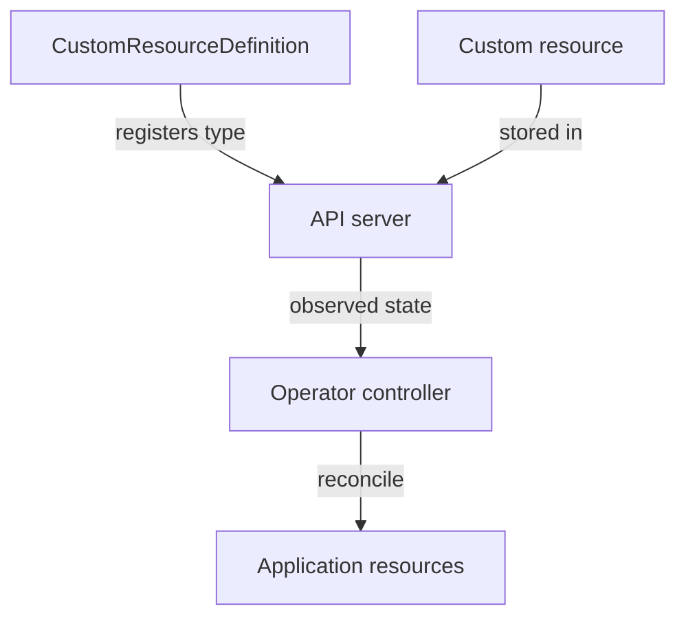
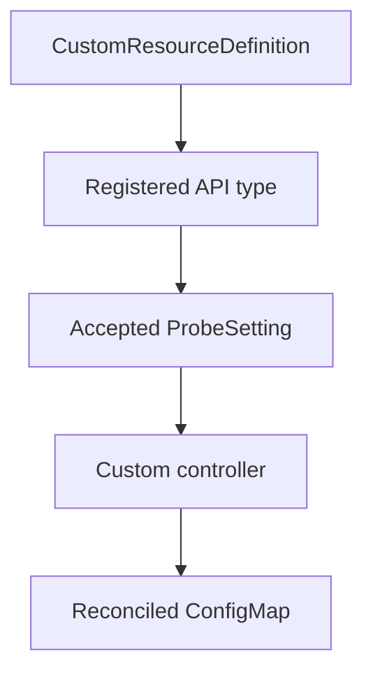

# Custom Resources And Operators

The playground accepts a `ProbeSetting`, then a small controller turns its requested message into a ConfigMap. Registering that custom type and implementing its behavior are separate operations. This separation explains why an accepted custom object can still have no useful result.

## Learning objectives

- Distinguish custom type registration from controller execution.
- Trace desired custom configuration into a reconciled object.
- Identify permissions and prerequisites needed by a controller.

## Before you start

Use a shell on your own machine with the module playground running. A Pod is Kubernetes's unit for running one or more containers together. The environment provides the `probe` Deployment, which maintains application Pods, and the `starfleet` namespace, which groups these objects.

Read-only commands below use kubectl, the Kubernetes command-line tool. Select the private kubeconfig: the file that identifies this environment's cluster and credentials. The commands do not change the application.

## Custom Resources and Operators

A team wants Kubernetes to manage a database using a resource named `Database`. A CustomResourceDefinition (CRD) extends the Kubernetes API with a new resource type and its schema. Creating a CRD makes that type available; it does not install database software or implement database behavior by itself.

A custom resource is an instance of the new type. It can describe a requested database version or replica count. A custom controller watches those instances and reconciles actual resources toward their requested state. An Operator is an approach that uses controllers and custom resources to encode application-specific operational knowledge.


The definition provides the API type, and the controller provides the behavior.

An Operator may automate upgrades, backups or recovery if its implementation supports them. Those capabilities are not automatic properties of every Operator. The controller needs permissions to manage the objects it creates, and its own availability and compatibility affect how reliably it can reconcile changes.

Distinguish desired-state acceptance from implemented behavior. A custom resource can exist while its controller is absent or failing. In that case, status may not progress and application objects may never appear. The API server can validate a resource schema without understanding whether an application-specific upgrade is safe.

Evaluate an extension through its API contract, controller behavior and operating requirements. For a scenario where a new resource is accepted but nothing happens, check whether a responsible controller exists and is working. For an unknown resource type, check whether the definition has been installed.

## What A Database Operator Must Implement

A custom `Database` resource might request version two, three members and a backup schedule. The CRD validates the structure of those fields. It can require an allowed version value or replica range, but schema validation alone cannot perform a safe database upgrade or verify an application-consistent backup.

The controller must translate that intent into actual operations. It might create StatefulSets, claims and Services, observe member readiness and update resource status. Application-specific logic determines upgrade order, compatibility checks and recovery actions. A controller that only creates Pods should not be assumed to implement every advanced database operation named in marketing material.

Status should provide useful evidence about that reconciliation. A condition might indicate that members are ready or that an upgrade is blocked by a compatibility check. The custom resource's generation can identify the desired revision, while the controller's observed revision indicates how far processing has reached. Creating the object and seeing a useful completed status remain separate events.

## Permissions And Controller Failure

The Operator runs as a workload or other process with credentials. It needs appropriate permissions to watch its custom resources and manage the child objects involved. Permission to create the custom resource for a user does not automatically grant its controller the permissions it needs. The identity and permissions of each participant matter.

If the controller stops, existing database processes may continue while new changes and recovery actions stall. If the CRD is missing, the API may reject the resource type before any controller can see an instance. If the controller has insufficient permissions, objects can exist without expected children being created.

Diagnose the boundary supported by evidence: type registration, accepted custom intent, controller execution, child-resource reconciliation or application health. This sequence explains both the power and limits of Operators without treating an extension as automatic operational expertise.

## Inspect the mechanism

A CustomResourceDefinition (CRD) registers a type in the application programming interface (API). The fixture's `ProbeSetting` belongs to `training.astrona.io/v1` and has a message field. Its custom controller polls accepted objects and creates or updates a corresponding ConfigMap. The controller, not the CRD schema, performs that operation.

This is a deliberately small example of reconciliation. It does not implement database upgrades, backups or external cleanup. If the controller stops, the custom object and existing ConfigMap may remain while new requested messages stop progressing. Diagnose type registration, controller state and output separately instead of assuming that successful object creation completed the operation.



Type registration enables the request, while executable controller logic produces its result.

<!-- astrona:playground:renew -->

Select the private cluster connection and inspect the live state from your host shell:

```sh
export KUBECONFIG="$(astrona kubeconfig ats-029-playground-010-01)"
if test "$(kubectl config current-context)" = "kind-astro-ats-029-playground-010-01"; then
  kubectl get customresourcedefinition probesettings.training.astrona.io
  kubectl -n starfleet get deployments
  kubectl -n starfleet get probesettings.training.astrona.io
  kubectl -n starfleet get configmaps
else
  printf "Select this module's private kubeconfig before continuing.\n" >&2
fi
```

Read the registered type, the controller Deployment and any accepted instances. The initial environment need not have a ProbeSetting instance until you create one. ConfigMaps already present include the application fixture, so do not attribute every ConfigMap to custom reconciliation. A later controller-created object needs a clear relationship to the custom request.

You can now distinguish an extension schema from an operational implementation. Controller availability, permissions and supported behavior determine how accepted intent becomes useful application state.

## Common pitfalls

> [!WARNING]
> Installing a CRD registers a resource type. The controller must be installed and functioning to turn a custom resource into application behavior.
