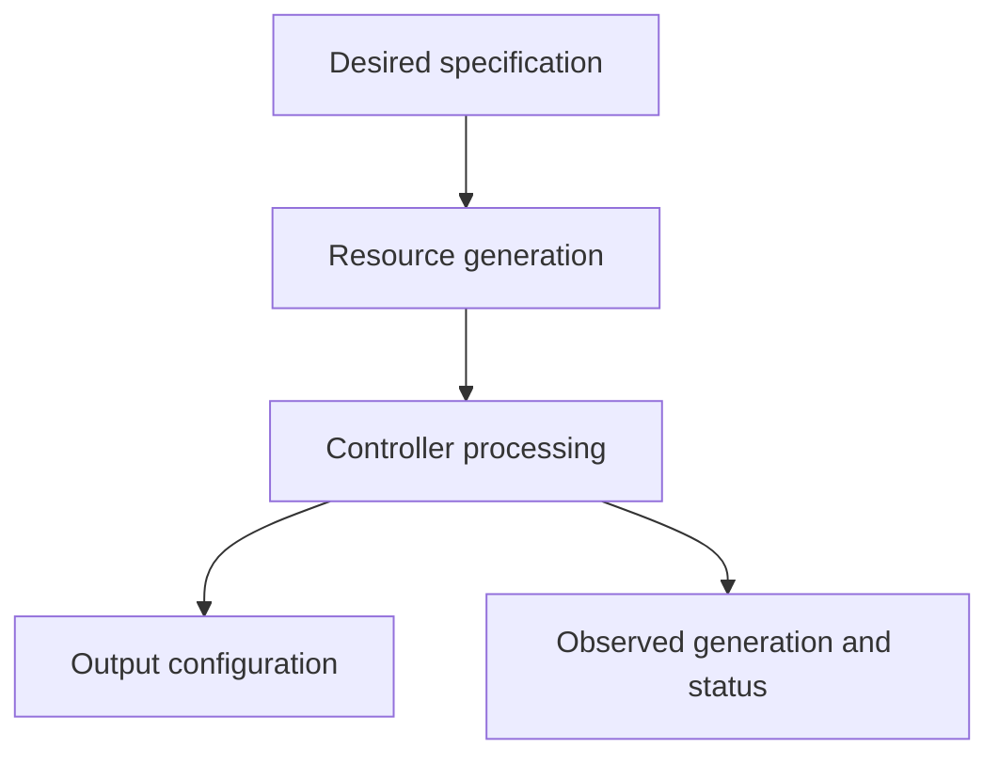

# Reading A Custom Resource And Its Controller Contract

The custom `ProbeSetting` requests one message, but its status has not yet observed the latest generation. A status value must be interpreted through the installed controller contract. Merely seeing a field named ready does not make it control Service traffic.

## Learning objectives

- Discover a custom resource's scope and schema.
- Compare desired generation with controller observations.
- Explain status and cleanup behavior through the actual implementation.

## Before you start

Use a shell on your own machine with the module playground running. A Pod is Kubernetes's unit for running one or more containers together. The environment provides the `probe` Deployment, which maintains application Pods, and the `starfleet` namespace, which groups these objects.

Read-only commands below use kubectl, the Kubernetes command-line tool. Select the private kubeconfig: the file that identifies this environment's cluster and credentials. The commands do not change the application.

## Reading A Custom Resource and Its Controller Contract

A CustomResourceDefinition, usually shortened to CRD, adds a resource type to the Kubernetes application programming interface (API). A custom resource is an instance of that type. A controller can watch those instances and reconcile other resources or external systems. Registering the schema and running the controller are separate responsibilities.

## Discover The Registered Type

A custom type has a group, kind, plural resource name, scope and supported versions. A definition can be namespaced or cluster-scoped. A namespaced `Report` object belongs to a namespace; a cluster-scoped type does not become namespaced merely because a client supplies a namespace option.

The CRD declares which versions are served and which version is used for storage. Conversion can support differences between representations where configured. A client should submit a served version with fields supported by that version's schema, rather than assuming an older example still matches the installed definition.

Discovery identifies that the resource endpoint exists. The schema describes accepted fields, types and validation. Finding the endpoint does not prove that the current identity can create an instance or that a controller is running. These are independent authorization and operational conditions.

## Interpret Spec And Status

The `spec` commonly describes the desired application-level behavior, such as a report schedule or replica requirement. The `status` commonly records observations made by a controller. Their exact meanings belong to the custom type's contract, rather than universal semantics attached to arbitrary field names.

For example, a `Report` can request an output destination through its specification. A controller can validate the request, create a Job and report progress through conditions. Editing a status field manually is not equivalent to completing that Job. If the status subresource is enabled, permissions and updates can be separated from ordinary desired-state changes.

Conditions can indicate readiness or failure, but their types and reasons are defined by the type and controller. An author must explain the meaning actually used. A custom field named `ready` does not automatically control a Service endpoint or a Pod readiness gate without a designed connection.

## Recognize Operator Responsibilities

An Operator is a controller arrangement that encodes application operational knowledge using Kubernetes resources, often including custom types. It can automate tasks such as creating members, managing configuration or coordinating recovery. A CRD alone cannot perform those tasks because it registers a resource schema rather than executing reconciliation logic.

A controller needs permissions to watch its inputs and create or change its outputs. If it can read custom instances but cannot create Jobs, the desired object can be accepted while reconciliation fails. Examine controller identity, authorization and observations before repeatedly recreating the custom object.

External prerequisites remain relevant. A controller might require a Secret, a storage class or access to another system. Missing prerequisites can leave its custom instances unready even when the API server accepted them. Understand which responsibility belongs to the schema, the controller and the dependent platform.

## Deletion And Application Lifecycle

A finalizer is a marker that keeps deletion pending until responsible cleanup has finished or the marker is deliberately removed. A custom controller can use it to clean up external state. An object with a deletion timestamp and a remaining finalizer can therefore remain visible while its cleanup is blocked.

Removing a finalizer without satisfying its intended cleanup can leave orphaned external resources. Keeping it when the responsible controller can never recover can block deletion indefinitely. The proper diagnosis starts with the cleanup contract, current controller condition and required external access, rather than treating every finalizer as an unnecessary obstacle.

When an application task asks for a custom resource, read the installed schema and the relevant controller contract. Determine its scope, required fields, identity and observed conditions. This supports a valid desired definition and a defensible interpretation of whether the application operation is actually progressing.

## Inspect the mechanism

A generation identifies a revision of desired configuration under the resource's semantics. The fixture controller records `observedGeneration` when it processes that desired state and sets its supported readiness status. Compare these fields before treating an old ready value as evidence about a newer request.

The fixture registers a status subresource, which lets status updates use a distinct API operation and permission. Its controller also needs permission to create or update ConfigMaps. A user allowed to create ProbeSettings does not automatically grant those output permissions to the controller. This example does not implement finalizer-based deletion cleanup; learning the finalizer mechanism should not turn into a claim that this particular controller performs it.



A current observation should correspond to the desired generation being assessed.

<!-- astrona:playground:renew -->

Select the private cluster connection and inspect the live state from your host shell:

```sh
export KUBECONFIG="$(astrona kubeconfig ats-029-playground-010-01)"
if test "$(kubectl config current-context)" = "kind-astro-ats-029-playground-010-01"; then
  kubectl explain probesetting.spec --api-version=training.astrona.io/v1
  kubectl get customresourcedefinition probesettings.training.astrona.io -o yaml
  kubectl -n starfleet get probesettings.training.astrona.io -o yaml
else
  printf "Select this module's private kubeconfig before continuing.\n" >&2
fi
```

Inspect the registered scope, served version, schema and status subresource. If instances exist, compare their generation and observedGeneration. An empty instance list is valid initial state. Schema explanation comes from the server; it establishes accepted fields, while the status and output objects provide evidence of what the running controller actually did.

You can now read a custom contract without assigning universal meaning to its fields. Reconciliation, output permissions and cleanup must be checked against the actual implementation rather than inferred from a type name.

## Common pitfalls

> [!WARNING]
> A CRD registers a type; it does not guarantee reconciliation. Server acceptance, controller permissions, external prerequisites and finalizer cleanup are separate parts of the custom application's lifecycle.
