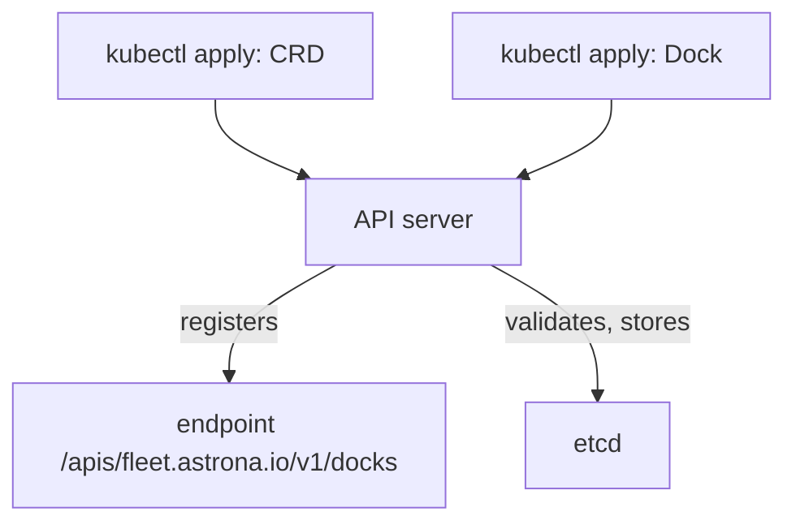

# Writing A CustomResourceDefinition

Every `kubectl` command ends in a request to the Kubernetes API server, and the API server only answers for resource types it knows. If you type `kubectl get docks` before anyone has registered a type called `docks`, the server answers that it has no such resource type. A CustomResourceDefinition (CRD) is the object that registers a new type. This part explains the fields a CRD needs, applies a small one, and creates the first object of the new type.

## What a CRD is and who handles it

A CRD is a Kubernetes object of the kind `CustomResourceDefinition` in the API group `apiextensions.k8s.io/v1`. It is cluster scoped, which means it does not live in a namespace. When you create one, the part of the API server that handles extensions (the `apiextensions` server) adds a new REST endpoint for the type. It also starts to validate and store objects of that type in etcd, the database of the cluster, next to the built-in objects.

An object of the new type is a custom resource. The CRD is the definition of the type, and a custom resource is one instance of it, in the same way as a Pod is one instance of the Pod type. The CRD does not run any code. It does not create Pods or Services for its objects. The part that acts on custom resources is a controller, and this module does not use one.



The diagram shows that the CRD changes what the API server accepts, and that custom resources are validated and stored by the same server.

## The fields every CRD needs

The metadata name of a CRD must be the plural name, a dot, and the group: `docks.fleet.astrona.io`. The API server rejects the CRD when the name and the fields do not match. The `spec` has these fields:

- `group` is the API group of the new type, usually a domain name you control. It becomes part of `apiVersion`, for example `fleet.astrona.io/v1`.
- `names` holds `plural`, `singular`, `kind` and `listKind`. `kind` is the name you write in YAML (`Dock`). `plural` is the resource name you use in commands and in the URL (`docks`). The optional `shortNames` list gives short command names, and `categories` lets the type appear in groups such as `all`.
- `scope` is `Namespaced` or `Cluster`. A `Namespaced` type has a namespace for each object, like a Pod. A `Cluster` type has none, like a Node. You choose the scope once; the group, the scope and the kind cannot be changed on an existing CRD.
- `versions` is a list. Each entry has a `name` such as `v1`, the booleans `served` and `storage`, and the `schema`. Exactly one version has `storage: true`: the version the API server writes to etcd.
- `schema.openAPIV3Schema` describes the fields of the object. In `apiextensions.k8s.io/v1` the schema is required, and it must be a structural schema: every field has a `type`, from the top of the object down.

## Define a Dock

The example type is a `Dock`, a place in the `starfleet` namespace where vehicles stop. A `Dock` has a number of berths and a location. The schema allows only those two fields in `spec`.

<!-- astrona:playground:renew -->

Save this as `dock-crd.yaml`:

```yaml
apiVersion: apiextensions.k8s.io/v1
kind: CustomResourceDefinition
metadata:
  name: docks.fleet.astrona.io
spec:
  group: fleet.astrona.io
  scope: Namespaced
  names:
    plural: docks
    singular: dock
    kind: Dock
    listKind: DockList
    shortNames:
    - dck
  versions:
  - name: v1
    served: true
    storage: true
    schema:
      openAPIV3Schema:
        type: object
        properties:
          spec:
            type: object
            properties:
              berths:
                type: integer
                minimum: 1
              location:
                type: string
```

Apply it:

```sh
kubectl apply -f dock-crd.yaml
```

The command prints `customresourcedefinition.apiextensions.k8s.io/docks.fleet.astrona.io created`. The API server needs a moment to start serving the new endpoint. The CRD reports its progress in two conditions: `NamesAccepted` is true when no other type uses the same names, and `Established` is true when the endpoint serves requests. Wait for the second one before you use the type:

```sh
kubectl wait --for=condition=Established crd/docks.fleet.astrona.io --timeout=60s
```

The command returns when the condition is true. A script that creates a custom resource right after `kubectl apply` of its CRD can fail with an error that the kind is not recognised, because the endpoint did not exist yet. The `wait` command removes that race.

## Find the new type

Discovery is how `kubectl` learns which types exist. The command `kubectl api-resources` reads the discovery documents of the API server. Filter it to the new group:

```sh
kubectl api-resources --api-group=fleet.astrona.io
```

The table has one row for each type of the group. Read the columns: `NAME` is the plural (`docks`), `SHORTNAMES` shows `dck`, `APIVERSION` shows `fleet.astrona.io/v1`, `NAMESPACED` shows `true` and `KIND` shows `Dock`. The scope, the short name and the kind you wrote in the CRD are all visible here, and this is the command to use on an unknown cluster.

The command `kubectl explain` reads the schema of the type. Ask for the `spec` of a `Dock`:

```sh
kubectl explain dock.spec
```

The output lists `berths` with the type `integer` and `location` with the type `string`. When a field has a `description` in the schema, `explain` prints it. The playground CRD `telemetries.fleet.astrona.io` has descriptions on every field, so `kubectl explain telemetry.spec` reads like documentation. A CRD without descriptions still works, but its `explain` output has no text, so add descriptions to every field you publish.

## Create, read and delete a custom resource

Now the API server knows the kind `Dock`. A custom resource looks like any other object: it has `apiVersion`, `kind`, `metadata` and the fields of the schema.

Save this as `dock-bay.yaml`:

```yaml
apiVersion: fleet.astrona.io/v1
kind: Dock
metadata:
  name: bay-one
  namespace: starfleet
spec:
  berths: 4
  location: outer ring
```

Apply it:

```sh
kubectl apply -f dock-bay.yaml
```

Then check the result with the full name, with the short name, and as YAML:

```sh
kubectl get docks -n starfleet
kubectl get dck -n starfleet
kubectl get dock bay-one -n starfleet -o yaml
```

The first two commands return the same object. The default table has only the `NAME` and `AGE` columns, because the CRD defines no printer columns yet. The YAML shows the fields you set plus `metadata` that the API server added: `uid`, `creationTimestamp`, `generation` and `resourceVersion`. No `status` appears, because no schema field and no controller writes one.

Delete the object and look at what a scope mistake looks like. Because `Dock` is `Namespaced`, a command without `-n` looks in the `default` namespace:

```sh
kubectl delete dock bay-one -n starfleet
kubectl get docks
```

The second command finds no object, because `bay-one` was in `starfleet` and is now deleted, and `default` never held a `Dock`. Use `kubectl get docks -A` to list the objects of all namespaces.

You now know how a CRD registers a type, how to confirm that the type is served, and how to create and delete an object of it. The schema of `Dock` allows any number of berths of one or more, and any location text. The open question is how to make the API server reject objects that make no sense, and how to fill in values the user left out.

## Common pitfalls

> [!WARNING]
> - **A CRD name that does not match its fields.** The metadata name must be `<plural>.<group>`. A mismatch is rejected when you apply the CRD.
> - **Using the type before it is `Established`.** Run `kubectl wait --for=condition=Established` after `kubectl apply` of the CRD, and before the first custom resource.
> - **Forgetting the scope.** Namespaced custom resources need `-n <namespace>` or `-A`. A `get` without it only looks in the current namespace.
> - **A schema that is not structural.** In `v1` every field needs a `type`. A schema without types is rejected.
> - **Expecting behaviour from the CRD.** A `Dock` is stored and validated. No Pod, Service or other object appears because of it.
