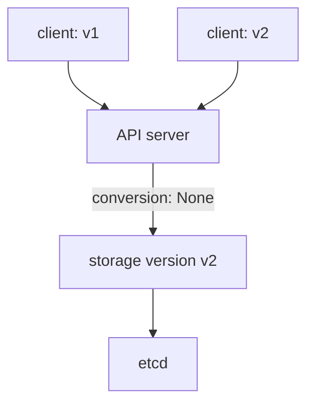

# Versions And Removing A CRD

An API changes over time. A team adds a field, renames another, or decides that the first design was wrong. Users of the old API already created objects, and their scripts still send the old `apiVersion`. A CRD solves this with versions: one CRD can serve several versions at the same time, and the API server stores each object in one chosen version. This part adds a second version to a CRD, reads one object through both versions, and then deletes the CRD to see what happens to its objects.

## Served versions and the storage version

The `versions` list of a CRD has one entry for each version of the API, such as `v1` and `v2`. Two booleans control how the API server uses an entry:

- `served` says whether clients can read and write objects through this version. A version with `served: false` has no endpoint. Clients that still send it receive an error.
- `storage` says which version the API server writes to etcd. Exactly one version has `storage: true`. When a client uses another served version, the API server converts the object to the storage version before it writes it, and converts it back when it answers.

Three more fields help users to move. `deprecated: true` marks a version as obsolete, and `deprecationWarning` sets the text that `kubectl` prints as a warning when someone uses it. The `conversion` field says how the API server converts between versions. The default strategy is `None`, which changes only the `apiVersion` string and keeps all fields as they are. It is correct only when the schemas of the versions have the same fields. When fields differ, the CRD needs the strategy `Webhook`, which calls a service that converts the object, and that service is an extra component the CRD author must run.



The diagram shows that clients can use either version and that the API server stores every object in the storage version.

## Start with one version

The example type is a `Gate`. Save this as `gate-crd.yaml`:

<!-- astrona:playground:renew -->

```yaml
apiVersion: apiextensions.k8s.io/v1
kind: CustomResourceDefinition
metadata:
  name: gates.fleet.astrona.io
spec:
  group: fleet.astrona.io
  scope: Namespaced
  names:
    plural: gates
    singular: gate
    kind: Gate
    listKind: GateList
  versions:
  - name: v1
    served: true
    storage: true
    schema:
      openAPIV3Schema:
        type: object
        properties:
          spec:
            type: object
            properties:
              label:
                type: string
```

Apply it and wait until the API server serves the type:

```sh
kubectl apply -f gate-crd.yaml
kubectl wait --for=condition=Established crd/gates.fleet.astrona.io --timeout=60s
```

Save this as `gate-one.yaml`:

```yaml
apiVersion: fleet.astrona.io/v1
kind: Gate
metadata:
  name: gate-one
  namespace: outpost
spec:
  label: arrivals
```

Apply it:

```sh
kubectl apply -f gate-one.yaml
```

Then read which versions of this type the API server has stored objects in:

```sh
kubectl get crd gates.fleet.astrona.io -o jsonpath='{.status.storedVersions}'
```

The CRD records the answer in `status.storedVersions`. At this point it lists only `v1`, because `v1` is the only version that has ever been the storage version.

## Add a second version

Version 2 keeps the same fields. The change is that `v2` becomes the storage version and `v1` is marked as deprecated, so users get a warning and have time to move.

Save this as `gate-crd-v2.yaml`:

```yaml
apiVersion: apiextensions.k8s.io/v1
kind: CustomResourceDefinition
metadata:
  name: gates.fleet.astrona.io
spec:
  group: fleet.astrona.io
  scope: Namespaced
  names:
    plural: gates
    singular: gate
    kind: Gate
    listKind: GateList
  conversion:
    strategy: None
  versions:
  - name: v1
    served: true
    storage: false
    deprecated: true
    deprecationWarning: fleet.astrona.io/v1 Gate is deprecated, use fleet.astrona.io/v2
    schema:
      openAPIV3Schema:
        type: object
        properties:
          spec:
            type: object
            properties:
              label:
                type: string
  - name: v2
    served: true
    storage: true
    schema:
      openAPIV3Schema:
        type: object
        properties:
          spec:
            type: object
            properties:
              label:
                type: string
```

Apply it:

```sh
kubectl apply -f gate-crd-v2.yaml
```

Then check the stored versions again, and read the same object through each version:

```sh
kubectl get crd gates.fleet.astrona.io -o jsonpath='{.status.storedVersions}'
kubectl get gates.v1.fleet.astrona.io gate-one -n outpost -o jsonpath='{.apiVersion}'
kubectl get gates.v2.fleet.astrona.io gate-one -n outpost -o jsonpath='{.apiVersion}'
```

The first command now lists `v1` and `v2`. The API server keeps `v1` in the list because `gate-one` is still stored in etcd as `v1`: nothing rewrote it. New and updated objects use `v2`. The second command prints `fleet.astrona.io/v1` together with the deprecation warning on the error output, and the third prints `fleet.astrona.io/v2`. It is one object, shown through two versions. A plain `kubectl get gates` uses the preferred version, which is the version with the highest priority, here `v2`.

You cannot remove `v1` from the `versions` list while `storedVersions` still contains it. To retire a version, an administrator first rewrites every object so that it is stored in the new version, and then removes the old version from `status.storedVersions` of the CRD. Only then does the API server accept a CRD without the old version.

## Delete a CRD

The CRD owns every object of its type. Deleting the CRD deletes all of them, in all namespaces. The API server does this on purpose, because objects of a type that no longer exists would have no schema.

Delete the `Gate` CRD:

```sh
kubectl delete crd gates.fleet.astrona.io
kubectl get gates -A
```

The `delete` command waits until the API server has removed the stored objects, and then removes the CRD. The `get` command fails with an error that the server does not have a resource type `gates`, and `gate-one` is gone. Applying the CRD again does not bring it back; it creates an empty type. For that reason, `kubectl delete crd` is a command to run with care, and a CRD for a shared type deserves the same protection as a database.

The delete can also hang. The API server removes the objects first, and an object that has a finalizer stays in the `Terminating` state until its finalizer is removed. When the controller that owns the finalizer is gone, the CRD stays in the `Terminating` state too.

You now know how versions, the storage version and conversion work, and how deleting a CRD removes its data. One fact stays open: a CRD and its objects only store and validate data, and acting on that data takes a controller, which a CRD does not include.

## Common pitfalls

> [!WARNING]
> - **Setting `storage: true` on two versions.** The API server rejects the CRD. Exactly one version is the storage version.
> - **Using `conversion: None` when the schemas differ.** Only the `apiVersion` changes, so a renamed field is not converted and the data is lost on conversion.
> - **Expecting `storedVersions` to shrink on its own.** It keeps every version that ever stored an object until an administrator cleans it up.
> - **Deleting a CRD to "reset" it.** The command deletes every custom resource of the type, in every namespace, and no undo exists.
> - **Marking a version `served: false` while clients still use it.** Their requests fail at once. Use `deprecated: true` with a clear `deprecationWarning` first.
