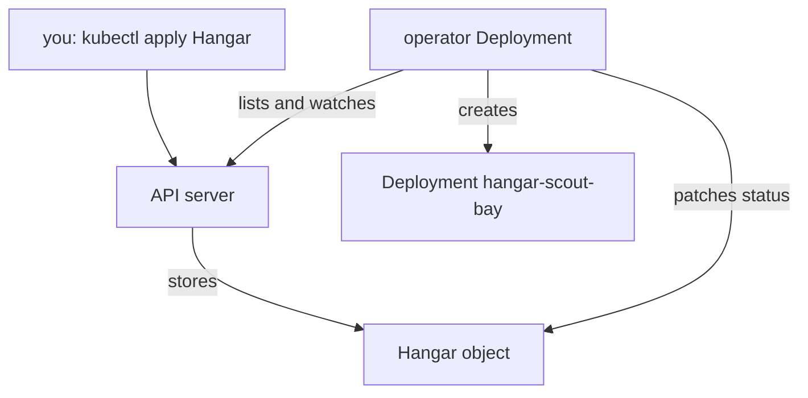

# Discovering Custom Types And Operators

A developer often receives a cluster that someone else configured. The platform team says that the cluster has a `Hangar` type, but gives no list of what it contains. Before you can write a custom resource, you need to know which types the cluster extends, what the fields mean, and which program acts on them. Kubernetes does not link these pieces for you. This part shows the commands that find each piece, and explains what an operator is made of.

## Two halves of an extension

An extension has two halves that Kubernetes treats as unrelated objects. The first half is the API: the CRD, which defines a type. The second half is the behaviour: a controller, which is a program that watches objects through the API and changes the cluster until it matches them. An operator is a controller (or a set of controllers) that manages an application by following a custom resource, and that carries knowledge of the application: how to create it, update it and keep it healthy.

The controller runs as a normal workload. It is usually a Deployment in its own namespace. It calls the API server with the token of a service account, and a Role or ClusterRole with a binding limits what that account can do. An operator is therefore four ordinary objects plus the CRD: a Deployment, a service account, a role and a role binding.



The diagram shows that the user and the operator both talk only to the API server. The operator reads `Hangar` objects, creates a Deployment, and writes the status back.

The API gives no field that says "this CRD is served by that Deployment". You find the operator by its names and labels, by the roles that mention the API group, and by the documentation of the product. The commands below follow that order.

## Find the custom types

List the CRDs of the cluster:

<!-- astrona:playground:renew -->

```sh
kubectl get crd
```

Each row is one custom type. The name has the form `<plural>.<group>`, so `hangars.fleet.astrona.io` is the plural `hangars` in the group `fleet.astrona.io`. The group tells you which product or team owns the type. In a cluster with other operators, the list also holds groups such as `cert-manager.io` or `monitoring.coreos.com`.

The command `kubectl api-resources` shows the types of the group with their scope and kind, and it works for built-in types too:

```sh
kubectl api-resources --api-group=fleet.astrona.io
```

Read the row: the plural `hangars`, the short name `hgr`, the API version `fleet.astrona.io/v1`, `NAMESPACED` is `true`, and the kind is `Hangar`. You need the kind and the API version for `apiVersion` and `kind` in YAML, the plural for commands, and the scope to know whether to pass `-n`. To list every API version in the cluster, run `kubectl api-versions`.

## Read what a type means

The CRD holds the schema, and `kubectl explain` prints it in a readable form:

```sh
kubectl explain hangar.spec
kubectl explain hangar.status.conditions
```

The first command lists `image` and `replicas` with their types and descriptions. The second lists the fields of a condition. When a type has several versions, add `--api-version=fleet.astrona.io/v1`. To see what the CRD itself says about scope, versions and printer columns, read the object:

```sh
kubectl get crd hangars.fleet.astrona.io -o yaml
```

Look at four places in the output. `spec.scope` is `Namespaced`. `spec.versions` has `v1` with `served: true` and `storage: true`. The key `subresources.status` shows that the status has its own endpoint, and that `kubectl patch --subresource=status` works on it. The list `additionalPrinterColumns` says what `kubectl get hangars` prints. Under `schema.openAPIV3Schema` you find the rules: `replicas` is an integer between 1 and 5 with the default 1.

Now list the objects of the type in all namespaces:

```sh
kubectl get hangars -A
```

The cluster has no `Hangar` yet, so the command reports that no resources were found. A reply that says the server does not have a resource type means something else: the CRD does not exist or is not yet established.

## Find the operator

Search the workloads first. Operators usually run in a namespace of their own and carry a recognisable name:

```sh
kubectl get deployments -A
kubectl get pods -n fleet-system --show-labels
```

The first command lists the Deployments of every namespace, and `hangar-operator` in `fleet-system` stands out next to the system components. The second shows its pod and the label `app.kubernetes.io/name=hangar-operator`, a standard label that many operators carry. Look at the service account and the log of the Deployment:

```sh
kubectl get deployment hangar-operator -n fleet-system -o jsonpath='{.spec.template.spec.serviceAccountName}'
kubectl logs -n fleet-system deployment/hangar-operator
```

The first command prints `hangar-operator`, the service account the controller uses. The log of a healthy controller with nothing to do is short: it prints that the operator started, and it prints more only when it finds a problem. When you find the log empty after you create an object, the controller is not seeing it.

Finally, find the permissions. The `-o wide` output of the cluster role bindings has a column for service accounts:

```sh
kubectl get clusterrolebindings -o wide | grep hangar
kubectl get clusterrole hangar-operator -o yaml
```

The binding row shows the role `ClusterRole/hangar-operator` and the subject `fleet-system/hangar-operator`. The role lists what the operator may do: `get`, `list` and `watch` on `hangars` in the group `fleet.astrona.io`, `get` and `patch` on `hangars/status`, and the verbs it needs on `deployments` in the group `apps`. A permission list with a rule for the custom group is the surest sign that a service account is the operator of that group.

You now know how to find the type, read its schema and find the controller and its permissions. The cluster is quiet because no `Hangar` exists. The open question is what happens after you create one, and which evidence shows that the operator did its work.

## Common pitfalls

> [!WARNING]
> - **Expecting `kubectl get all` to list custom resources.** It lists only types that belong to the category `all`. Use `kubectl get <plural> -A` for a custom type.
> - **Reading the CRD as proof that the feature works.** A CRD with no running operator accepts objects and does nothing with them.
> - **Guessing the API version.** Read it from `kubectl api-resources`. A wrong `apiVersion` in YAML fails with an error that the kind is not recognised.
> - **Forgetting the scope.** A namespaced type needs `-n <namespace>` or `-A`. A cluster-scoped type ignores `-n`.
> - **Looking for the operator in the namespace of your application.** Operators often live in a separate namespace, such as `fleet-system`, and act on objects in all namespaces.
