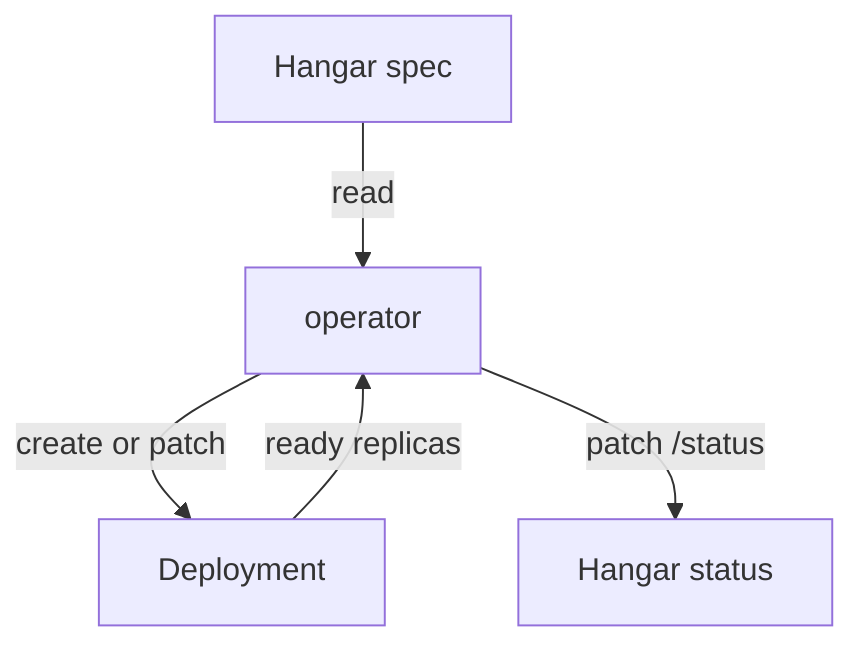

# Creating A Custom Resource And Reading Its Status

After you find a type, you create an object of it and wait for the result. With a built-in type such as a Deployment, you know where to look: the pods appear and the rollout finishes. With a custom type, the result depends on the operator, and you must read what the operator reports. This part creates a `Hangar`, follows what the operator creates, reads the status and its conditions, and shows how to tell whether the operator has seen your latest change.

## The reconcile loop

A controller works in a loop that is called reconciliation. The controller reads the desired state from the custom resource, reads the current state of the cluster, and acts to remove the difference. When the controller is done, it writes the observed state into the `status` of the custom resource. The loop starts again when an object changes. It does not matter how the object changed. The controller compares the whole desired state with the whole current state each time, so a missed notification does not leave the cluster wrong.

The `Hangar` operator in the playground follows this loop. For a `Hangar` named `scout-bay` it makes sure a Deployment named `hangar-scout-bay` exists with the requested number of replicas and image. It then counts the ready replicas and writes a `Ready` condition. The operator polls the API server every few seconds, and a production operator uses a watch, but the observable behaviour is the same: a change shows in the status within seconds.



The diagram shows that the spec flows into the operator, and that the observed result flows back into the status.

## Create a Hangar

Save this as `hangar-scout-bay.yaml`. It sets only the replica count, and the CRD supplies the image from its default:

<!-- astrona:playground:renew -->

```yaml
apiVersion: fleet.astrona.io/v1
kind: Hangar
metadata:
  name: scout-bay
  namespace: starfleet
spec:
  replicas: 2
```

Apply it:

```sh
kubectl apply -f hangar-scout-bay.yaml
```

Then wait for the condition and look at the result:

```sh
kubectl wait --for=condition=Ready hangar/scout-bay -n starfleet --timeout=120s
kubectl get hangars -n starfleet
kubectl get deployments,pods -n starfleet
```

The `wait` command watches the conditions of the custom resource, the same way it watches a Deployment. It returns when `Ready` is `True`. The table shows the printer columns of the CRD: `REPLICAS` is `2` and `READY` is `True`. The last command lists a Deployment named `hangar-scout-bay` and two pods. You did not create the Deployment. The operator created it from the `Hangar`.

The first wait may fail if the operator needs more than the timeout to pull the image. Run it again. The pods need the image `ghcr.io/stefanprodan/podinfo:6.15.0`, which kind already holds in the playground.

## Read the status and the conditions

Read the whole status:

```sh
kubectl get hangar scout-bay -n starfleet -o jsonpath='{.status}'
```

The status has three parts that follow a common Kubernetes convention. `readyReplicas` is a number the operator counted. `observedGeneration` is the value of `metadata.generation` that the operator processed. `conditions` is a list. Each condition has a `type` (`Ready`), a `status` (`True`, `False` or `Unknown`), a short machine-readable `reason`, a human-readable `message`, and a `lastTransitionTime` that changes only when the `status` changes.

Conditions are the standard way for an operator to explain itself. A reader who sees `Ready: False` with the reason `DeploymentProgressing` and the message `1 of 2 replicas are ready` knows that the operator is working and that the pods are not yet ready. A reader who sees `Ready: False` with the reason `DeploymentFailed` knows that the operator tried and failed, and the message holds the error. A custom resource with no status at all means that the operator has not processed it yet, or that it cannot write the status. `kubectl describe hangar scout-bay -n starfleet` prints the conditions in a readable block.

## Generation and observed generation

Every change to the `spec` of an object raises `metadata.generation` by one. A change to `status` or `metadata` does not. The operator copies the generation it processed into `status.observedGeneration`. The two numbers answer a question that a `Ready: True` alone cannot: is this status about my latest change?

Change the number of replicas:

```sh
kubectl patch hangar scout-bay -n starfleet --type=merge -p '{"spec":{"replicas":3}}'
kubectl get hangar scout-bay -n starfleet -o jsonpath='{.metadata.generation} {.status.observedGeneration}'
```

The second command prints two numbers separated by a space. Right after the patch, the first number is `2` and the second number can still be `1`, because the operator has not yet run its next loop. A few seconds later both are `2`. While the two numbers differ, the `Ready` condition describes the old request and you must not trust it.

Now wait again and check the pods:

```sh
kubectl wait --for=condition=Ready hangar/scout-bay -n starfleet --timeout=120s
kubectl get deployment hangar-scout-bay -n starfleet
```

Because the condition might still be `True` from the previous generation, a script that scales a custom resource should compare the two generations as well as the condition. The Deployment now shows three of three ready replicas.

## What validation protects

The CRD limits `replicas` to the range 1 to 5. Try a value outside the range:

```sh
kubectl patch hangar scout-bay -n starfleet --type=merge -p '{"spec":{"replicas":9}}'
```

The API server rejects the patch with a validation error that names `spec.replicas` and the maximum of 5. The rejection comes from the CRD schema, before the operator sees anything. The operator never receives an invalid object, and the stored `Hangar` is unchanged. This is why a good CRD carries its rules in the schema: the validation does not depend on the operator running.

You now know how to create a custom resource, how to read the operator's report, and how to check that the report matches your latest request. The next question is what ties the Deployment to the `Hangar`, and what happens to it when you delete the `Hangar`.

## Common pitfalls

> [!WARNING]
> - **Trusting `Ready: True` without looking at the generation.** The condition can belong to an older spec. Compare `metadata.generation` with `status.observedGeneration`.
> - **Editing the Deployment that the operator created.** The operator sets it back to match the `Hangar` on its next loop. Change the `Hangar`.
> - **Reading an empty status as success.** No status means the operator has not processed the object or cannot write it. It does not mean that all is well.
> - **Using `kubectl wait` without a timeout.** A condition that never becomes true blocks the command. Always pass `--timeout`.
> - **Patching the spec of a custom resource with a value the CRD does not allow.** The API server rejects it. Read `kubectl explain` for the limits first.
