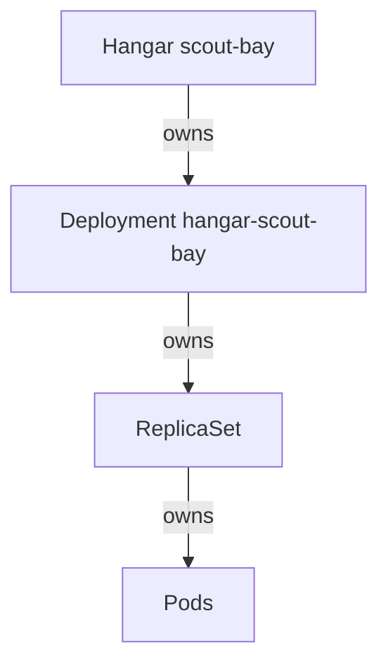

# Ownership, Garbage Collection And Finalizers

An operator creates objects on your behalf, and sooner or later you delete the custom resource. Two questions follow. Should the objects that the operator created disappear with it? And what if the operator, or another program, needs to do some work before the deletion finishes? Kubernetes answers the first question with owner references and garbage collection, and the second with finalizers. This part reads both on a real `Hangar`, and shows how to remove an object that is stuck in the `Terminating` state.

## Owner references and garbage collection

An owner reference is an entry in `metadata.ownerReferences` of an object that names another object as its owner. It holds the `apiVersion`, `kind`, `name` and `uid` of the owner, and two booleans: `controller`, which marks the owner as the managing controller, and `blockOwnerDeletion`. The operator sets this entry when it creates the Deployment for a `Hangar`.

The garbage collector is a controller inside `kube-controller-manager`. It watches owner references. When it finds an object whose owners no longer exist, it deletes that object. The rule runs for every type, built-in or custom. A ReplicaSet owned by a Deployment and a pod owned by a ReplicaSet follow the same rule. The `uid` matters: the collector compares the uid, not the name, so a new object with the old name is not the owner of the old dependents.

An owner and its dependents must be in the same namespace, or the owner must be cluster-scoped. A namespaced object cannot own an object in another namespace. This is why an operator that manages objects in many namespaces keeps each custom resource in the same namespace as its dependents.



The diagram shows a chain of owners. Deleting the top object makes the garbage collector delete every object below it.

## Read the owner reference

Create a `Hangar`. Save this as `hangar-probe-bay.yaml`:

<!-- astrona:playground:renew -->

```yaml
apiVersion: fleet.astrona.io/v1
kind: Hangar
metadata:
  name: probe-bay
  namespace: starfleet
spec:
  replicas: 1
```

Apply it and wait until the operator reports `Ready`:

```sh
kubectl apply -f hangar-probe-bay.yaml
kubectl wait --for=condition=Ready hangar/probe-bay -n starfleet --timeout=120s
```

Then read the owner reference of the Deployment that the operator created:

```sh
kubectl get deployment hangar-probe-bay -n starfleet -o jsonpath='{.metadata.ownerReferences}'
```

The output is a JSON list with one entry. It names the `Hangar` `probe-bay` as the owner, shows `controller` and `blockOwnerDeletion` as `true`, and holds the uid of the `Hangar`. Compare it with `kubectl get hangar probe-bay -n starfleet -o jsonpath='{.metadata.uid}'`: the two uids are equal. The reference is the only link between the two objects. The Deployment has no field that says "created by an operator", and the owner reference is how you trace an unknown object back to the custom resource.

## Delete the owner

Delete the `Hangar` and then list the Deployments:

```sh
kubectl delete hangar probe-bay -n starfleet
kubectl get deployments -n starfleet
```

The first command returns when the `Hangar` is gone. The `Deployment` can still be listed for a moment, because the default deletion mode is background: the API server removes the owner first, and the garbage collector removes the dependents afterwards. Run the second command again after a few seconds, and the Deployment `hangar-probe-bay` is gone together with its pods. The operator did not delete anything, and it did not need a permission to delete. The garbage collector did the work.

The flag `--cascade` changes this. The value `background` is the default. The value `foreground` keeps the owner in the `Terminating` state until its dependents with `blockOwnerDeletion: true` are gone. The value `orphan` deletes only the owner and removes the owner references from the dependents, so they stay. Wait until `kubectl get deployments -n starfleet` no longer lists `hangar-probe-bay`. Then create the `Hangar` again and delete it with `orphan`:

```sh
kubectl apply -f hangar-probe-bay.yaml
kubectl wait --for=condition=Ready hangar/probe-bay -n starfleet --timeout=120s
kubectl delete hangar probe-bay -n starfleet --cascade=orphan
kubectl get deployment hangar-probe-bay -n starfleet -o jsonpath='{.metadata.ownerReferences}'
```

The Deployment stays and keeps running. The last command prints nothing after a few seconds, because the garbage collector removes the owner reference. Run it again if it still prints the reference. Nothing owns this Deployment any more, so nothing deletes it. Remove it yourself:

```sh
kubectl delete deployment hangar-probe-bay -n starfleet
```

## Finalizers

A finalizer is a string in `metadata.finalizers` that tells the API server to wait. When a client deletes an object that has finalizers, the API server does not remove it. It sets `metadata.deletionTimestamp` and leaves the object in place. A controller that owns a finalizer sees the timestamp, does its cleanup work (for example deleting a resource outside the cluster, or taking a backup), and then removes its own string from the list. When the list is empty, the API server deletes the object.

Finalizers are how an operator guarantees that cleanup runs. They are also the usual reason for an object that stays in the `Terminating` state. When the controller that owns the finalizer is gone or broken, nobody removes the string, and the object waits for ever. The built-in foreground deletion uses a finalizer too.

Create a `Hangar` that has a finalizer that no controller in this cluster handles. Save this as `hangar-old-bay.yaml`:

```yaml
apiVersion: fleet.astrona.io/v1
kind: Hangar
metadata:
  name: old-bay
  namespace: starfleet
  finalizers:
  - legacy.astrona.io/archive
spec:
  replicas: 1
```

Apply it and delete it:

```sh
kubectl apply -f hangar-old-bay.yaml
kubectl delete hangar old-bay -n starfleet --wait=false
```

Without `--wait=false` the `delete` command would wait for the object to disappear, and it would never return. Look at the object:

```sh
kubectl get hangar old-bay -n starfleet -o jsonpath='{.metadata.deletionTimestamp} {.metadata.finalizers}'
kubectl get hangars -n starfleet
```

The first command prints a timestamp and the finalizer `legacy.astrona.io/archive`. The second still lists `old-bay`. The object is marked for deletion and waits for the owner of the finalizer. The `hangar-operator` ignores objects with a deletion timestamp, and it does not own this finalizer.

## Remove a stuck finalizer

First find out who should remove the finalizer. The name `legacy.astrona.io/archive` points to a controller that archives the object before deletion. If that controller exists and works, wait for it. If it was uninstalled, nobody will ever remove the string. Only then remove it yourself:

```sh
kubectl patch hangar old-bay -n starfleet --type=merge -p '{"metadata":{"finalizers":null}}'
kubectl get hangars -n starfleet
```

The patch sets the list to empty, the API server deletes the object, and the second command no longer lists `old-bay`. Removing a finalizer skips the cleanup that it stood for. For a custom resource that holds a database or a cloud resource, the cleanup does not run, and the external resource stays behind. Remove a finalizer only when you know that the cleanup is done, or not needed.

You now know how ownership connects an operator's objects to a custom resource, how deletion modes decide what stays, and why a finalizer holds an object. The remaining question is how to find the cause when a custom resource does nothing at all.

## Common pitfalls

> [!WARNING]
> - **Deleting the dependent instead of the owner.** The operator creates the Deployment again on its next loop. Delete the custom resource.
> - **Using `--cascade=orphan` and forgetting the leftovers.** The dependents keep running with no owner, and nothing deletes them later.
> - **Running `kubectl delete` without `--wait=false` on an object with a finalizer.** The command blocks until the finalizer is gone.
> - **Removing a finalizer to make an error disappear.** The cleanup it protected does not run. Find its owner first.
> - **Expecting an owner reference across namespaces.** A namespaced owner cannot own an object in another namespace, and the garbage collector treats such a reference as invalid.
