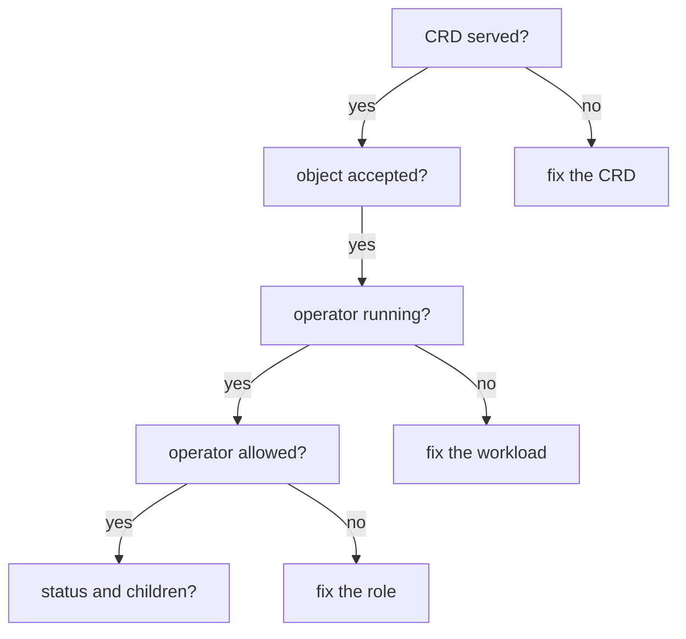

# Troubleshooting A Custom Resource That Does Not Reconcile

The most common support case with an operator is: "I created the object, the API server accepted it, and nothing happened." Acceptance only means that the object passed the schema and was stored. The result depends on a chain of components, and a failure at any link looks the same from outside: a custom resource with no status and no child objects. This part walks the chain in order, breaks two links on purpose, and shows the evidence each failure leaves.

## The chain, in order

Check the links from the API toward the application. Each check has a command, and the first failing check names the problem:

1. The type exists and is served: `kubectl get crd` and `kubectl api-resources --api-group=<group>`. A reply that the server has no such resource type, or that the kind is not recognised, ends here.
2. The API server accepted the object: the `apply` command succeeded. A validation error names the field. Nothing is stored after a rejection, so there is no object to debug.
3. The operator runs: `kubectl get deployment -n <operator-namespace>`, then `kubectl get pods`. A Deployment with zero ready pods, or a pod in `CrashLoopBackOff`, means that no controller reads your object.
4. The operator can act: `kubectl logs` of the operator. A line with `forbidden` or HTTP 403 means a missing permission. `kubectl auth can-i` confirms it.
5. The operator reports: `kubectl describe` or `-o yaml` of the custom resource shows the status and conditions. A condition with the status `False` carries a reason and a message from the operator.
6. The children exist and are healthy: the Deployments and pods that the operator creates, found through the owner reference or the names.



The diagram shows that each question has one fix, and that you ask the questions in the same order every time.

## Failure one: the operator is not running

Stop the operator. A Deployment with zero replicas stands for any reason that leaves no controller pod: a crash, a bad image, a node problem, or an uninstall.

Scale it down:

<!-- astrona:playground:renew -->

```sh
kubectl scale deployment hangar-operator -n fleet-system --replicas=0
kubectl get deployment hangar-operator -n fleet-system
```

The Deployment shows `0/0` ready. Now create a `Hangar`. Save this as `hangar-shuttle-bay.yaml`:

```yaml
apiVersion: fleet.astrona.io/v1
kind: Hangar
metadata:
  name: shuttle-bay
  namespace: starfleet
spec:
  replicas: 1
```

Apply it:

```sh
kubectl apply -f hangar-shuttle-bay.yaml
```

Then look for the result:

```sh
kubectl get hangars -n starfleet
kubectl get deployment hangar-shuttle-bay -n starfleet
```

The `apply` command succeeds: the API server validated and stored the object. The table shows `shuttle-bay` with `REPLICAS` of `1` and an empty `READY` column, because no status exists. The second command reports that the Deployment is not found. This is the signature of a missing controller: the object exists, the status is empty and no child objects appear. Nothing in the object says that the controller is gone, so you must check the operator itself.

Start the operator again and wait for the result:

```sh
kubectl scale deployment hangar-operator -n fleet-system --replicas=1
kubectl wait --for=condition=Ready hangar/shuttle-bay -n starfleet --timeout=180s
```

The operator starts, lists all `Hangar` objects, and finds `shuttle-bay`. It creates the Deployment and writes the status. A controller that was down does not lose work, because the custom resource holds the desired state. On start, the controller reads all objects and reconciles each of them.

## Failure two: the operator lacks a permission

The operator calls the API server as the service account `hangar-operator`, so Kubernetes RBAC decides what it may do. Remove the permission to create Deployments from its `ClusterRole`. The rule for the `apps` group is the third rule of the role, at index 2, and the patch replaces its verbs:

```sh
kubectl patch clusterrole hangar-operator --type=json -p '[{"op":"replace","path":"/rules/2/verbs","value":["get","list","watch","patch"]}]'
```

Save this as `hangar-drifter-bay.yaml`:

```yaml
apiVersion: fleet.astrona.io/v1
kind: Hangar
metadata:
  name: drifter-bay
  namespace: starfleet
spec:
  replicas: 1
```

Apply it:

```sh
kubectl apply -f hangar-drifter-bay.yaml
```

Then look for the evidence, in the order of the chain:

```sh
kubectl get hangar drifter-bay -n starfleet -o jsonpath='{.status.conditions}'
kubectl logs -n fleet-system deployment/hangar-operator --tail=5
kubectl auth can-i create deployments.apps -n starfleet --as=system:serviceaccount:fleet-system:hangar-operator
```

This operator reports its failure in three places. The condition `Ready` is `False` with the reason `DeploymentFailed`, and its message holds the answer of the API server: HTTP 403 and the text that the service account `hangar-operator` cannot create the resource `deployments` in the API group `apps`. The operator log prints the same error once. The `can-i` command answers `no`. The check with `--as` is the quickest proof, because it does not depend on what the operator chooses to report. An operator written without such a status leaves you only the log, and an operator that does not log leaves you only `can-i`, so learn all three.

Fix the cause in the role, not in the operator. Give back the single verb that is missing:

```sh
kubectl patch clusterrole hangar-operator --type=json -p '[{"op":"replace","path":"/rules/2/verbs","value":["get","list","watch","create","patch"]}]'
kubectl wait --for=condition=Ready hangar/drifter-bay -n starfleet --timeout=180s
```

The operator does not need a restart. Kubernetes checks the permissions on every request, so the next loop of the operator succeeds. Do not repair the failure by binding the service account to `cluster-admin`. That gives the operator, and anything that steals its token, the rights over the whole cluster. Add the exact verb on the exact resource that the log names.

## Failures that leave a different trace

Two more causes are common, and each has its own evidence. When the CRD has no status subresource, the operator can create the children but its write to the `/status` endpoint fails, so the custom resource keeps an empty status while the children run. The log of the operator names the status write. When the CRD schema does not declare the status fields, the API server removes them as unknown fields: the write succeeds and the status stays empty. Compare the claim with the schema using `kubectl explain hangar.status`.

You now have an order of questions that finds the failing link in any operator: the type, the object, the operator workload, the permission, the status and the children. Each question needs only `kubectl`, and the answers come from the cluster, not from guessing.

## Common pitfalls

> [!WARNING]
> - **Debugging the custom resource when the operator is down.** An accepted object with an empty status is the signature of a controller that is not running. Check the operator Deployment first.
> - **Reading only the custom resource.** Many operators report the real error only in their log. Run `kubectl logs` on the operator.
> - **Granting `cluster-admin` to fix a `forbidden` error.** Add only the verb and resource named in the error.
> - **Restarting the operator after an RBAC change.** It is not needed. Kubernetes checks permissions on every request.
> - **Checking `can-i` as yourself.** You are the cluster administrator and the answer is always `yes`. Use `--as=system:serviceaccount:<namespace>:<name>`.
