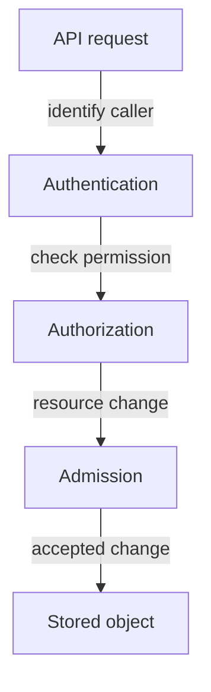
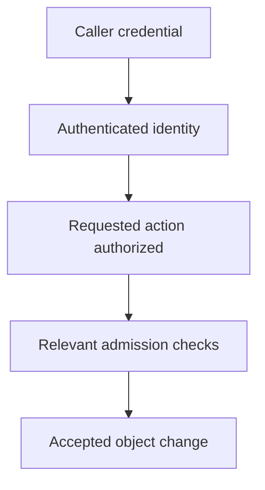

# API Request Checks And Workload Identity

A caller can have a valid identity and still be forbidden to read Pods. It can also be allowed to create Pods while admission rejects a privileged configuration. Identity, permission and accepted configuration are distinct decisions.

## Learning objectives

- Distinguish authentication, authorization and admission.
- Explain why a valid credential is insufficient for a resource action.
- Select the failed request stage before changing permissions or configuration.

## Before you start

Use a shell on your own machine with the module playground running. A Pod is Kubernetes's unit for running one or more containers together. The environment provides the `probe` Deployment, which maintains application Pods, and the `starfleet` namespace, which groups these objects.

Read-only commands below use kubectl, the Kubernetes command-line tool. Select the private kubeconfig: the file that identifies this environment's cluster and credentials. The commands do not change the application.

## API Request Checks and Workload Identity

The `shuttle` application asks the Kubernetes application programming interface (API) to read Pods. Before returning data, the API server evaluates the request. Authentication establishes the caller's identity. Authorization decides whether that identity may perform the requested action on the target resource.

Admission handles additional checks and possible mutation for relevant resource-changing requests after authorization. An admission policy might reject a privileged Pod even when the caller is authorized to create Pods. Authentication failure, insufficient permission and a policy rejection describe different stages and require different corrections.

A ServiceAccount is a namespaced Kubernetes identity intended for workloads and automation. A Pod can use one to authenticate API requests through a token. Modern projected tokens can have bounded lifetime and audience, limiting where and for how long they are useful. A token still needs protection against disclosure.

Every namespace has a default ServiceAccount, but using it does not imply administrative access. Permissions come from authorization configuration. A workload that does not need API access can avoid automatically mounting credentials, reducing unnecessary credential exposure.


Identity, permission and admission policy are distinct checks before a resource change is stored.

If the application authenticates successfully but receives a forbidden response, investigate its permissions rather than replacing the token first. If a Pod creation is rejected for security settings, inspect the admission policy and requested fields. Fix the stage supported by the evidence.

## Following A Resource-Changing Request

A developer requests a new Pod. The API server first establishes a caller identity through a configured authentication mechanism. A presented certificate or token must be valid for the intended use. Successfully identifying the caller does not yet decide whether the developer may create Pods in the target namespace.

Authorization then evaluates the requested action, resource and scope. A read grant does not imply a create grant. The namespace and API group are part of the request's meaning. If this check fails, changing the proposed Pod's image may be irrelevant because the caller lacks permission to create any such object.

For an authorized resource change, admission can mutate or validate the request through configured checks. A mutating check might supply a default, while a validating check can reject disallowed behavior. These mechanisms must be evaluated as part of the cluster's policy; authorization alone is not the complete acceptance contract.

## Workload Credentials Have A Scope And Lifetime

A ServiceAccount identifies a workload within a namespace. The Pod can obtain a projected token with a defined audience and lifetime. Audience describes the intended recipient, so a token accepted by one service should not automatically be useful everywhere. Limited lifetime reduces continued usefulness after expiry, but exposure while valid still matters.

The workload should receive credentials only when it needs them. Disabling automatic token mounting can reduce unnecessary access for an application that never calls the Kubernetes API. That choice is separate from the ServiceAccount's role grants: not mounting a credential changes availability of that credential to the process, while RBAC defines what an authenticated identity may do.

A diagnosis should state which stage rejected the request and which identity made it. An admission error about privilege is not repaired by issuing another token. A forbidden response is not resolved merely by adding a namespace label. The corrective action belongs to the failed contract.

## Inspect the mechanism

Authentication answers who made the request. Authorization evaluates that identity's requested verb, resource and scope. Admission processes relevant authorized resource-changing requests, including configured mutation and validation. A read permission says nothing about whether a proposed privileged Pod satisfies admission policy.

The `auth can-i` command asks an authorization question. It does not create the proposed object, validate its schema or run its process. The kind author connection commonly has broad rights, so a yes response for that connection is not evidence that an application ServiceAccount has the same permission. Always name the identity and scope whose authority you are evaluating.



A request can pass one decision and still fail a later one that evaluates a different property.

<!-- astrona:playground:renew -->

Select the private cluster connection and inspect the live state from your host shell:

```sh
export KUBECONFIG="$(astrona kubeconfig ats-029-playground-020-01)"
if test "$(kubectl config current-context)" = "kind-astro-ats-029-playground-020-01"; then
  kubectl auth can-i get pods -n starfleet
  kubectl auth can-i create pods -n starfleet
  kubectl -n starfleet get serviceaccounts
else
  printf "Select this module's private kubeconfig before continuing.\n" >&2
fi
```

These checks describe the current kubeconfig identity, not every workload. A yes response establishes the queried authorization result. It does not bypass admission or test whether a specific Pod configuration will be accepted. `get serviceaccounts` lists available workload identities but does not disclose or copy their credentials.

You can now explain which request boundary rejected an operation. Correcting a credential, a grant and an admission violation are different changes and should follow the evidence for the failed stage.

## Common pitfalls

> [!WARNING]
> A valid token does not grant every permission. Authorization and admission can reject a request after authentication succeeds.
