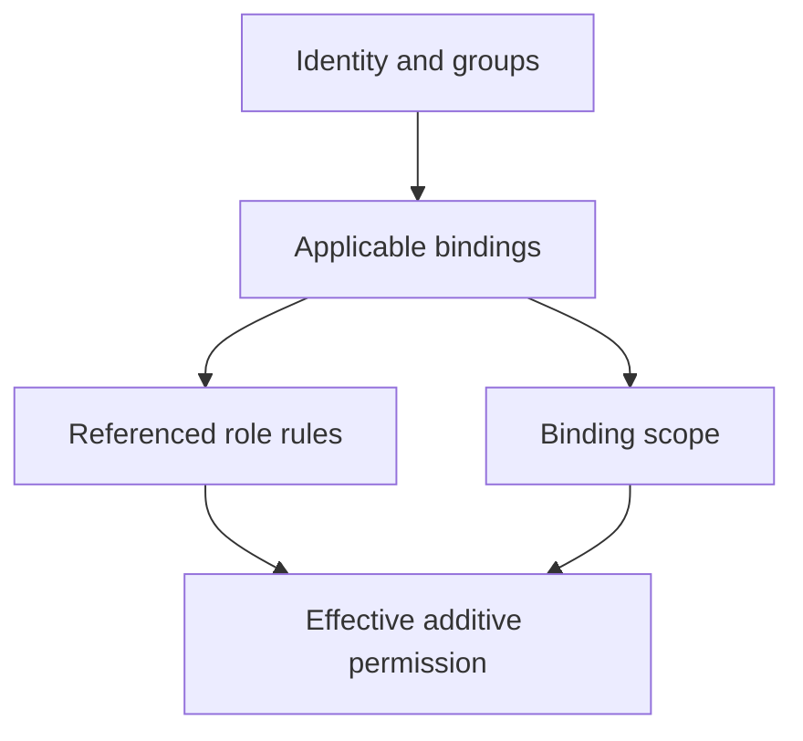

# RBAC Grants And Their Consequences

A RoleBinding grants a reusable ClusterRole only inside the binding's namespace. Its reference to a cluster-scoped role definition does not make the grant cluster-wide. Read the binding scope and subject together.

## Learning objectives

- Trace a binding from its subject to its permission rules.
- Distinguish RoleBinding scope from ClusterRoleBinding scope.
- Explain additive grants and indirect access consequences.

## Before you start

Use a shell on your own machine with the module playground running. A Pod is Kubernetes's unit for running one or more containers together. The environment provides the `probe` Deployment, which maintains application Pods, and the `starfleet` namespace, which groups these objects.

Read-only commands below use kubectl, the Kubernetes command-line tool. Select the private kubeconfig: the file that identifies this environment's cluster and credentials. The commands do not change the application.

## RBAC Grants and Their Consequences

The `shuttle` identity only needs to read Pods in `outpost`. Role-Based Access Control (RBAC) grants actions on resource types to identities through roles and bindings. A Role describes permissions within a namespace, while a ClusterRole is a cluster-scoped definition that can describe namespaced or cluster-scoped permissions.

A RoleBinding grants permissions within its own namespace. It can refer to a Role in that namespace or a ClusterRole. Referencing a ClusterRole through a RoleBinding does not turn the grant into a cluster-wide grant. A ClusterRoleBinding grants the referenced ClusterRole at cluster scope.

Rules distinguish resource types and verbs. Permission to get one object's data differs from permission to list a collection, watch changes, create objects or delete them. The application programming interface (API) group also matters. A rule for core Pods does not automatically cover Deployments in another group.

Least privilege means granting only the permissions needed for a defined job. Read access to Secrets is sensitive because it can reveal credentials. Permission to create Pods may also enable access to mounted data or workload identities, depending on other controls. A superficially narrow verb can still have important indirect effects.

RBAC permissions are additive: another applicable binding may grant an action that one role omits. Removing a rule from one role does not guarantee the identity loses permission if another binding still grants it. Scope and all applicable grants must be considered.

For the `shuttle` scenario, a namespace-scoped read grant fits better than a cluster-wide administrative binding. Check the subject, verbs, resources and namespace together. A binding with the right role but the wrong ServiceAccount or namespace does not satisfy the intended access.

## Building A Narrow Read Grant

Assume `shuttle` in `outpost` needs to retrieve Pod details in that namespace. A suitable Role can allow the relevant read verbs on core Pods, and a RoleBinding can identify the intended ServiceAccount. The namespace of the binding determines where the grant applies. The ServiceAccount subject also needs the correct namespace so it identifies the expected workload identity.

If the same permission definition is useful in several namespaces, a ClusterRole can be reused through separate RoleBindings. That reuse does not make every binding cluster-wide. A ClusterRoleBinding has different scope and should only be used when the required access justifies it.

The difference between `get`, `list` and `watch` matters. Getting a known object requests one record. Listing obtains a collection. Watching streams subsequent changes. A component that watches a collection commonly needs a combination appropriate to its workflow rather than a vague “read” label. Rules should match the actual API operations.

## Indirect Privileges And Additive Grants

A grant to read Secrets can reveal credentials for another service. A grant to create Pods can expose a route to mounted data or workload identities, subject to the cluster's other controls. Permission analysis should therefore ask what the identity can accomplish through the resources it may create or read, not only whether the verb sounds harmless.

Several bindings can apply to one caller through its username or groups. Effective permissions are the union of those grants. Removing a broad rule from one Role is insufficient if a ClusterRoleBinding still grants it elsewhere. RBAC does not express a general explicit-deny rule that cancels another grant.

Review the subject, group memberships, verb, API group, resource and namespace together. A correct role with the wrong binding subject fails to provide needed access; a correct subject with an overly broad binding grants more than intended. Least privilege is the narrowest working combination of these fields and the surrounding admission protections.

## Inspect the mechanism

Role-Based Access Control (RBAC) stores permission definitions and the bindings that connect them to identities. A Role is a namespaced definition. A ClusterRole is a reusable cluster-scoped definition. The binding type and namespace determine the grant's reach, while the subject identifies who receives it.

Rules are additive across applicable bindings. If one Role omits Secret reads while another applicable grant allows them, the omission is not a denial. A complete review therefore traces all relevant bindings, including group subjects. Creating a workload can also expose mounted data or workload identity subject to other controls, so a seemingly simple create verb can have indirect effects.



Effective permission combines the identity, all applicable grants and each binding's scope.

<!-- astrona:playground:renew -->

Select the private cluster connection and inspect the live state from your host shell:

```sh
export KUBECONFIG="$(astrona kubeconfig ats-029-playground-020-01)"
if test "$(kubectl config current-context)" = "kind-astro-ats-029-playground-020-01"; then
  kubectl -n starfleet get roles,rolebindings -o yaml
  kubectl get clusterrolebindings
else
  printf "Select this module's private kubeconfig before continuing.\n" >&2
fi
```

Read roleRef, subjects and the namespace on any local binding. The baseline may contain no application-specific grants. Cluster bindings can include kind bootstrap identities; their existence is not permission for you to copy an administrative grant into an application example. This read-only review exposes the grant mechanism without adding privileges.

You can now justify a narrow grant using the exact resource, action and namespace. A role name alone neither proves least privilege nor describes all effective permissions.

## Common pitfalls

> [!WARNING]
> A RoleBinding to a ClusterRole still grants permissions in the binding's namespace. RBAC grants combine; an omitted rule is not an explicit denial.
