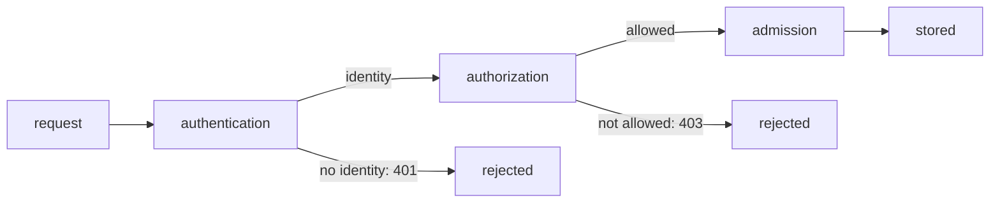

# How The API Server Authenticates A Request

A request to the Kubernetes API server carries a credential, and the API server must decide who owns it before it can decide what that owner may do. If this step is unclear, you cannot tell a wrong credential from a missing permission, and the error messages look alike. This part explains what authentication is, which credential types the API server accepts, and how each one turns into a username and a list of groups.

## Authentication is the first check

The **API server** (`kube-apiserver`) is the control plane component that every `kubectl` command, every controller and every `kubelet` talks to. It handles each request in a fixed order. First it authenticates the request. Then it authorizes it. Then it runs admission control on requests that create or change objects.



The diagram shows that authentication runs first and that a failure at each stage returns a different status code.

**Authentication** is the step that turns the credential in the request into an identity: a username and a list of groups. It does not decide what the identity may do. The API server has several authenticator modules, and it asks them one after another. The first module that accepts the credential wins. If none accepts it, the API server returns `401 Unauthorized`.

Kubernetes has no `User` object and no `Group` object. You cannot run `kubectl get users`. A user exists only as a string inside a credential that a trusted authenticator accepted. This is why the way you create a user is to create a credential that the cluster trusts.

## The credential types you use

Four credential types matter for the CKAD exam and for daily work.

- **Client certificate.** The client presents an X.509 certificate signed by the certificate authority (CA) that the API server trusts. The **common name** (`CN`) field of the certificate subject becomes the username. Each **organization** (`O`) field becomes one group.
- **ServiceAccount token.** A ServiceAccount is a Kubernetes object that gives a workload an identity. The cluster issues a signed JSON Web Token (JWT) for it. The username is `system:serviceaccount:<namespace>:<name>`. The groups are `system:serviceaccounts` and `system:serviceaccounts:<namespace>`.
- **OpenID Connect (OIDC) token.** An external identity provider signs the token, and the API server reads the username and groups from claims in it. A cluster administrator must configure this on the API server. You meet it in managed clusters.
- **Webhook token and static token file.** Other ways an administrator can configure. The exam does not ask you to set them up.

Every identity that passes authentication also receives the group `system:authenticated`. A request with no credential at all can be treated as the user `system:anonymous` in the group `system:unauthenticated`, if anonymous requests are allowed. Authorization normally denies that identity almost everything.

## Read your own identity

The command `kubectl auth whoami` sends a request to the API server and prints the identity the API server assigned to the credential in your current `kubeconfig` context. Run it in the playground:

<!-- astrona:playground:renew -->

```sh
kubectl auth whoami
```

The output is a table with the attributes of the identity. You will see a `Username` row with the name `kubernetes-admin` and a `Groups` row that includes `system:authenticated`. Your administrator credential carries one more group that gives it full rights. The exact administrator group depends on how the cluster was built, so do not rely on its name.

The same information is available in a format you can read in a script:

```sh
kubectl auth whoami -o jsonpath='{.status.userInfo.username}{"\n"}'
```

This prints only the username. The grading scripts of the labs in this course use this form, because it does not depend on the table layout.

## Create a token for a ServiceAccount

A ServiceAccount token shows the second credential type. The command `kubectl create token` asks the API server to issue a short-lived JWT for a ServiceAccount through the TokenRequest API. The `shuttle` ServiceAccount already exists in `starfleet`:

```sh
kubectl -n starfleet create token shuttle
```

The command prints a long string with three parts separated by dots. This is the JWT. It has a limited lifetime, one hour by default, and the API server rejects it after it expires. The command does not store anything in the cluster, so you can create as many tokens as you need.

A JWT is not encrypted. Its middle part is base64 text that holds the claims, including the subject `system:serviceaccount:starfleet:shuttle`. Anyone who copies the string can use it until it expires, so treat a token like a password. Do not paste it into a ticket or a chat.

## What the API server does with a client certificate

A client certificate works because of public key cryptography and a trusted CA. The API server holds the public certificate of the cluster CA. When a client connects over TLS (Transport Layer Security), it presents its certificate and proves that it holds the matching private key. The API server checks that the CA signed the certificate and that the certificate has not expired.

The API server does not look up the name in any list. It trusts the subject fields exactly as they are written, because the CA signed them. A certificate with the subject `CN=ensign-chen,O=bridge-crew` therefore authenticates as the user `ensign-chen` in the group `bridge-crew`. The cluster does not need to know in advance that `ensign-chen` exists.

This has a consequence that the exam likes to test. The CA signs whatever subject you ask for, so the person who approves a request for a certificate controls the identity. If the subject contains `O=system:masters`, the user joins a built-in group that the default RBAC rules bind to `cluster-admin`. The next part shows the approval process that protects against this.

## Telling 401 from 403

The status code tells you which stage failed. `401 Unauthorized` means authentication failed: the credential was missing, expired, signed by an unknown CA or malformed. `403 Forbidden` means authentication succeeded and authorization refused the action. The message names the identity the API server saw:

```text
Error from server (Forbidden): pods is forbidden: User "ensign-chen" cannot list resource "pods" in API group "" in the namespace "outpost"
```

When you see this text, stop checking certificates. The credential works. The identity needs a Role and a RoleBinding. When you see `Unauthorized` or `You must be logged in to the server`, the credential itself is the problem, and no Role can help.

You now know that authentication produces a username and groups from a credential, and that the subject of a client certificate becomes that identity without any lookup. The open question is how a new user obtains a certificate that the cluster CA has signed, and who decides to sign it.

## Common pitfalls

> [!WARNING]
> - **Looking for a user list.** Kubernetes stores no `User` objects. `kubectl get users` does not exist, and a name is valid only inside a credential that an authenticator accepted.
> - **Treating `403` as a credential error.** `Forbidden` means the identity was accepted and authorization refused it. Fix the Role or the RoleBinding, not the certificate.
> - **Forgetting that tokens are secrets.** Anyone who holds a ServiceAccount token can act as that ServiceAccount until the token expires.
> - **Trusting the group name `system:masters` to be harmless.** A certificate with that organization field bypasses the normal permission model.
