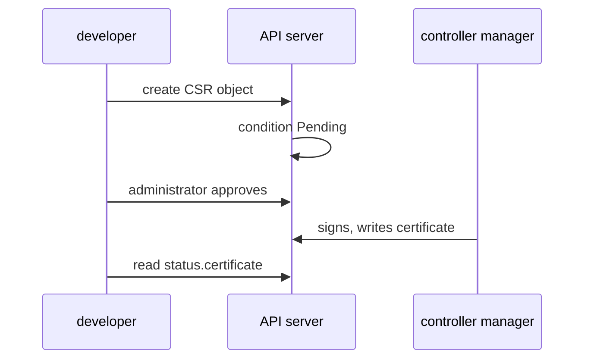

# Issue A Client Certificate With A CertificateSigningRequest

A new developer needs a credential, and a certificate is the usual choice for a person. The developer must not receive the private key of the cluster CA, so the cluster has to sign the certificate on request. Kubernetes provides an API for this: the `CertificateSigningRequest` object. This part walks through the whole flow with `openssl` and `kubectl`, and explains what each component does at each step.

## The flow in one picture

A **CertificateSigningRequest** (CSR) is a Kubernetes object that holds a request for a signed certificate. The flow has four steps and three actors. The developer creates a key pair and a request. An administrator approves the request. The controller manager signs it.



The diagram shows that the signing happens inside the cluster, after an approval, and that the developer only reads the result.

The private key never leaves the developer's machine. Only the request, which holds the public key and the wanted subject, goes into the cluster. The **controller manager** (`kube-controller-manager`) is the control plane component that runs the signing controller. It holds the CA key and signs approved requests of the right signer.

## Create the private key and the request file

You need `openssl` on your own machine. First create a 2048-bit RSA private key. Then create a certificate signing request file with the subject you want. The playground uses the user `ensign-chen` and the group `bridge-crew`.

<!-- astrona:playground:renew -->

```sh
openssl genrsa -out ensign-chen.key 2048
openssl req -new -key ensign-chen.key -subj "/CN=ensign-chen/O=bridge-crew" -out ensign-chen.csr
```

The first command writes the private key. The second writes a PEM (Privacy Enhanced Mail) text file with the request. The `-subj` value sets the subject: `CN=ensign-chen` becomes the username and `O=bridge-crew` becomes one group. A second `O` field adds a second group.

The `CertificateSigningRequest` object needs the request file as one line of base64 text. Print it:

```sh
base64 < ensign-chen.csr | tr -d '\n'
```

The `tr` command removes the line breaks, because the field must be a single base64 string. Copy the output. You paste it into the YAML file in the next step.

## Submit the CertificateSigningRequest

The object has four fields that matter. The `request` field holds the base64 text. The `signerName` field says which signer handles the request. The `usages` field lists what the certificate may be used for. The optional `expirationSeconds` field asks for a lifetime. The signer can shorten it, and the minimum is 600 seconds.

For a person who calls the API server, the signer is `kubernetes.io/kube-apiserver-client` and the usage is `client auth`. Save this as `csr-ensign-chen.yaml`, and replace `<REQUEST>` with the base64 line you copied:

```yaml
apiVersion: certificates.k8s.io/v1
kind: CertificateSigningRequest
metadata:
  name: ensign-chen
spec:
  request: <REQUEST>
  signerName: kubernetes.io/kube-apiserver-client
  expirationSeconds: 86400
  usages:
    - client auth
```

Apply it:

```sh
kubectl apply -f csr-ensign-chen.yaml
```

Then check the result:

```sh
kubectl get csr ensign-chen
```

The `CONDITION` column shows `Pending`. The request exists, but nothing signed it. The `REQUESTOR` column shows the identity that created the object, which is `kubernetes-admin` here. The API server records the requestor so that an approver can see who asked.

A CSR for a client certificate that uses another signer, or a usage list that does not contain `client auth`, is not accepted by the client signer. The signer is a fixed name. A typo here leaves the request pending forever, because no controller owns that name.

## Approve the request and fetch the certificate

Approval is a separate action, and it needs its own permission. The approve action is the `approve` verb on the `signers` resource in the `certificates.k8s.io` group. The cluster administrator holds it. The command `kubectl certificate approve` adds the `Approved` condition to the object:

```sh
kubectl certificate approve ensign-chen
kubectl get csr ensign-chen
```

The condition changes to `Approved`. After a few seconds the signing controller in the controller manager signs the request and the condition reads `Approved,Issued`. If you see only `Approved`, run the second command again.

The signed certificate is in the field `status.certificate`, encoded as base64. Decode it into a file:

```sh
kubectl get csr ensign-chen -o jsonpath='{.status.certificate}' | base64 -d > ensign-chen.crt
openssl x509 -in ensign-chen.crt -noout -subject -issuer -dates
```

The `openssl` command prints the subject, the issuer and the validity dates. The subject shows `CN=ensign-chen` and `O=bridge-crew`. The issuer is the cluster CA. The end date is about one day after now, which is the lifetime you asked for.

## Deny, delete and renew

An administrator can also refuse a request with `kubectl certificate deny ensign-chen`. The object then carries the condition `Denied`, and no certificate is ever issued for it. A request that is neither approved nor denied stays `Pending` until the cluster removes it. A cluster controller also deletes old requests automatically, so do not keep the object as a record.

Kubernetes cannot revoke a client certificate. The API server has no revocation list for them. The certificate works until it expires, so a short `expirationSeconds` is the control you have. To remove access earlier, delete the RoleBinding that names the user. The certificate then still authenticates the user, but authorization grants nothing.

To renew, you create a new request with a new name. A CSR object cannot be changed after you create it, except for the status that the controllers write.

## Why approval matters

The CA signs the subject that the request names. If an administrator approves a request with `O=system:masters` without reading it, the new user receives full cluster rights. Before you approve, read the request. The command `kubectl get csr ensign-chen -o jsonpath='{.spec.request}' | base64 -d | openssl req -noout -subject` prints the subject that you are about to sign, with no changes to the cluster.

You can now issue a client certificate for a user and read what is in it. The certificate alone does not let `kubectl` use it. The open question is how to put the key and the certificate into a `kubeconfig` file and use them as a separate context.

## Common pitfalls

> [!WARNING]
> - **Pasting a base64 string with line breaks.** The `request` field must be one line. Use `tr -d '\n'`, or the API server rejects the object.
> - **Using the wrong signer or usage.** For a user certificate, use `kubernetes.io/kube-apiserver-client` with `client auth`. Another signer name leaves the request pending.
> - **Approving without reading the subject.** The CA signs what the request asks for, including powerful groups such as `system:masters`.
> - **Expecting to revoke a certificate.** Kubernetes has no client certificate revocation. Use short lifetimes and remove the RoleBinding.
> - **Fetching the certificate too early.** After approval, `status.certificate` stays empty for a few seconds until the controller manager signs the request.
