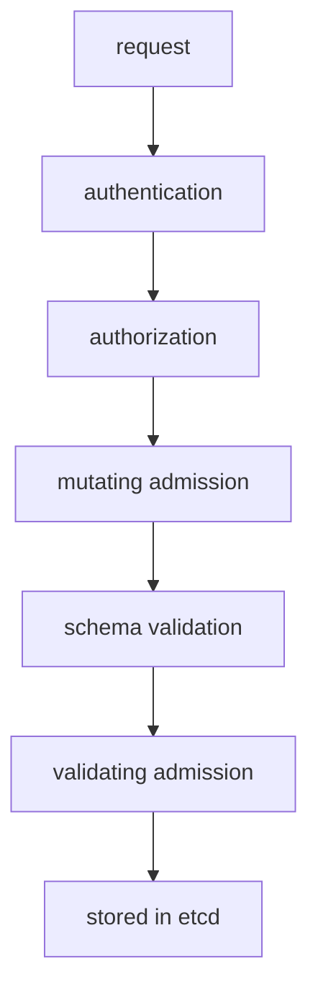

# The Admission Chain: Mutating And Validating Steps

You write a Deployment with a few lines. The pod that the cluster runs from it has a service account, a mounted token, tolerations and often more fields that you never wrote. Something added them, and the same something can refuse a request that your Role allows. This part explains the admission chain: where it sits, which steps change an object, which steps only judge it, and how to see the result of each in the playground.

## Where admission sits

An **admission controller** is code inside the API server that intercepts a request after authentication and authorization and before the API server stores the object in etcd, the cluster database. Admission applies only to requests that create, update or delete an object. It does not apply to reads such as `kubectl get`.

There are two kinds of admission step. A **mutating** step can change the object. A **validating** step can only accept or reject it. The API server runs all mutating steps first, then checks the object against its schema, then runs all validating steps.



The diagram shows that validating admission sees the object after every mutation, so a validating step judges the final object and not what you typed.

If any step rejects the request, the API server stops and returns an error to the client. Nothing is stored, and no later step runs. A request can pass authorization and still fail here, which is why a `Forbidden` message can come from either stage. The text of the message tells you which one.

## Built-in plugins and webhooks

Most admission steps are **plugins** that are compiled into the API server. A cluster administrator turns plugins on and off with the API server flags `--enable-admission-plugins` and `--disable-admission-plugins`. Many plugins are on by default. Some of the ones you meet in application work:

- `ServiceAccount` sets the default service account on a pod and adds the token volume. It is mutating, and it also rejects a pod that names a service account that does not exist.
- `DefaultTolerationSeconds` adds the tolerations for unreachable and not-ready nodes to a pod.
- `LimitRanger` applies default resource requests and limits and enforces the minimum and maximum of a `LimitRange`. It both mutates and validates.
- `ResourceQuota` rejects a request that would take a namespace over its quota. It validates.
- `NamespaceLifecycle` rejects objects created in a namespace that does not exist or is being deleted. It validates.
- `PodSecurity` checks pods against the Pod Security Standards that a namespace label selects. It validates.
- `MutatingAdmissionWebhook` and `ValidatingAdmissionWebhook` call external HTTP servers that an administrator registers. This is how policy engines and service meshes change or check pods.
- `ValidatingAdmissionPolicy` evaluates rules written in CEL inside the API server, with no external server.

Application developers rarely change the plugin list. You need to recognise what each plugin does when you read a pod or an error message.

## See a mutation

The `scout` Deployment was created without a service account, and its pod template does not contain one. Compare the template with the pod that the cluster created:

<!-- astrona:playground:renew -->

```sh
kubectl -n starfleet get deployment scout -o jsonpath='{.spec.template.spec.serviceAccountName}{"\n"}'
kubectl -n starfleet get pods -l app=scout -o jsonpath='{.items[0].spec.serviceAccountName}{"\n"}'
```

The first command prints an empty line. The second prints `default`. The `ServiceAccount` plugin wrote that value into the pod when the Deployment's ReplicaSet created it. Now look at what else the pod holds:

```sh
kubectl -n starfleet get pods -l app=scout -o jsonpath='{.items[0].spec.volumes[*].name}{"\n"}{.items[0].spec.tolerations[*].key}{"\n"}'
```

The first line shows a volume named `kube-api-access-` followed by a random suffix. The `ServiceAccount` plugin added a projected volume that mounts a token for the pod's service account. The second line shows the tolerations `node.kubernetes.io/not-ready` and `node.kubernetes.io/unreachable`. The `DefaultTolerationSeconds` plugin added both. You wrote none of them.

The `kubectl diff` command shows this kind of change before you apply. It asks the API server to run the request through admission without storing it, and it prints the difference between the stored object and the result.

## See a validating rejection

Save this as `pod-missing-serviceaccount.yaml`. It names a service account that does not exist:

```yaml
apiVersion: v1
kind: Pod
metadata:
  name: probe
  namespace: outpost
spec:
  serviceAccountName: ghost
  containers:
    - name: probe
      image: busybox:1.37.0
      command: ["sh", "-c", "sleep 3600"]
```

Apply it:

```sh
kubectl apply -f pod-missing-serviceaccount.yaml
```

The command fails with `Error from server (Forbidden)`. The message says `error looking up service account outpost/ghost` and `serviceaccount "ghost" not found`. You are the cluster administrator, so RBAC allowed the request. The `ServiceAccount` admission plugin refused it. The word `Forbidden` appears in both RBAC and admission errors, so read the rest of the message. An RBAC message names a user, a verb and a resource: `User "x" cannot create resource "pods"`. An admission message names a plugin, a policy or a quota.

A request that names a namespace that does not exist fails in a similar way. The `NamespaceLifecycle` plugin rejects it, and the message says that the namespace is not found.

## Where webhooks and plugins show up

Webhook configurations are API objects, so you can list them. In the playground the lists are empty, because no policy engine is installed:

```sh
kubectl get mutatingwebhookconfigurations,validatingwebhookconfigurations
```

In a cluster with a service mesh or a policy engine, you see entries here. When a pod arrives with extra containers or labels that you did not write, a mutating webhook is the likely cause. When a request fails with `admission webhook "..." denied the request`, a validating webhook rejected it, and the quoted name tells you which one.

You can now place each admission step in the chain and tell a mutation from a rejection. The open question is how the two plugins that you will configure yourself, `LimitRanger` and `ResourceQuota`, change your pods and what their errors look like.

## Common pitfalls

> [!WARNING]
> - **Reading every `Forbidden` as an RBAC error.** An admission rejection also says `Forbidden`. RBAC messages name a user and a verb.
> - **Expecting the stored object to match your YAML.** Mutating steps add fields. Compare the YAML with `kubectl get -o yaml` when a pod behaves differently.
> - **Expecting admission to run on reads.** `kubectl get` and `kubectl describe` skip admission. Only create, update and delete requests pass it.
> - **Assuming an administrator skips admission.** Admission judges the object, not the user. The cluster administrator gets the same rejection.
