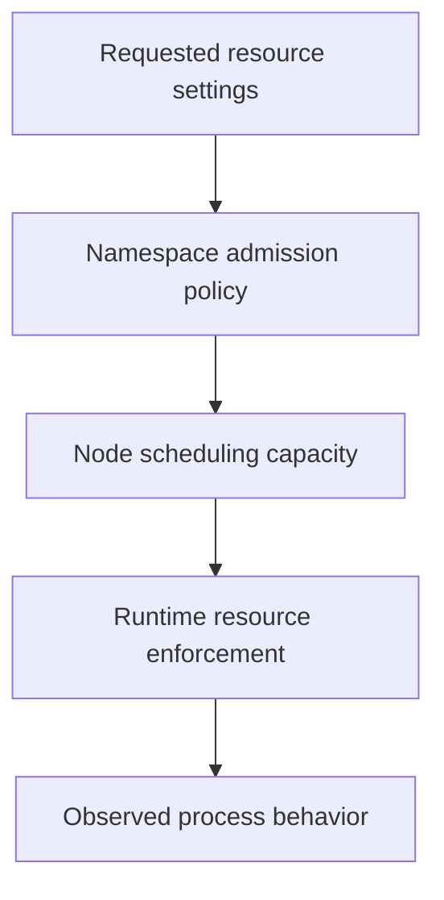

# Requests, Limits And Namespace Budgets

A Pod passes its namespace budget but cannot fit on any eligible node. Another Pod runs and then reaches a memory limit. Both concern resources, yet admission, placement and runtime enforcement require different corrections.

## Learning objectives

- Distinguish requests, limits, ResourceQuota and LimitRange.
- Classify resource failure by admission, scheduling or execution.
- Interpret the admitted values rather than assumed defaults.

## Before you start

Use a shell on your own machine with the module playground running. A Pod is Kubernetes's unit for running one or more containers together. The environment provides the `probe` Deployment, which maintains application Pods, and the `starfleet` namespace, which groups these objects.

Read-only commands below use kubectl, the Kubernetes command-line tool. Select the private kubeconfig: the file that identifies this environment's cluster and credentials. The commands do not change the application.

## Requests, Limits and Namespace Budgets

The `scout` container requests 250 millicores of central processing unit (CPU) capacity and 128 mebibytes of memory. One thousand millicores equal one CPU. A request expresses resource demand used for scheduling and resource allocation decisions. The scheduler compares requests with allocatable node capacity, not just the node's current measured utilization.

A limit constrains resource use at runtime. A CPU limit can lead to throttling: the process must wait for more permitted CPU time. A container that exceeds an enforced memory limit can be terminated because it ran out of permitted memory. A memory limit is not a guarantee that the application will be healthy at that size.

Requests and limits answer different questions. A low request can permit dense placement even when actual usage becomes much higher. A very large request can leave a Pod unscheduled despite apparently idle nodes. Accurate sizing requires measurements, the application's behavior and enough headroom for its workload.

A ResourceQuota limits aggregate resource consumption or object counts in a namespace. It can reject requests that would exceed the budget. A LimitRange sets defaults and constraints for individual resources, such as container requests and limits. Neither creates node capacity. A namespace that remains within quota can still contain an unschedulable Pod.

Consider a namespace budget that allows four CPUs, while every eligible node has less than one CPU left for new requests. A new two-CPU Pod may pass quota admission but remain Pending because no single eligible node fits it. Total free capacity spread across nodes cannot always satisfy one Pod's placement requirement.

Read resource failures by identifying the stage: quota rejection happens during API admission, insufficient capacity during scheduling, and limit enforcement during execution. The same word “resources” can describe three separate mechanisms.

## A Resource-Sizing Calculation

Assume a node reports four CPUs of allocatable capacity. Existing Pods request a total of 3.5 CPUs. A new Pod requests 750 millicores, equal to 0.75 CPU. Only 0.5 CPU remains in the requested-capacity calculation, so the new Pod does not fit that node even if the current CPU graph shows low activity.

Now compare a container requesting 250 millicores with a 500-millicore CPU limit. Its request contributes 0.25 CPU to placement calculations. Its limit constrains how much CPU time it may consume under the configured runtime enforcement. The gap is not free capacity reserved exclusively for that container, and actual behavior also depends on contention and system configuration.

Memory needs different reasoning. A process can increase its memory footprint until an enforced boundary causes termination. Giving a process more CPU time does not solve an excessive memory allocation. Likewise, setting a large memory limit without a realistic request can allow dense placement that later produces node pressure.

## Admission And Placement Are Separate Budgets

Suppose a ResourceQuota permits two more CPUs in a namespace. A new Pod requests one CPU and passes quota, but all eligible nodes are already committed. The namespace budget says the team may request that amount; it does not promise a place where the Pod fits. Conversely, spare nodes do not bypass an exhausted namespace quota.

A LimitRange can provide default requests and limits when they are omitted, and it can reject values outside allowed constraints. These defaults influence the final admitted object, so the effective values may differ from what a short source snippet appears to contain. Read the stored configuration before calculating placement demand.

The three stages are admission against namespace policy, scheduling against eligible node resources and execution under runtime limits. A clear answer identifies which boundary failed and what change would address it without discarding the application's actual needs.

## Inspect the mechanism

A request declares scheduling demand, while a limit constrains runtime usage under the supported resource semantics. A ResourceQuota limits namespace totals or object counts. A LimitRange can add defaults and per-container constraints. Neither namespace object supplies physical node capacity.

For the fixture, read the stored container resource fields before doing arithmetic. Central processing unit (CPU) quantities can use millicpu, where 1000m is one CPU unit. Memory suffixes such as Mi represent binary quantities. Current consumption is separate from both declarations. A low usage snapshot cannot override a request that is too large to schedule, and a larger request does not automatically raise an existing memory limit.



Resource checks act at distinct stages, so the same resource value can participate in different failures.

<!-- astrona:playground:renew -->

Select the private cluster connection and inspect the live state from your host shell:

```sh
export KUBECONFIG="$(astrona kubeconfig ats-029-playground-030-01)"
if test "$(kubectl config current-context)" = "kind-astro-ats-029-playground-030-01"; then
  kubectl -n starfleet get deployment probe -o jsonpath='{.spec.template.spec.containers[0].resources}{"\n"}'
  kubectl -n starfleet get resourcequotas,limitranges
  kubectl -n starfleet get pods -l app=probe
else
  printf "Select this module's private kubeconfig before continuing.\n" >&2
fi
```

Compare the admitted container requests and limits with any namespace policy. The initial namespace need not contain quota or LimitRange objects, so their absence is meaningful baseline state. These are declarations and status observations, not measured usage. A rejected resource request would require admission evidence; an accepted Pending Pod requires placement evidence.

You can now select the responsible resource boundary and explain its correction. Useful sizing still requires realistic workload measurements and the complete Pod population.

## Common pitfalls

> [!WARNING]
> Quotas do not reserve or create physical capacity. CPU throttling and memory termination are different consequences of runtime limits.
