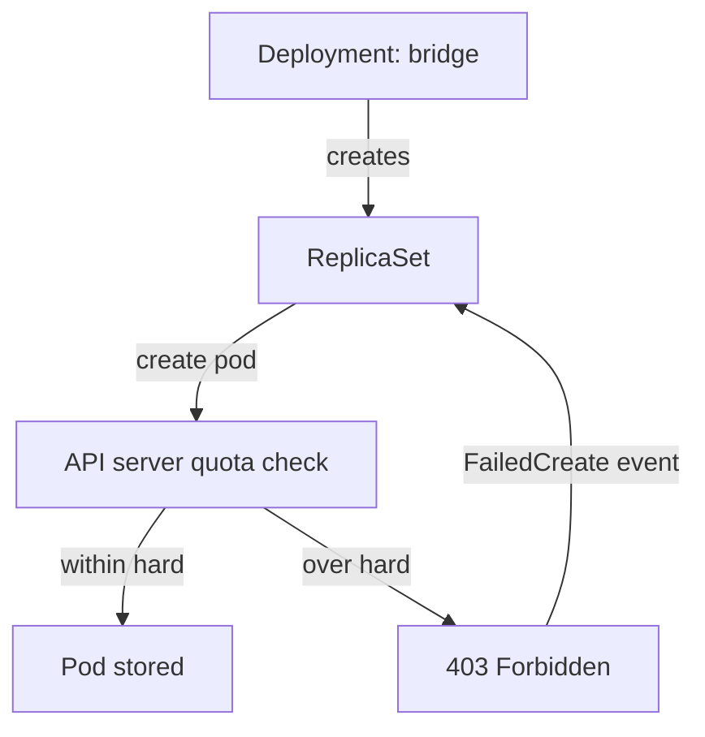

# Quota With Deployments And Changing A Quota

In daily work you rarely create pods by hand. You create a Deployment, and a controller creates the pods. That changes where a quota error shows up. The Deployment is accepted, nothing appears to fail, and the pods are simply missing. This part follows one Deployment through two quota errors, fixes each one, and then changes the quota itself to see what a changed limit does to running pods.

## Who creates the pod, and who refuses it

A Deployment does not create pods. It creates a ReplicaSet, and the ReplicaSet controller (inside `kube-controller-manager`) creates the pods. Each pod creation is a normal API request, so the quota admission plugin checks it. When the plugin refuses, the ReplicaSet controller receives the 403 error. It cannot change the Deployment that you created, so it records a warning event with the reason `FailedCreate` on the ReplicaSet and tries again later.



The diagram shows that the refusal comes back to the ReplicaSet, not to your `kubectl` command, so the message is in the ReplicaSet events.

## A Deployment that cannot create pods

Create a quota that is small enough to reach quickly. The three existing pods in `starfleet` request 30m CPU in total.

<!-- astrona:playground:renew -->

```sh
kubectl -n starfleet create quota ship-budget \
  --hard=requests.cpu=100m,requests.memory=256Mi,limits.memory=512Mi
kubectl -n starfleet create deployment bridge --image=ghcr.io/stefanprodan/podinfo:6.15.0 --replicas=2
```

Both commands succeed, because the quota checks pods and the second command created a Deployment. Look at what exists:

```sh
kubectl -n starfleet get deployment bridge
kubectl -n starfleet get deployment bridge -o jsonpath='{.status.conditions[?(@.type=="ReplicaFailure")].message}{"\n"}'
kubectl -n starfleet describe replicaset -l app=bridge
```

The Deployment shows 0 of 2 pods ready. The `ReplicaFailure` condition and the events of the ReplicaSet carry the message `failed quota: ship-budget: must specify`, followed by the resources the pod did not declare. The `bridge` pods declare nothing, and the quota controls CPU requests, memory requests and memory limits. Set all three on the container:

```sh
kubectl -n starfleet set resources deployment bridge --requests=cpu=20m,memory=32Mi --limits=memory=64Mi
kubectl -n starfleet rollout status deployment/bridge --timeout=180s
```

The command `kubectl set resources` edits the pod template, which starts a new ReplicaSet. Its pods declare all three values, so the quota admits them. Two pods now request 40m CPU, and the quota shows 70m of 100m used.

## A Deployment that runs out of quota

Now scale up. Each pod requests 20m, and only 30m remain.

```sh
kubectl -n starfleet scale deployment bridge --replicas=5
kubectl -n starfleet get deployment bridge
kubectl -n starfleet describe replicaset -l app=bridge
```

One more pod fits, because 90m is below 100m. The next pod would bring the total to 110m, so the Deployment stays at 3 ready pods out of 5. The ReplicaSet events now show `FailedCreate` with a message that starts `exceeded quota: ship-budget` and names `requests.cpu`. The two errors need different fixes. A `must specify` error means the pod template is incomplete. An `exceeded quota` error means the pod template is fine and the namespace is full, so either the quota grows or the demand shrinks.

## Change the quota

A quota is an ordinary object, so you can edit it. Raise the CPU request limit to 200m:

```sh
kubectl -n starfleet patch quota ship-budget --type merge -p '{"spec":{"hard":{"requests.cpu":"200m"}}}'
kubectl -n starfleet rollout status deployment/bridge --timeout=180s
```

You did not touch the Deployment. The ReplicaSet controller keeps retrying the failed creation, and the new limit now admits the missing pods, so the rollout finishes. The wait can last a short time because the controller retries after a delay.

The opposite change shows that a quota never removes pods. Lower the limit below the current use:

```sh
kubectl -n starfleet patch quota ship-budget --type merge -p '{"spec":{"hard":{"requests.cpu":"50m"}}}'
kubectl -n starfleet describe quota ship-budget
kubectl -n starfleet get pods -l app=bridge
```

The quota now shows more CPU in use than its hard value, and all five `bridge` pods keep running. The quota has only one effect: it refuses the next create or change that would add more. A pod that is deleted and recreated, for example during a rollout, has to fit again. Clean up:

```sh
kubectl -n starfleet delete deployment bridge
kubectl -n starfleet delete quota ship-budget
```

You now know where a quota error appears for a Deployment, how to tell the two error messages apart, and what a changed quota does to existing pods. The open question is how to avoid the `must specify` error for every workload, which is the job of defaults that the namespace itself supplies.

## Common pitfalls

> [!WARNING]
> - **Looking for the error on the Deployment.** `kubectl apply` succeeds. Read the ReplicaSet events or the `ReplicaFailure` condition.
> - **Fixing `must specify` by raising the quota.** The pod template lacks values. A larger quota does not help.
> - **Fixing `exceeded quota` by editing the pod template.** If the template is complete, only a larger quota or a lower request helps.
> - **Lowering a quota to remove pods.** Existing pods stay. Scale or delete the workload to free the quota.
