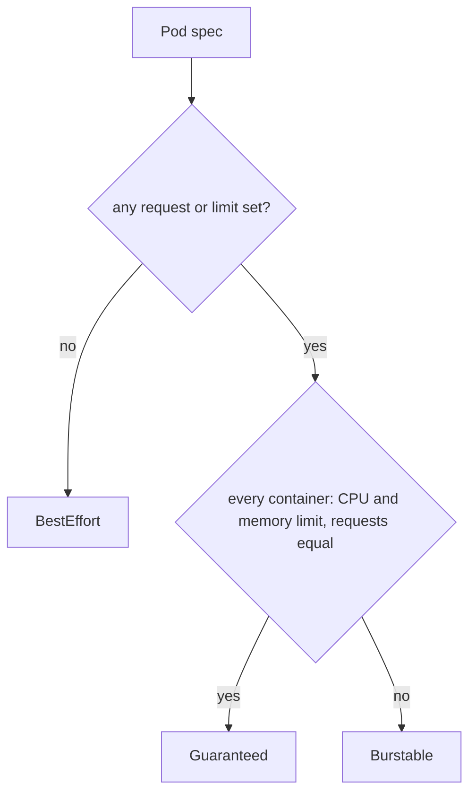

# QoS Classes

Two pods on the same node can ask for very different things. One states exactly how much memory and CPU it needs and promises not to go beyond it. Another states nothing at all. When the node runs short of memory, the cluster must stop one of them, and it needs a rule that does not depend on guessing. The rule is the quality of service (QoS) class, a label that the API server computes from the resources in the pod specification and stores in the pod status. This part shows how the three classes are computed and how to produce each one.

## The three classes

The API server assigns the class when it creates the pod, and the class never changes for that pod. The decision uses only the requests and limits for central processing unit (CPU) and memory, and it looks at every container, including init containers.



The diagram shows that a pod is `BestEffort` only when no container sets anything, and `Guaranteed` only when every container is fully specified with requests equal to limits.

- `Guaranteed`: every container has a CPU limit and a memory limit, and the request of each equals its limit. A container that sets only limits also qualifies, because the API server copies the limit into the missing request.
- `Burstable`: at least one container sets a request or a limit, and the pod does not meet the `Guaranteed` rule. This is the most common class.
- `BestEffort`: no container in the pod sets any request or limit.

A pod that sets memory requests equal to limits but no CPU values is `Burstable`, because the rule needs CPU and memory in every container. The same is true when one of two containers sets nothing.

## Create one pod of each class

The `starfleet` namespace has no LimitRange, so a pod keeps exactly the values you write. Save this as `pods-qos.yaml`. It holds three pods in one file, separated by `---`:

<!-- astrona:playground:renew -->

```yaml
apiVersion: v1
kind: Pod
metadata:
  name: qos-guaranteed
  namespace: starfleet
spec:
  containers:
  - name: main
    image: curlimages/curl:8.22.0
    command: ["sh", "-c", "sleep 3600"]
    resources:
      requests:
        cpu: 50m
        memory: 32Mi
      limits:
        cpu: 50m
        memory: 32Mi
---
apiVersion: v1
kind: Pod
metadata:
  name: qos-burstable
  namespace: starfleet
spec:
  containers:
  - name: main
    image: curlimages/curl:8.22.0
    command: ["sh", "-c", "sleep 3600"]
    resources:
      requests:
        cpu: 50m
        memory: 32Mi
      limits:
        memory: 64Mi
---
apiVersion: v1
kind: Pod
metadata:
  name: qos-besteffort
  namespace: starfleet
spec:
  containers:
  - name: main
    image: curlimages/curl:8.22.0
    command: ["sh", "-c", "sleep 3600"]
```

Apply it:

```sh
kubectl apply -f pods-qos.yaml
```

Then check the result. The class is a field of the pod status, so you can read it even before the pods are running:

```sh
kubectl -n starfleet get pods -o custom-columns='NAME:.metadata.name,QOS:.status.qosClass'
```

The three new pods show `Guaranteed`, `Burstable` and `BestEffort`. The pods `scout`, `probe` and `shuttle` show `Burstable`, because each has a CPU request but no CPU limit. The `kubectl describe pod` command prints the same value on the line `QoS Class`.

## Make a Deployment produce a class

You rarely write a bare pod. The class comes from the pod template of the workload, so you change the template. The `probe` Deployment is `Burstable` now. Set equal requests and limits on its container, which makes it `Guaranteed`:

```sh
kubectl -n starfleet set resources deployment probe --requests=cpu=50m,memory=64Mi --limits=cpu=50m,memory=64Mi
kubectl -n starfleet rollout status deployment/probe --timeout=120s
kubectl -n starfleet get pods -l app=probe -o custom-columns='NAME:.metadata.name,QOS:.status.qosClass'
```

The change to the template starts a rolling update. The new pod is `Guaranteed`, and the old pod is deleted after the new one is ready. The old pod keeps its old class until it is gone, because the class of a pod does not change.

## What the class controls

The class has two effects on the node. The first is the order of eviction when the node runs short of memory: the kubelet (the agent on each node that runs the pods) stops pods of lower classes first, and a later part walks through that order. The second is the OOM score, a number between -1000 and 1000 that the Linux kernel reads when it must kill a process to recover memory. The kubelet sets a score of -997 for `Guaranteed` containers and 1000 for `BestEffort` containers, and a value between 2 and 999 for `Burstable` containers that depends on the share of node memory they request. A higher score means the process is killed earlier.

The class does not change how the scheduler places the pod. The scheduler uses the requests, not the class. It also does not change how much CPU or memory the container may use: the limits do that.

Delete the three pods. The `probe` Deployment keeps its new template:

```sh
kubectl -n starfleet delete pod qos-guaranteed qos-burstable qos-besteffort
```

You now know the three classes, how to read them with `kubectl`, and how a pod template produces each one. The next question is what happens when a container uses more than its limit, which depends on whether the resource is CPU or memory.

## Common pitfalls

> [!WARNING]
> - **Thinking equal memory is enough.** `Guaranteed` needs CPU and memory, requests and limits, in every container. One missing CPU limit makes the pod `Burstable`.
> - **Editing a running pod to change its class.** The class is fixed at creation. Change the Deployment template and let new pods replace the old ones.
> - **Forgetting init containers and sidecars.** The class is computed over all containers. A sidecar with no resources keeps the pod from being `Guaranteed`.
> - **Assuming the class limits usage.** The class orders eviction and kill decisions. Only limits cap usage.
