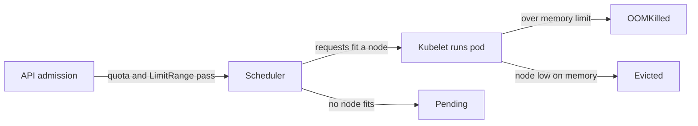

# Scheduling, Pending And Eviction

A pod can pass every namespace policy and still never run. Another pod can run for days and then be stopped, although it never exceeded a limit. Both failures come from the node and not from the namespace. The scheduler decides where a pod may start, and the kubelet decides which pods to stop when a node runs short. This part follows the requests through both decisions, and ends with a table that maps each symptom to the stage that caused it.

## How the scheduler uses requests

The scheduler (`kube-scheduler`) is the control plane component that picks a node for every new pod. It does not look at current use. It adds up the requests of the pods that are already assigned to a node and checks whether the new pod's requests fit in what is left of the node's allocatable resources.

Allocatable is the part of a node's capacity that is available to pods. It equals the capacity minus the resources reserved for the operating system and the Kubernetes components, and minus the eviction threshold. The request of a pod is the sum of the requests of its containers. If the pod has init containers, the largest init container request counts when it is larger than that sum.



The diagram shows the three stages in order and the failure that belongs to each one: a quota or range error at admission, `Pending` at scheduling, and `OOMKilled` or `Evicted` on the node.

## Read the node's numbers

The allocatable values and the sum of requests are visible with `kubectl`. Read them before you size a pod:

<!-- astrona:playground:renew -->

```sh
kubectl get nodes -o jsonpath='{.items[0].status.allocatable}{"\n"}'
kubectl describe nodes | grep -A 9 'Allocated resources'
```

The first command prints the allocatable CPU, memory, ephemeral storage and the maximum number of pods. The second prints a table of the requests and limits already assigned to the node, as numbers and as percentages of allocatable. The requests column is the one the scheduler uses. A node can show a low percentage of requests and still be busy, or a high percentage and be idle, because requests are declarations.

## Make a pod Pending

Ask for more CPU than any node has. A request of 1000 CPUs is larger than the node in the playground. Save this as `pod-too-large.yaml`:

```yaml
apiVersion: v1
kind: Pod
metadata:
  name: too-large
  namespace: starfleet
spec:
  containers:
  - name: main
    image: curlimages/curl:8.22.0
    command: ["sh", "-c", "sleep 3600"]
    resources:
      requests:
        cpu: "1000"
        memory: 64Mi
```

Apply it:

```sh
kubectl apply -f pod-too-large.yaml
```

Then check the result:

```sh
kubectl -n starfleet get pod too-large
kubectl -n starfleet describe pod too-large
kubectl -n starfleet get events --field-selector reason=FailedScheduling
```

The API server accepts the pod, because no quota or range forbids it. The pod stays in the phase `Pending`. In the events at the end of `describe pod`, the scheduler records a warning with the reason `FailedScheduling`. The message says how many nodes were checked and why each one failed, and for this pod it contains `Insufficient cpu`. A memory shortage reads `Insufficient memory`. Other causes use other texts, such as a node taint that the pod does not tolerate or a node selector that no node matches, so read the words after the node count.

A `Pending` pod with `FailedScheduling` needs a smaller request, a bigger node, or room made by removing other pods. It does not need a larger quota. Replace the pod with a request that fits:

```sh
kubectl -n starfleet delete pod too-large
kubectl -n starfleet run fits --image=curlimages/curl:8.22.0 --command -- sleep 3600
kubectl -n starfleet get pod fits
```

The pod `fits` has no requests, so the scheduler places it on the node, and its status becomes `Running` after the image starts. Delete it when you are done:

```sh
kubectl -n starfleet delete pod fits
```

## Eviction under node pressure

The kubelet watches the memory, the disk and the process identifiers of its node. When a signal falls below a threshold, the node is under pressure, and the kubelet evicts pods. Eviction means that the kubelet stops the pod's containers and sets the pod to the phase `Failed` with the reason `Evicted`. By default the kubelet starts evicting when the available memory falls below 100Mi. An evicted pod that a Deployment manages is replaced by a new pod, which the scheduler places on a node that has room.

The kubelet picks pods in this order:

1. Pods whose memory use is above their request come first. A `BestEffort` pod has no request, so it is always above it.
2. Among those pods, the lower pod priority is evicted first. Priority is the number that a PriorityClass gives a pod.
3. Among pods of equal priority, the pod with the largest memory use above its request goes first.

Pods that use less memory than they requested are evicted last. A `Guaranteed` pod, whose request equals its limit and whose use cannot exceed it, is almost never above its request, so it is the last to go. This is the practical value of a QoS class: the same node pressure removes the unspecified pods first.

Eviction differs from an OOM kill. The kubelet evicts a whole pod on purpose to protect the node, and it does so before the node runs out of memory. The kernel OOM killer acts when memory is already exhausted, either in one container's cgroup or on the whole node, and it ends one process.

## Which stage failed

Use the symptom to find the stage before you change anything:

| Symptom | Stage | Where to read the cause |
| --- | --- | --- |
| `Forbidden` when you create the object | Admission | The error text: `exceeded quota`, `must specify`, `maximum cpu usage` |
| A Deployment has fewer pods than it should | Admission, through the controller | The ReplicaSet events |
| The pod is `Pending` | Scheduling | `kubectl describe pod`, the `FailedScheduling` event |
| The pod shows `OOMKilled` or `CrashLoopBackOff` | Runtime | `lastState.terminated.reason` and the exit code |
| The application is slow but healthy | Runtime | The CPU limit and the throttling counters |
| The pod status shows `Evicted` | Node pressure | The pod status message and the node conditions |

You now know that the scheduler places pods by requests and that a pod can stay `Pending` for a reason that no namespace policy explains. You also know the order in which the kubelet evicts pods, and how to find the failing stage from the symptom.

## Common pitfalls

> [!WARNING]
> - **Raising a quota to fix `Pending`.** `FailedScheduling` is a node capacity problem. A quota only limits admission.
> - **Sizing a request from current use.** The scheduler uses requests. Measure the real peaks first, then set requests close to normal use and limits above the peaks.
> - **Expecting an evicted pod to come back by itself.** A bare pod stays `Failed`. A Deployment creates a replacement.
> - **Confusing eviction with an OOM kill.** An evicted pod has the reason `Evicted` in its status. An OOM-killed container has `OOMKilled` in the container state and restarts inside the same pod.
