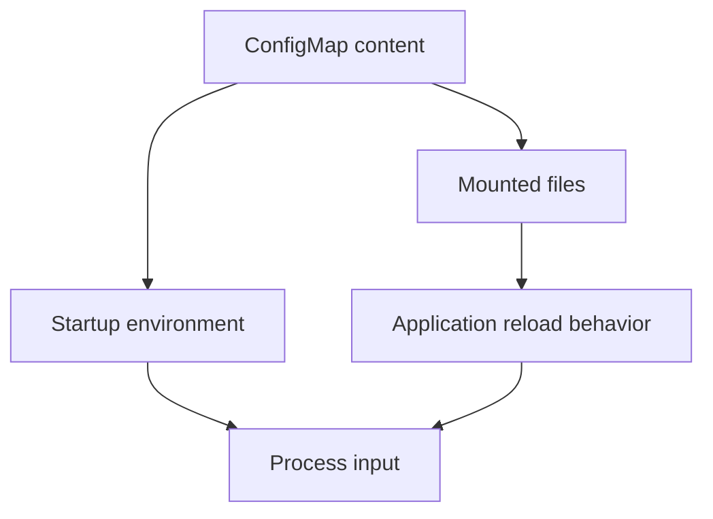

# ConfigMaps, Secrets And Configuration Delivery

A ConfigMap changes, but the running process keeps its startup environment value. The object was updated successfully; adoption did not occur through that delivery method. Configuration maintenance needs both delivery and consumption to be explained.

## Learning objectives

- Compare environment-variable and mounted-file delivery.
- Explain why a configuration update may require restart or reload.
- Trace an object reference into the consumer's effective input.

## Before you start

Use a shell on your own machine with the module playground running. A Pod is Kubernetes's unit for running one or more containers together. The environment provides the `probe` Deployment, which maintains application Pods, and the `starfleet` namespace, which groups these objects.

Read-only commands below use kubectl, the Kubernetes command-line tool. Select the private kubeconfig: the file that identifies this environment's cluster and credentials. The commands do not change the application.

## ConfigMaps, Secrets and Configuration Delivery

The `scout` application uses a non-sensitive log level and a sensitive database password. A ConfigMap stores configuration data that is not intended to be secret. A Secret is a Kubernetes resource for sensitive data. Keeping both outside the image lets the same application artifact run with different deployment settings.

A Pod can receive values through environment variables or files mounted from a volume. Environment variables are set when the container starts; updating the source object does not rewrite the environment of that running process. Mounted configuration files can receive updates after a delay, but the application must notice or reload them. A mount using `subPath` does not receive those automatic volume updates.

A Secret's base64 representation is an encoding, not encryption. Access control, encryption at rest and careful application behavior are separate protections. A person allowed to read a Secret can obtain its contents, and a process can accidentally expose a password by writing it to logs. The resource type alone does not make all handling safe.

Configuration needs a lifecycle plan. If an application only reads a file during startup, changing the ConfigMap requires a restart or rollout to activate the new value. If it supports reload, verify that the reload occurred. For password rotation, consider when the external database begins accepting the new value and when clients stop using the old one.

Suppose the log level changes but the application keeps its previous verbosity. First identify whether it reads an environment variable, a mounted file or a cached value. The correct explanation depends on how the data reaches the process, not just on whether the Kubernetes object was updated.

## Configuration As A Process Input

Imagine `scout` reads a log level at startup and checks a configuration file for a feature setting during each request. Updating the ConfigMap can affect these two settings differently. The startup environment remains the same until a new process receives different values. A supported mounted-file update can become visible later, but only the application logic determines when the new setting is used.

A file update is therefore only one stage. Delivery changes the mounted data; adoption changes the application's effective behavior. An application that reads once and caches the result needs an explicit reload or restart even if its file changed correctly. An application that watches files needs to handle the update mechanism and avoid reading inconsistent intermediate state.

Separating configuration from an image supports reuse, but it also creates a compatibility contract. Version two may require a new key that version one never used. A rollout containing both versions can need settings valid for both. A missing required key should produce a clear error rather than a silently unsafe default.

## Rotating Sensitive Values

For a database password, identify the issuer, the stored Secret, the delivery method and each consumer. If the database stops accepting the old password before all clients adopt the new one, requests can fail. If the old password remains valid forever, rotation has not removed its exposure.

Environment-based consumers generally need new containers to receive new values. File-based consumers may need application reload. In both cases, readiness and representative requests should confirm that consumers can use the updated credential. Avoid logging the password as proof of adoption; verify authentication behavior without exposing the secret.

A Secret also needs protections beyond its resource name. Read access can reveal the credential, container access can expose mounted files and diagnostic bundles can copy them unintentionally. Handle sensitivity through permissions, storage encryption and application behavior, while preserving a clear plan for how updates become effective.

## Inspect the mechanism

The fixture mounts its application code from `probe-code`. A ConfigMap is an object for non-confidential configuration data. A volume supplies that data as files, while an environment reference supplies values when the container starts. These delivery paths have different update behavior.

Updating a normal ConfigMap volume can change files after propagation delay, but the application decides whether to reread them. A process started with an environment value retains it until it is replaced or changes it itself. A `subPath` file mount has another limitation: it does not receive the normal ConfigMap volume updates. Identify the precise mount and application behavior before choosing reload or replacement.



A stored change becomes effective only through its delivery and application consumption paths.

<!-- astrona:playground:renew -->

Select the private cluster connection and inspect the live state from your host shell:

```sh
export KUBECONFIG="$(astrona kubeconfig ats-029-playground-040-01)"
if test "$(kubectl config current-context)" = "kind-astro-ats-029-playground-040-01"; then
  kubectl -n starfleet get deployment probe -o jsonpath='{.spec.template.spec.containers[0].env}{"\n"}{.spec.template.spec.containers[0].volumeMounts}{"\n"}{.spec.template.spec.volumes}{"\n"}'
  kubectl -n starfleet get configmaps
else
  printf "Select this module's private kubeconfig before continuing.\n" >&2
fi
```

Find which object each volume references and where the container mounts it. Do not assume every ConfigMap in the namespace is consumed. Reading references does not disclose application Secrets. The result describes delivery intent, while observing the application's behavior establishes whether it adopted a changed value.

You can now explain why object update success and process adoption differ. A configuration change needs an explicit refresh plan and behavior check that fit its consumer.

## Common pitfalls

> [!WARNING]
> Updating a ConfigMap or Secret does not automatically replace environment variables in running containers. Base64 data in a Secret is not encrypted merely because it is encoded.
