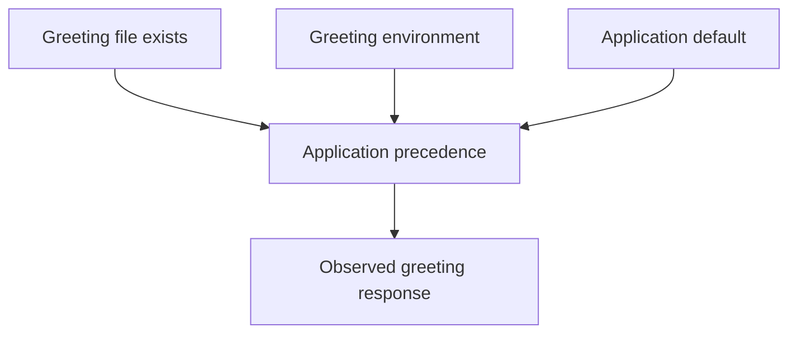

# Configuration, Dependencies And Request Failures

The `probe` greeting remains unchanged after a configuration edit because the process reads a different source. The request succeeds, but it exposes the wrong effective value. Trace precedence and delivery before treating every configuration problem as a startup failure.

## Learning objectives

- Distinguish stored configuration from effective request behavior.
- Explain the fixture's file-over-environment precedence.
- Verify a correction through the original request operation.

## Before you start

Use a shell on your own machine with the module playground running. A Pod is Kubernetes's unit for running one or more containers together. The environment provides the `probe` Deployment, which maintains application Pods, and the `starfleet` namespace, which groups these objects.

Read-only commands below use kubectl, the Kubernetes command-line tool. Select the private kubeconfig: the file that identifies this environment's cluster and credentials. The commands do not change the application.

## Configuration, Dependencies and Request Failures

The `scout` Pod is Running and Ready, but some requests return server errors. Process health does not prove that every application operation works. A request can fail in input validation, internal logic, authentication, a downstream connection or response handling.

Trace a representative failing request from the affected caller. Record its method, route, relevant non-sensitive inputs, timing and correlation identifier. A correlation identifier connects related records across components. A distributed trace can add the request's timed operations across services when the system is instrumented for it.

Configuration must match what the process actually received. An environment variable may still contain the value from container startup after its source object changed. A mounted file can update while an application keeps a cached value. Inspect the effective input and reload behavior rather than only the latest ConfigMap or Secret record.

Dependencies add separate failure modes. A connection refusal can indicate the wrong listener or destination. A timeout may indicate unreachable networking or a slow dependency. An authentication rejection can mean the service was reached successfully but did not accept the credentials. These observations support different corrections.

An HTTP status code gives a category of response, not a complete diagnosis. A server error can originate in the application or a proxy; a successful transport connection does not identify which component produced the final result. Compare response evidence with application and intermediary records.

Reproduce safely with the smallest input that still demonstrates the problem. Correct one supported cause, then repeat the same operation and verify related behavior. A success from a different caller or path may miss the original permission, configuration or data condition.

## A Request-Level Diagnostic Example

A client sends a report creation request and receives an error. The gateway record shows the request arrived; the application record shows authentication succeeded; a downstream record shows the database rejected the operation. This sequence narrows the failure beyond network connection and user authentication. The application reached a dependency whose own credentials or permission contract failed.

Now compare a timeout before any application record appears. The gateway may have failed to connect to a backend, or collection may be missing. The absence of one log is not enough to identify the cause. Combine endpoint and connection evidence with the telemetry path before concluding that the request never arrived.

A request identifier helps relate records, but it must propagate correctly and be distinguishable across attempts. A retry can create another timed operation even when it belongs to the same logical work. Traces can connect these operations, while logs provide detailed errors where recorded.

## Effective Inputs And Safe Reproduction

The stored ConfigMap may show a valid address while the process still uses an old environment value. A Secret may have rotated while the database accepts only the replacement and the running consumer still uses the previous credential. Inspect the consumer's update mechanism rather than treating the current source record as the complete runtime state.

Reproduction should retain the failing caller's permissions, meaningful input and relevant dependency versions. Use a controlled data case that does not trigger unwanted production side effects. For a write request, distinguish a safe repeated test from an operation that creates another transaction.

After a correction, repeat the representative operation and verify both its response and intended external effect. A successful response can still conceal a missing durable result; a timeout can still follow a completed effect. Application-level debugging needs the operation's contract, not only the transport status.

## Inspect the mechanism

This application reads `/settings/greeting` when the file exists; otherwise it uses `GREETING` or a default. That order comes from its code. Kubernetes delivers sources but does not impose one universal precedence across every application's files and environment variables.

Two ConfigMaps with correct-looking values can therefore yield the same unintended response if neither is referenced at the required path. Likewise, a referenced file can update while an application that caches startup values remains unchanged. Compare reference, visible delivery and application adoption as separate facts. A valid ConfigMap object alone proves none of the later facts.



The response reflects the source chosen by application logic, not merely the newest stored object.

<!-- astrona:playground:renew -->

Select the private cluster connection and inspect the live state from your host shell:

```sh
export KUBECONFIG="$(astrona kubeconfig ats-029-playground-040-01)"
if test "$(kubectl config current-context)" = "kind-astro-ats-029-playground-040-01"; then
  kubectl -n starfleet get deployment probe -o jsonpath='{.spec.template.spec.containers[0].env}{"\n"}{.spec.template.spec.containers[0].volumeMounts}{"\n"}'
  kubectl -n starfleet get configmaps
else
  printf "Select this module's private kubeconfig before continuing.\n" >&2
fi
```

Inspect the actual environment and mounts. The baseline has no settings mount until the practice creates one, so a missing greeting file does not indicate failed ConfigMap propagation. A later response comparison must use the intended caller and path. These commands read declared inputs without dumping confidential values or changing the consumer.

You can now diagnose stale or unexpected settings through the actual consumer contract. Verify adoption using the original operation, rather than assuming a successful configuration write repaired request behavior.

## Common pitfalls

> [!WARNING]
> Running and Ready do not prove every operation succeeds. Verify effective configuration and the original caller's request rather than only the source configuration object.
