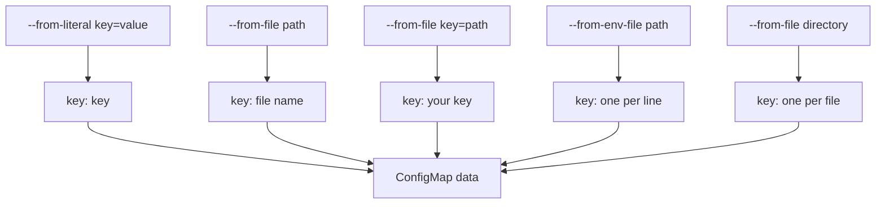

# Creating ConfigMaps From Literals, Files And Directories

An application needs settings such as a log level, a region name or a whole configuration file. If you build those into the container image, you must build a new image for every change. A ConfigMap keeps the settings in the cluster instead, and `kubectl create configmap` turns values, files or directories into that object. This part shows the four ways to give it a source and the keys each one produces.

## One ConfigMap, many keys

A **ConfigMap** is a namespaced Kubernetes object with a `data` field: a map of string keys to string values. The **key** is the name a pod uses to ask for one value. The **value** is the text itself, which can be one word or a whole file. The Kubernetes API server stores the object in etcd, the cluster database, and the kubelet (the agent on each node) reads it when a pod needs it.

The `kubectl create configmap` command builds the object for you. It needs a name and at least one source. Every source flag decides two things: where the value comes from and what the key is called.

## Literals: `--from-literal`

The simplest source is a literal. You write `key=value` in the command. Each `--from-literal` flag adds one key.

The commands in this part use the `starfleet` namespace. Create a ConfigMap for the `scout` application with two literal keys:

<!-- astrona:playground:renew -->

```sh
kubectl -n starfleet create configmap scout-literals --from-literal=LOG_LEVEL=debug --from-literal=REGION=outpost-7
```

You should see:

```text
configmap/scout-literals created
```

Print only the `data` field:

```sh
kubectl -n starfleet get configmap scout-literals -o jsonpath='{.data}'
```

The output is a JSON object with the two keys `LOG_LEVEL` and `REGION`. The key is exactly the text before the first `=`, and the value is everything after it. If a value contains spaces, put quotes around the whole `key=value` argument for your shell.

## Files: `--from-file`

A second source is a file. This is the right choice when the application reads a configuration file such as `app.properties` or `nginx.conf`. With `--from-file=PATH`, the key is the file name without its directory, and the value is the whole content of the file.

Save this as `scout.properties`:

```properties
retries=3
region=outpost-7
```

Create a ConfigMap from it:

```sh
kubectl -n starfleet create configmap scout-file --from-file=scout.properties
```

Check the key name:

```sh
kubectl -n starfleet get configmap scout-file -o jsonpath='{.data}'
```

You will see one key called `scout.properties`, and its value holds the two lines of the file. The key is the file name, including the dot. A pod that mounts this ConfigMap as a volume gets a file with exactly that name.

Sometimes the file name on your machine is not the name the application expects. Use `--from-file=KEY=PATH` to choose the key. The next command stores the same file under the key `app.properties`:

```sh
kubectl -n starfleet create configmap scout-file-key --from-file=app.properties=scout.properties
```

```sh
kubectl -n starfleet get configmap scout-file-key -o jsonpath='{.data}'
```

The only key is now `app.properties`. The content is the same; only the key changed. Choosing the key here is far easier than renaming it later, because a pod that asks for `app.properties` fails if the key is called `scout.properties`.

## Environment files: `--from-env-file`

Many tools read settings from an environment file, a text file with one `NAME=value` per line. The `--from-env-file=PATH` flag reads such a file and creates one key for each line. This is different from `--from-file`: the file is not stored as one value. Each line becomes its own key.

Save this as `scout.env`:

```text
# settings for the scout application
MODE=fast

RETRIES=3
```

Create the ConfigMap:

```sh
kubectl -n starfleet create configmap scout-env --from-env-file=scout.env
```

```sh
kubectl -n starfleet get configmap scout-env -o jsonpath='{.data}'
```

The ConfigMap has two keys, `MODE` and `RETRIES`. The comment line that starts with `#` and the empty line do not become keys. The file name `scout.env` does not appear anywhere in the object. Use this form when the application wants separate environment variables, because each key can then become one variable. You cannot combine `--from-env-file` with `--from-file` or `--from-literal` in the same command.

## Directories: `--from-file` with a directory

When you give `--from-file` a directory, kubectl creates one key for every regular file directly inside it. The key is the file name and the value is the content. It does not enter subdirectories, and it skips anything that is not a regular file.

Create a directory with two files by saving each of these files. Save this as `conf.d/banner.txt` (create the `conf.d` directory first with `mkdir conf.d`):

```text
scout online
```

Save this as `conf.d/limits.conf`:

```text
max_connections=20
```

Create the ConfigMap from the directory:

```sh
kubectl -n starfleet create configmap scout-dir --from-file=conf.d
```

```sh
kubectl -n starfleet get configmap scout-dir -o name
kubectl -n starfleet describe configmap scout-dir
```

The first command prints `configmap/scout-dir`. The `describe` output lists the keys `banner.txt` and `limits.conf` and shows each value. You can repeat `--from-file` and mix files, directories and literals in one command, as long as you do not use `--from-env-file`.

## Valid key names and what a key becomes

Not every text works as a key. A ConfigMap key may contain only letters, digits, a dash (`-`), an underscore (`_`) and a dot (`.`). It must not be `.` or `..`, and it must not be empty. A key such as `my key` or `app/config` is rejected by the API server.

The key name matters later. When a pod mounts the ConfigMap as a volume, each key becomes a file name. When a pod turns keys into environment variables, a key such as `app.properties` or `log-level` is not a clean variable name, so shells and many programs cannot use it. For environment variables, write keys in uppercase with underscores, like `LOG_LEVEL`. For files, use the real file name, like `nginx.conf`.



The diagram shows that all five source forms end in the same `data` map; only the way the keys are named differs.

## Preview with a client-side dry run

Creating a wrong ConfigMap costs time, because `kubectl create` fails if the name already exists. A dry run shows the object without sending it to the cluster. With `--dry-run=client`, kubectl builds the object on your machine, and `-o yaml` prints it.

```sh
kubectl -n starfleet create configmap scout-preview --from-literal=MODE=slow --from-literal=REGION=drifter-1 --dry-run=client -o yaml
```

The output is a ConfigMap YAML with `apiVersion: v1`, `kind: ConfigMap`, a `data` map holding `MODE` and `REGION`, and the name and namespace. Nothing is created. You can confirm this:

```sh
kubectl -n starfleet get configmap scout-preview
```

The cluster answers with a `NotFound` error. Save the YAML into a file and edit it, or pipe it into `kubectl apply -f -` to create or update the object in one step. That pattern is the usual way to change a ConfigMap that already exists, because `create` refuses to overwrite it.

You now know how to create a ConfigMap from five kinds of sources and how each one names its keys. The open question is what the API server does with files that are not text, how large a ConfigMap can be, and how to stop anyone from changing one.

## Common pitfalls

> [!WARNING]
> - **Expecting the key to be the path.** `--from-file=conf.d/banner.txt` creates the key `banner.txt`, not `conf.d/banner.txt`.
> - **Using `--from-file` when you wanted one key per line.** `--from-file` stores the whole file under one key. Use `--from-env-file` for one key per `NAME=value` line.
> - **Putting a comment or quotes in an environment file and expecting them to be processed.** Comment lines and blank lines are skipped, but write values plain, without quotes.
> - **Using `create` on an existing name.** The command fails with `AlreadyExists`. Use `--dry-run=client -o yaml` with `kubectl apply -f -` to update.
> - **Choosing a key with a slash or a space.** The API server rejects it. Use letters, digits, `-`, `_` and `.`.
