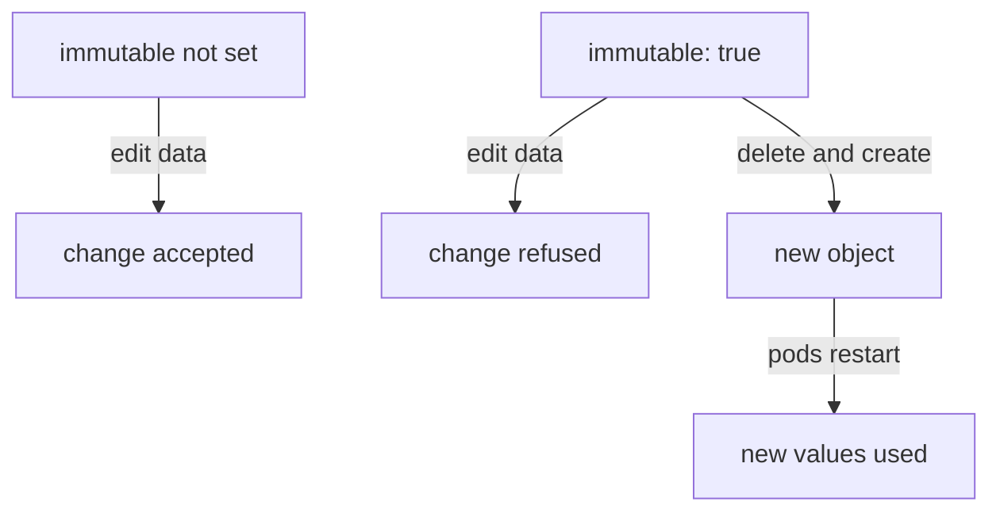

# Data, Binary Data, Limits And Immutability

A ConfigMap looks like a plain list of keys, but it has rules. It stores text in one field and bytes in another, it has a hard size limit, and it can be locked so that nobody can change it. These rules decide what you can put in a ConfigMap and how you change it later. This part explains them and the commands you use to inspect, edit and replace an object that already exists.

## Write a ConfigMap as YAML

The `kubectl create` command is quick, but a ConfigMap is often kept as a YAML file in a repository. The object has the same shape every time: `apiVersion: v1`, `kind: ConfigMap`, a name and a `data` map.

Save this as `configmap-probe-settings.yaml`:

```yaml
apiVersion: v1
kind: ConfigMap
metadata:
  name: probe-settings
  namespace: starfleet
data:
  LOG_LEVEL: info
  probe.conf: |
    interval=10
    timeout=2
```

Apply it:

<!-- astrona:playground:renew -->

```sh
kubectl apply -f configmap-probe-settings.yaml
```

Then check the keys:

```sh
kubectl -n starfleet get configmap probe-settings -o jsonpath='{.data}'
```

The `LOG_LEVEL` value is one word. The `probe.conf` value uses the YAML block marker `|`, which keeps the line breaks, so the value is a two-line file. This is how you write a configuration file inside a ConfigMap without a separate source file.

## The `data` field and the `binaryData` field

A ConfigMap has two fields for content. The `data` field holds UTF-8 text, which is normal readable text. The `binaryData` field holds bytes that are not valid text, such as a small certificate in binary form or a compressed file. In YAML, the values in `binaryData` are written in base64, a text encoding for bytes.

You do not need to choose by hand when you use `kubectl create`. If a file given to `--from-file` is not valid UTF-8, kubectl stores it in `binaryData`. Text files go to `data`. Create a small binary file and a ConfigMap from it:

```sh
head -c 16 /dev/urandom > blob.bin
kubectl -n starfleet create configmap probe-binary --from-file=blob.bin
```

Look at where the key landed:

```sh
kubectl -n starfleet get configmap probe-binary -o jsonpath='{.binaryData}'
```

You will see the key `blob.bin` with a base64 value. The `data` field is empty or missing. Random bytes are almost never valid UTF-8, which is why the key went to `binaryData`. One rule never changes: a key must be unique across both fields. The same key name cannot exist in `data` and in `binaryData`.

When a pod mounts the ConfigMap as a volume, the kubelet writes the bytes of both fields as files. A pod that reads the file sees the original bytes, not the base64 text.

## The size limit

A ConfigMap is stored as a single object in etcd, and the whole object must be smaller than 1 MiB (one mebibyte, 1,048,576 bytes). The total of all keys and values counts. The limit exists because etcd and the API server are not built to move large objects around.

If you try to create a ConfigMap that is too large, the API server refuses it with an error that says the object is too long. The fix is never to compress or split by hand. Large files such as machine learning models or big data sets belong in a volume, an image or an object store, not in a ConfigMap. Keep ConfigMaps for small settings and small configuration files.

## The `immutable` field

A ConfigMap normally changes at any time, and running pods can see the change. Sometimes that is a danger: one wrong edit can break every pod that mounts it. Setting `immutable: true` locks the object.

Save this as `configmap-probe-locked.yaml`:

```yaml
apiVersion: v1
kind: ConfigMap
metadata:
  name: probe-locked
  namespace: starfleet
immutable: true
data:
  LOG_LEVEL: warn
```

Apply it:

```sh
kubectl apply -f configmap-probe-locked.yaml
```

Now try to change the value with a server-side dry run, so nothing is stored even if it would work:

```sh
kubectl -n starfleet patch configmap probe-locked --dry-run=server -p '{"data":{"LOG_LEVEL":"debug"}}'
```

The API server refuses the change. The error says that the `data` field is immutable when `immutable` is set. You cannot change `data` or `binaryData`, and you cannot set `immutable` back to `false`. The only way to change the content is to delete the ConfigMap and create it again, and then restart the pods that use it, because the kubelet does not watch an immutable ConfigMap for changes.

That second effect is the benefit. The kubelet stops watching immutable ConfigMaps, so the API server has less work in a large cluster. It also gives you a safe pattern: create a new ConfigMap with a new name, such as `probe-settings-v2`, point the Deployment at it and let the rollout replace the pods.



The diagram shows that an immutable ConfigMap changes only through a new object and a pod restart.

## Inspect, edit and replace

Four commands cover most daily work with an existing ConfigMap. Use `kubectl get configmap NAME -o yaml` to see the full object, including `data`, `binaryData` and `immutable`. Use `kubectl describe configmap NAME` for a readable view of the keys and values, with a section called `BinaryData` that lists binary keys by size only.

To change a mutable ConfigMap, run `kubectl edit configmap NAME`. It opens the object in your editor and sends the result to the API server when you save. If you keep the YAML in a file, edit the file and run `kubectl replace -f FILE`, which replaces the whole object with the file, or `kubectl apply -f FILE`, which updates the object from the file. Replace removes any key that is not in the file.

Try an edit on the mutable ConfigMap from the beginning of this part. Change the value with a patch, then read it back:

```sh
kubectl -n starfleet patch configmap probe-settings -p '{"data":{"LOG_LEVEL":"debug"}}'
kubectl -n starfleet get configmap probe-settings -o jsonpath='{.data.LOG_LEVEL}'
```

The value is now `debug`. The same patch on `probe-locked` failed, and that difference is the whole meaning of `immutable`.

Also remember that deleting the ConfigMap does not stop a running pod that already copied its values into environment variables. It only blocks new pods that need the object. Changing the object also does not restart any pod. That is a separate step covered when you wire a ConfigMap into a Deployment.

You now know the two content fields, the size limit, the lock and the commands to inspect and change an object. The open question is how a pod asks for these keys, through environment variables and volumes, and what happens when it asks for a key that does not exist.

## Common pitfalls

> [!WARNING]
> - **Putting a large file in a ConfigMap.** The whole object must stay below 1 MiB, and the API server rejects a larger one.
> - **Expecting `immutable: true` to be reversible.** You cannot turn it off. Delete the object and create it again.
> - **Editing an immutable ConfigMap and expecting pods to notice.** Pods only use a new object after they restart with a reference to it.
> - **Using the same key in `data` and `binaryData`.** Each key must be unique across both fields.
> - **Using `kubectl replace` with a partial file.** Replace swaps the whole object, so any key missing from the file disappears.
