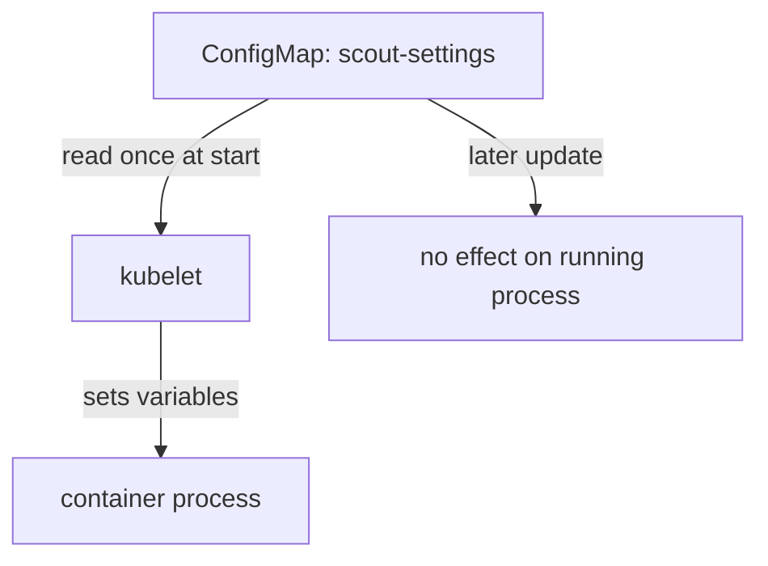

# ConfigMap Values As Environment Variables

An application often reads its settings from environment variables, because every language and every shell can read them. Kubernetes can fill those variables from a ConfigMap when it starts the container, so the same image runs with different values in each namespace. This part shows the two ways to do it, what a wrong reference does to the pod, and why the value never changes while the container runs.

## One key as one variable: `configMapKeyRef`

An **environment variable** is a named string that the operating system gives to a process when it starts. In a pod specification, the `env` list of a container defines variables one by one. A variable can have a fixed `value`, or it can take its value from another object with `valueFrom`. The kubelet (the agent on each node that starts containers) reads the ConfigMap and sets the variable before the container process starts.

The playground already has the ConfigMap `scout-settings` in the `starfleet` namespace. It has the keys `LOG_LEVEL` (value `info`), `REGION` (value `outpost-7`), `app.properties` and `banner.txt`. Save this as `pod-probe-env.yaml`:

```yaml
apiVersion: v1
kind: Pod
metadata:
  name: probe-env
  namespace: starfleet
spec:
  containers:
    - name: probe
      image: docker.io/library/busybox:1.37.0
      command: ["sleep", "3600"]
      env:
        - name: PROBE_LOG_LEVEL
          valueFrom:
            configMapKeyRef:
              name: scout-settings
              key: LOG_LEVEL
```

The variable name `PROBE_LOG_LEVEL` is free. The `name` under `configMapKeyRef` is the ConfigMap, and the `key` is the key inside it. The two names do not have to match, so you can give the application the variable name it expects. The ConfigMap must be in the same namespace as the pod, because a pod cannot read a ConfigMap from another namespace.

Apply it:

<!-- astrona:playground:renew -->

```sh
kubectl apply -f pod-probe-env.yaml
```

Then check the variable inside the container:

```sh
kubectl -n starfleet wait --for=condition=Ready pod/probe-env --timeout=60s
kubectl -n starfleet exec probe-env -- printenv PROBE_LOG_LEVEL
```

The command prints `info`. The kubelet copied the value of the key `LOG_LEVEL` into the variable `PROBE_LOG_LEVEL`.

## All keys as variables: `envFrom`

Writing one entry for every key is slow when a ConfigMap has many settings. The `envFrom` list of a container loads every key of a ConfigMap as a variable, with the key as the variable name. A `prefix` adds a fixed text in front of every name, which avoids clashes between two ConfigMaps.

Save this as `pod-probe-envfrom.yaml`:

```yaml
apiVersion: v1
kind: Pod
metadata:
  name: probe-envfrom
  namespace: starfleet
spec:
  containers:
    - name: probe
      image: docker.io/library/busybox:1.37.0
      command: ["sleep", "3600"]
      envFrom:
        - configMapRef:
            name: scout-settings
        - prefix: SETTING_
          configMapRef:
            name: scout-settings
```

Apply it and print all variables that contain the word `LOG` or `REGION`:

```sh
kubectl apply -f pod-probe-envfrom.yaml
kubectl -n starfleet wait --for=condition=Ready pod/probe-envfrom --timeout=60s
kubectl -n starfleet exec probe-envfrom -- printenv | grep -E 'LOG_LEVEL|REGION'
```

The output has four lines: `LOG_LEVEL=info` and `REGION=outpost-7` from the first entry, and `SETTING_LOG_LEVEL=info` and `SETTING_REGION=outpost-7` from the entry with the prefix. The same ConfigMap was loaded twice, once as it is and once with `SETTING_` in front of each key. Real pods usually use one entry; the second one only shows what the prefix does.

## Keys that cannot become variables

The ConfigMap `scout-settings` also has the keys `app.properties` and `banner.txt`. A variable name may contain only letters, digits and underscores, and it must not start with a digit. The key `app.properties` contains a dot, so it is not a valid variable name. Kubernetes does not fail the pod for this. The kubelet skips the invalid key, starts the container and records an event on the pod.

Look at the events of the pod and list the variable names the container has:

```sh
kubectl -n starfleet describe pod probe-envfrom
kubectl -n starfleet exec probe-envfrom -- printenv | grep -c 'app.properties'
```

The `Events` section of `describe` has a warning with the reason `InvalidEnvironmentVariableNames`. It says that the kubelet skipped the key `app.properties`. The second command prints `0`, because no variable with that name exists. The `banner.txt` key is skipped for the same reason. A pod that needs those keys must read them as files from a volume. The rule is: with `envFrom`, check the event list, because a skipped key does not stop the pod.

## Missing references: the pod does not start

The situation is stricter when you name a key or a ConfigMap with `configMapKeyRef`. The pod cannot start without the value, so the kubelet refuses to create the container. Save this as `pod-probe-missing.yaml`. The key `LOG_LEVELL` has a typing mistake on purpose:

```yaml
apiVersion: v1
kind: Pod
metadata:
  name: probe-missing
  namespace: starfleet
spec:
  containers:
    - name: probe
      image: docker.io/library/busybox:1.37.0
      command: ["sleep", "3600"]
      env:
        - name: PROBE_LOG_LEVEL
          valueFrom:
            configMapKeyRef:
              name: scout-settings
              key: LOG_LEVELL
```

Apply it and look at the status:

```sh
kubectl apply -f pod-probe-missing.yaml
kubectl -n starfleet get pod probe-missing
kubectl -n starfleet describe pod probe-missing
```

The pod stays in the status `CreateContainerConfigError`, and it never reaches `Running`. The events of `describe` say that the kubelet could not find the key in the ConfigMap. The same status appears when the whole ConfigMap is missing, and also when `envFrom` points at a ConfigMap that does not exist. The pod starts by itself as soon as you create the missing object, because the kubelet retries.

The field `optional: true` changes this behavior. With `optional: true` on a `configMapKeyRef`, a missing key or a missing ConfigMap does not block the pod: the container starts and the variable is not set. Use it only for settings that have a safe default in the application. A required setting should stay required, so that a typing mistake shows up as an error and not as a wrong default at run time.

Delete the broken pod now, because it has no use:

```sh
kubectl -n starfleet delete pod probe-missing
```

## Which value wins, and when it is read

A container can get the same variable name from several places. A variable in the `env` list wins over a variable from `envFrom`. When two `envFrom` entries define the same name, the entry later in the list wins. You can also use a variable in the container `command` and `args` with the form `$(PROBE_LOG_LEVEL)`, and Kubernetes replaces it before the process starts. That expansion only works for variables defined in the `env` or `envFrom` of the same container.

The most important property is the moment of reading. The kubelet reads the ConfigMap once, when it creates the container, and writes the values into the environment of the process. A process cannot change its environment from outside, and Kubernetes does not try. Update the ConfigMap and read the variable again:

```sh
kubectl -n starfleet patch configmap scout-settings -p '{"data":{"LOG_LEVEL":"debug"}}'
kubectl -n starfleet exec probe-env -- printenv PROBE_LOG_LEVEL
```

The patch works and the ConfigMap now holds `debug`, but the command still prints `info`. The running container keeps the value from its start. A new pod created now would get `debug`. Restore the original value before you continue:

```sh
kubectl -n starfleet patch configmap scout-settings -p '{"data":{"LOG_LEVEL":"info"}}'
```



The diagram shows that the kubelet copies the values once when it starts the container, and that a later change to the ConfigMap does not reach the running process.

You now know how to put single keys and whole ConfigMaps into the environment, what happens with a wrong reference, and that the values are frozen at the start. The open question is how to deliver a whole configuration file and how a file can change while the pod runs.

## Common pitfalls

> [!WARNING]
> - **Expecting an environment variable to change after you edit the ConfigMap.** The value is fixed when the container starts. Only a new pod gets the new value.
> - **A typing mistake in `key` or `name`.** The pod stays in `CreateContainerConfigError`. Read the pod events with `kubectl describe pod`.
> - **Using `envFrom` and expecting every key to appear.** Keys with dots or dashes are skipped, and the pod starts anyway. Look for the `InvalidEnvironmentVariableNames` event.
> - **Putting the ConfigMap in another namespace.** A pod only reads ConfigMaps from its own namespace.
> - **Setting `optional: true` on a required setting.** The pod starts without the variable, and the application runs with a default that nobody chose.
