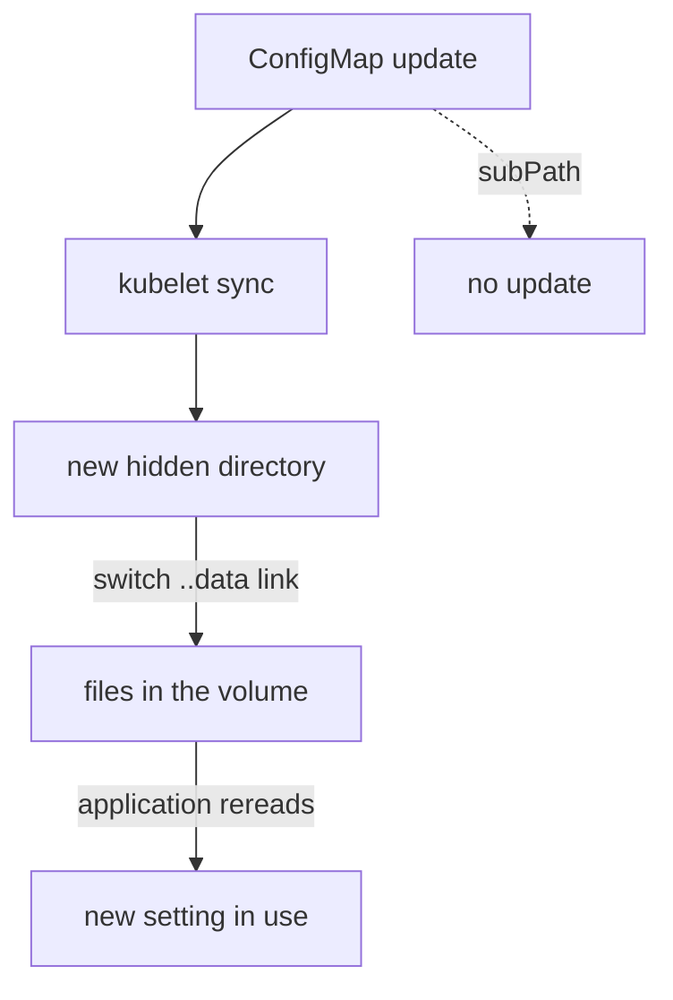

# ConfigMap Volumes, File Modes And Update Propagation

Many applications read a configuration file, not environment variables. A ConfigMap volume turns each key of a ConfigMap into a file inside the container, and unlike an environment variable, those files can change while the pod runs. This part shows how to mount all keys or only some of them, how to set file permissions, why `subPath` breaks updates, and how long an update takes to arrive.

## Mount a ConfigMap as a volume

A **volume** is a directory that Kubernetes attaches to a pod and mounts into containers. The volume type `configMap` fills that directory from a ConfigMap: the kubelet creates one file for every key, the file name is the key and the file content is the value. The pod needs two entries for this. The `volumes` list of the pod defines the volume and names the ConfigMap, and the `volumeMounts` list of the container says where the volume appears.

Save this as `pod-probe-files.yaml`:

```yaml
apiVersion: v1
kind: Pod
metadata:
  name: probe-files
  namespace: starfleet
spec:
  containers:
    - name: probe
      image: docker.io/library/busybox:1.37.0
      command: ["sleep", "3600"]
      volumeMounts:
        - name: settings
          mountPath: /etc/scout
  volumes:
    - name: settings
      configMap:
        name: scout-settings
```

The `name` in `volumeMounts` must match the `name` of the volume. The ConfigMap is `scout-settings` with the keys `LOG_LEVEL`, `REGION`, `app.properties` and `banner.txt`. Apply it:

<!-- astrona:playground:renew -->

```sh
kubectl apply -f pod-probe-files.yaml
```

Then list the directory and read one file:

```sh
kubectl -n starfleet wait --for=condition=Ready pod/probe-files --timeout=60s
kubectl -n starfleet exec probe-files -- ls /etc/scout
kubectl -n starfleet exec probe-files -- cat /etc/scout/app.properties
```

The directory has four files, one for each key, and `app.properties` holds the two lines `retries=3` and `region=outpost-7`. Keys with dots and dashes are fine here, because they are file names and not variable names. The mount hides everything that the image had at `/etc/scout`. If you mount over a directory that holds other files, those files disappear from the container, so mount into a directory that your own application owns.

## Select keys and set file modes

Mounting all keys is not always wanted. The `items` list under `configMap` selects keys and gives each one a path inside the volume. Only the listed keys appear. The `path` can differ from the key, so you can rename a key to the file name the application expects. A `mode` on an item sets the permissions of that file. The `defaultMode` of the volume sets the permissions for every file that has no own mode. The default is `0644`.

Save this as `pod-probe-items.yaml`:

```yaml
apiVersion: v1
kind: Pod
metadata:
  name: probe-items
  namespace: starfleet
spec:
  containers:
    - name: probe
      image: docker.io/library/busybox:1.37.0
      command: ["sleep", "3600"]
      volumeMounts:
        - name: settings
          mountPath: /etc/scout
          readOnly: true
  volumes:
    - name: settings
      configMap:
        name: scout-settings
        items:
          - key: app.properties
            path: probe.conf
            mode: 0400
```

Apply it and inspect the result:

```sh
kubectl apply -f pod-probe-items.yaml
kubectl -n starfleet wait --for=condition=Ready pod/probe-items --timeout=60s
kubectl -n starfleet exec probe-items -- ls /etc/scout
kubectl -n starfleet exec probe-items -- stat -L -c '%a' /etc/scout/probe.conf
```

The directory has a single file, `probe.conf`, and the command `stat` prints `400`. The key `app.properties` became the file `probe.conf`, and the other keys do not exist in the container. In the YAML, `0400` is written with a leading zero because it is an octal number. In the JSON form of the object, the API server shows it as the decimal number `256`. If you write `400` without the zero, the mode becomes the decimal number 400, which is a different set of permissions.

A listed key that does not exist in the ConfigMap is an error. The pod stays in `ContainerCreating`, and the events show a `FailedMount` warning, unless the volume has `optional: true`. The same happens when the whole ConfigMap is missing. With `optional: true` on the volume, the pod starts, and the directory is empty or lacks the missing keys.

## Mount one file with `subPath`

The mount of a whole volume hides the target directory. Sometimes you want to add a single file into a directory that already has other files. The field `subPath` on a `volumeMount` mounts one file or directory of the volume at the `mountPath`, and it leaves the rest of the target directory alone.

Save this as `pod-probe-subpath.yaml`:

```yaml
apiVersion: v1
kind: Pod
metadata:
  name: probe-subpath
  namespace: starfleet
spec:
  containers:
    - name: probe
      image: docker.io/library/busybox:1.37.0
      command: ["sleep", "3600"]
      volumeMounts:
        - name: settings
          mountPath: /etc/banner.txt
          subPath: banner.txt
  volumes:
    - name: settings
      configMap:
        name: scout-settings
```

Apply it and read the file:

```sh
kubectl apply -f pod-probe-subpath.yaml
kubectl -n starfleet wait --for=condition=Ready pod/probe-subpath --timeout=60s
kubectl -n starfleet exec probe-subpath -- cat /etc/banner.txt
```

The file `/etc/banner.txt` exists, and the other files of `/etc` are untouched. That is the benefit of `subPath`. The cost appears when the ConfigMap changes, as the next section shows.

## How an update reaches a mounted file

The kubelet keeps the files of a ConfigMap volume in step with the ConfigMap. It does this in a way that never shows a half-written file. The kubelet writes the new files into a new hidden directory, and then it changes a symbolic link called `..data` to point at that directory. The file `/etc/scout/REGION` is itself a symbolic link through `..data`, so the whole set of files switches at once.

The kubelet does not react instantly. It checks the volume on a periodic sync, and it also depends on how it caches ConfigMaps. The Kubernetes documentation states the delay as the kubelet sync period plus the cache propagation delay. In practice it takes from a few seconds to about a minute or two. There is no fixed guarantee, and the application must read the file again to see the new value.

Change the `REGION` and `banner.txt` keys, then poll the mounted file until it changes:

```sh
kubectl -n starfleet patch configmap scout-settings -p '{"data":{"REGION":"outpost-9","banner.txt":"scout moved\n"}}'
for attempt in $(seq 1 40); do
  kubectl -n starfleet exec probe-files -- cat /etc/scout/REGION
  sleep 5
done
```

The loop prints `outpost-7` for a while and then `outpost-9`, without any restart of the pod. Press Ctrl-C after you see the new value. Now read the file that uses `subPath`:

```sh
kubectl -n starfleet exec probe-subpath -- cat /etc/banner.txt
```

The file still says `scout online`, and it stays like that for the life of the container. A `subPath` mount bypasses the symbolic link that the kubelet updates, so the container never receives the change. Three delivery methods never update: environment variables, `subPath` mounts and volumes of an immutable ConfigMap. Only the plain volume mount updates, and even that needs an application that rereads its file. Restore the values before you continue:

```sh
kubectl -n starfleet patch configmap scout-settings -p '{"data":{"REGION":"outpost-7","banner.txt":"scout online\n"}}'
```



The diagram shows that the kubelet switches the whole set of files through one link, and that a `subPath` mount never sees the change.

You now know how to mount a ConfigMap as files, choose keys and permissions, and which mounts update. The open question is how to combine several sources in one directory, and how to make a Deployment use a changed ConfigMap when the delivery method does not update by itself.

## Common pitfalls

> [!WARNING]
> - **Mounting over a directory that holds files.** The mount hides the image's own files in that directory. Use a directory that your application owns, or use `subPath` for one file.
> - **Expecting a `subPath` file to update.** It never changes while the container runs. Restart the pod to read the new value.
> - **Writing a mode without the leading zero.** `0400` is octal and means read-only for the owner. `400` is a decimal number with different permissions.
> - **Expecting an instant update.** The files change after the kubelet sync, which can take a minute or more. The application must also read the file again.
> - **Listing an `items` key that does not exist.** The pod stays in `ContainerCreating` with a `FailedMount` event unless the volume is `optional`.
