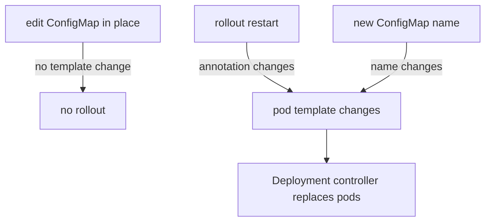

# Projected Volumes And Rollouts On Change

Real applications often need settings from more than one ConfigMap, and they must pick up a changed ConfigMap without anyone logging in to a pod. A projected volume puts several sources into one directory. A rollout replaces the pods of a Deployment so that every method of delivery, even the ones that never update, reads the new values. This part covers both and ends with the safest way to change configuration.

## Merge sources with a projected volume

A **projected volume** maps several existing sources into a single directory. The sources can be ConfigMaps, Secrets, `downwardAPI` (information about the pod itself, such as its name) and service account tokens. Each source lists the files it adds. Without a projected volume, every ConfigMap needs its own mount directory, and an application that expects all its files in one directory cannot use that.

Create a second ConfigMap with the limits of the application:

<!-- astrona:playground:renew -->

```sh
kubectl -n starfleet create configmap scout-limits --from-literal=limits.conf=max_connections=20
```

You should see:

```text
configmap/scout-limits created
```

Save this as `pod-probe-projected.yaml`:

```yaml
apiVersion: v1
kind: Pod
metadata:
  name: probe-projected
  namespace: starfleet
spec:
  containers:
    - name: probe
      image: docker.io/library/busybox:1.37.0
      command: ["sleep", "3600"]
      volumeMounts:
        - name: merged
          mountPath: /etc/scout
  volumes:
    - name: merged
      projected:
        defaultMode: 0440
        sources:
          - configMap:
              name: scout-settings
              items:
                - key: app.properties
                  path: app.properties
          - configMap:
              name: scout-limits
          - downwardAPI:
              items:
                - path: pod-name
                  fieldRef:
                    fieldPath: metadata.name
```

The volume has three sources. The first adds only the key `app.properties` from `scout-settings`. The second adds all keys of `scout-limits`, which is `limits.conf`. The third adds a file called `pod-name` that holds the name of the pod, which the kubelet fills from the pod's own metadata. The `defaultMode` applies to every file of the volume. Apply it:

```sh
kubectl apply -f pod-probe-projected.yaml
```

Then check the directory:

```sh
kubectl -n starfleet wait --for=condition=Ready pod/probe-projected --timeout=60s
kubectl -n starfleet exec probe-projected -- ls /etc/scout
kubectl -n starfleet exec probe-projected -- cat /etc/scout/pod-name
```

The directory holds three files, `app.properties`, `limits.conf` and `pod-name`, and the last command prints `probe-projected`. One ConfigMap volume can show only one ConfigMap, but this projected volume shows two ConfigMaps and the pod's name in one place. The paths must be unique across all sources. If two sources write the same path, the pod does not start, so give such files different `path` values. Projected ConfigMap sources update like a normal ConfigMap volume, with the same delay, and `subPath` has the same limit.

## Why a changed ConfigMap needs a rollout

Environment variables are read once, `subPath` files never change, and files from a plain mount change only after a delay and only if the application reads them again. A Deployment has to work for all of these cases, and the only method that is the same for every case is to replace the pods. A **rollout** is the process in which the Deployment controller creates new pods from the pod template and removes the old ones. A new pod starts new containers, so it reads the ConfigMap again from the beginning.

A rollout starts only when the pod template of the Deployment changes. A change to a ConfigMap does not change the pod template, because the template only holds the name of the ConfigMap. So after an edit of the ConfigMap, nothing happens until you start a rollout yourself. Save this as `deployment-probe.yaml`:

```yaml
apiVersion: apps/v1
kind: Deployment
metadata:
  name: probe
  namespace: starfleet
spec:
  replicas: 2
  selector:
    matchLabels:
      app: probe
  template:
    metadata:
      labels:
        app: probe
    spec:
      containers:
        - name: probe
          image: docker.io/library/busybox:1.37.0
          command: ["sleep", "3600"]
          envFrom:
            - configMapRef:
                name: probe-settings-v1
```

First create the ConfigMap that the Deployment uses, then apply the Deployment and wait for it:

```sh
kubectl -n starfleet create configmap probe-settings-v1 --from-literal=LOG_LEVEL=info
kubectl apply -f deployment-probe.yaml
kubectl -n starfleet rollout status deployment/probe
```

The last command ends with the line `deployment "probe" successfully rolled out`. Now edit the ConfigMap and check one pod:

```sh
kubectl -n starfleet patch configmap probe-settings-v1 -p '{"data":{"LOG_LEVEL":"debug"}}'
kubectl -n starfleet exec deploy/probe -- printenv LOG_LEVEL
```

The command prints `info`. The ConfigMap holds `debug`, but the running pods have not changed and the Deployment has not started a rollout.

## Three ways to start the rollout

The first way is the command `kubectl rollout restart`. It sets an annotation with the current time on the pod template. The template changes, so the Deployment controller starts a rollout, and the new pods read `debug`.

```sh
kubectl -n starfleet rollout restart deployment/probe
kubectl -n starfleet rollout status deployment/probe
kubectl -n starfleet exec deploy/probe -- printenv LOG_LEVEL
```

The last command now prints `debug`. The rollout replaced the pods one by one, so the application stayed available during the change.

The second way is a change that you control in the pod template, usually an annotation that holds a version or a hash of the configuration. Tools like Helm compute a checksum of the ConfigMap and write it into an annotation, so the template changes exactly when the configuration changes. By hand, you patch the annotation yourself:

```sh
kubectl -n starfleet patch deployment probe -p '{"spec":{"template":{"metadata":{"annotations":{"config-version":"2"}}}}}'
```

The third way is the safest for a controlled change: give every version of the configuration a new name, and set `immutable: true` on each one in its YAML when you write it as a file (the `kubectl create configmap` command has no flag for it). Create `probe-settings-v2`, and point the Deployment at it. The pod template then changes because the name changed, so the rollout starts by itself, and the old version stays available for a rollback.

```sh
kubectl -n starfleet create configmap probe-settings-v2 --from-literal=LOG_LEVEL=warn
kubectl -n starfleet patch deployment probe --type=json -p '[{"op":"replace","path":"/spec/template/spec/containers/0/envFrom/0/configMapRef/name","value":"probe-settings-v2"}]'
kubectl -n starfleet rollout status deployment/probe
```

The Deployment now shows `probe-settings-v2` in its pod template, and the new pods print `warn` for `LOG_LEVEL`. If the new value is wrong, `kubectl rollout undo deployment/probe` brings back the previous template, which points at the old ConfigMap, and the old values return with it. An edit of one ConfigMap in place would give you no way back.



The diagram shows that only a change of the pod template starts a rollout, and that an edit of the ConfigMap alone does not.

You now know how to merge sources into one directory and how to make a Deployment adopt new configuration safely. What remains is to combine these steps in one task: create the ConfigMap, consume it in a Deployment and change it safely.

## Common pitfalls

> [!WARNING]
> - **Editing a ConfigMap and expecting the Deployment to roll out.** The pod template does not change, so nothing happens. Run `kubectl rollout restart` or change the ConfigMap name.
> - **Two projected sources writing the same path.** The pod does not start. Give each source a unique `path`.
> - **Forgetting that a projected volume has no `subPath` update either.** A `subPath` mount of a projected file stays at its start value.
> - **Deleting the old ConfigMap right after a rollout.** A rollback needs it. Keep the previous version until the new one is proven.
> - **Rolling out before the new ConfigMap exists.** The new pods stay in `CreateContainerConfigError`, and the rollout stalls while the old pods keep running.
