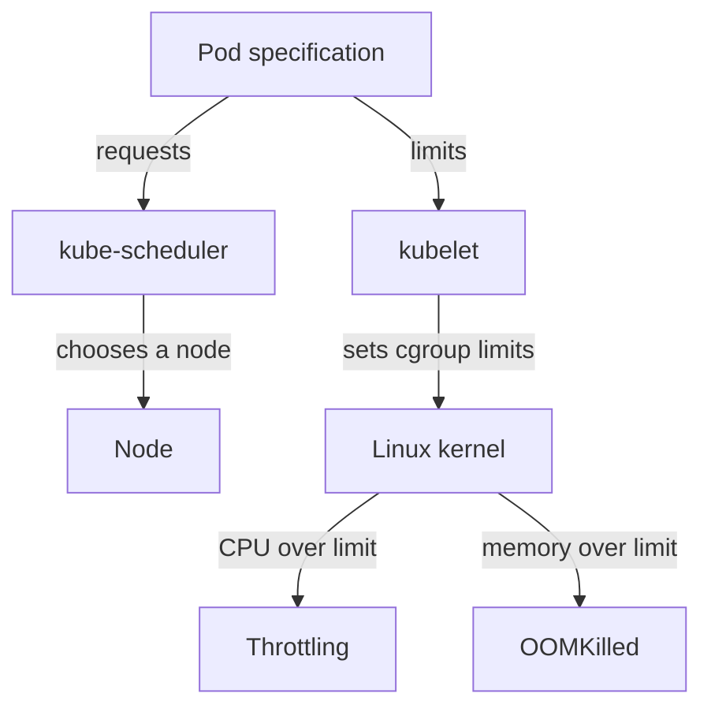

# CPU And Memory Requests And Limits

Every container uses central processing unit (CPU) time and memory, and a node has a fixed amount of both. Kubernetes needs two numbers from the developer to manage this: how much the container needs in order to be placed on a node, and how much it may use at most. Wrong numbers fail in different ways, so you need to know which component reads each number.

## Quantities and units

A resource quantity is a number with an optional suffix. CPU is measured in CPU units: `1` means one core (one virtual CPU on a cloud node, one hardware thread on a bare-metal node). The suffix `m` means millicpu, one thousandth of a CPU unit. So `500m` and `0.5` are the same amount, and `100m` is one tenth of a core. The smallest accepted value is `1m`.

Memory is measured in bytes. You can write a plain integer, or use a suffix. The decimal suffixes are `k`, `M`, `G`, `T`, `P` and `E` (powers of 1000). The binary suffixes are `Ki`, `Mi`, `Gi`, `Ti`, `Pi` and `Ei` (powers of 1024). So `128Mi` is 134217728 bytes and `128M` is 128000000 bytes. The two are close, but they are not the same, and the exam expects you to use `Mi` and `Gi` for memory.

Two unit mistakes cause most sizing failures. The first is a lowercase `m` on memory. In Kubernetes quantities `m` always means one thousandth, so `memory: 400m` asks for 0.4 bytes, not 400 megabytes. The second is a missing `m` on CPU. The value `cpu: "100"` asks for one hundred cores, and no ordinary node can run that Pod.

## Requests and limits do different jobs

A **request** is the amount of a resource that the container needs. The scheduler (`kube-scheduler`, the control plane component that picks a node for each new Pod) reads the requests of all containers in the Pod, adds them up, and only chooses a node that has that much unreserved capacity left. The request does not measure what the container uses. A container that requests 500m of CPU and uses 10m still reserves 500m on its node.

A **limit** is the most of a resource that the container may use. The scheduler does not use limits to place a Pod. The kubelet (the agent on each node) passes the limits to the container runtime, and the runtime asks the Linux kernel to enforce them with control groups (cgroups). The kernel, not Kubernetes, stops a container that goes over its limit.

The two resources break differently. CPU is compressible: when a container wants more CPU time than its limit, the kernel makes it wait for the next scheduling period. This is called throttling, and the process runs slower but keeps running. Memory is not compressible: when a container tries to use more memory than its limit, the kernel kills a process in the container. This is an out-of-memory (OOM) kill, and Kubernetes reports it as the reason `OOMKilled`.



The diagram shows that requests end at the scheduler while limits end at the kernel.

## See a limit in the kernel

Save a Pod that sets a request and a limit for both resources. The container only sleeps, so it stays running.

<!-- astrona:playground:renew -->

Save this as `pod-scout-limits.yaml`:

```yaml
apiVersion: v1
kind: Pod
metadata:
  name: scout-limits
  namespace: starfleet
spec:
  containers:
  - name: scout
    image: busybox:1.37.0
    command: ["sh", "-c", "sleep 3600"]
    resources:
      requests:
        cpu: 250m
        memory: 64Mi
      limits:
        cpu: 500m
        memory: 128Mi
```

Apply it:

```sh
kubectl apply -f pod-scout-limits.yaml
```

Then check the result:

```sh
kubectl -n starfleet wait --for=condition=Ready pod/scout-limits --timeout=120s
kubectl -n starfleet exec scout-limits -- cat /sys/fs/cgroup/cpu.max /sys/fs/cgroup/memory.max
```

On a node that uses cgroup version 2, the first file `cpu.max` holds two numbers, 50000 and 100000. The kernel lets the container run for 50000 microseconds in every period of 100000 microseconds, which is half a CPU and equals the limit of `500m`. The file `memory.max` holds 134217728, which is `128Mi` in bytes. The request of `250m` is not in these files as a ceiling: the kernel uses it only as a relative CPU weight when several containers compete for the same CPU.

## Cause CPU throttling

A container with a low CPU limit and a loop that never sleeps will hit the limit in every period. Save this Pod:

Save this as `pod-scout-busy.yaml`:

```yaml
apiVersion: v1
kind: Pod
metadata:
  name: scout-busy
  namespace: starfleet
spec:
  containers:
  - name: scout
    image: busybox:1.37.0
    command: ["sh", "-c", "while true; do :; done"]
    resources:
      requests:
        cpu: 50m
        memory: 16Mi
      limits:
        cpu: 100m
        memory: 32Mi
```

Apply it:

```sh
kubectl apply -f pod-scout-busy.yaml
```

Then check the result. Wait a few seconds after the Pod starts, then read the kernel's CPU statistics twice:

```sh
kubectl -n starfleet exec scout-busy -- cat /sys/fs/cgroup/cpu.stat
```

The file lists counters. `nr_periods` counts the scheduling periods that have passed, `nr_throttled` counts the periods in which the container was stopped because it had used its quota, and `throttled_usec` is the total time it waited. Run the command again after ten seconds and you will see `nr_throttled` and `throttled_usec` grow, while the Pod stays `Running`. Nothing in `kubectl get pod` or the events shows throttling, which is why a slow application with a low CPU limit is hard to diagnose without these counters or a metrics system.

## Cause an out-of-memory kill

Now give a container less memory than it uses. The command `tail /dev/zero` reads a file that has no line breaks, so `tail` keeps all the data in memory and grows without end.

Save this as `pod-scout-oom.yaml`:

```yaml
apiVersion: v1
kind: Pod
metadata:
  name: scout-oom
  namespace: starfleet
spec:
  containers:
  - name: scout
    image: busybox:1.37.0
    command: ["sh", "-c", "tail /dev/zero"]
    resources:
      requests:
        cpu: 50m
        memory: 16Mi
      limits:
        cpu: 100m
        memory: 32Mi
```

Apply it:

```sh
kubectl apply -f pod-scout-oom.yaml
```

Then check the result. The kubelet records why the last container run ended:

```sh
kubectl -n starfleet wait --for=jsonpath='{.status.containerStatuses[0].lastState.terminated.reason}'=OOMKilled pod/scout-oom --timeout=120s
kubectl -n starfleet get pod scout-oom -o jsonpath='{.status.containerStatuses[0].lastState.terminated.exitCode}{"\n"}'
```

The reason is `OOMKilled` and the exit code is 137, which is 128 plus signal 9 (`SIGKILL`) sent by the kernel. Because the Pod has the default `restartPolicy: Always`, the kubelet restarts the container, it is killed again, and `kubectl get pod` soon shows the status `CrashLoopBackOff` with a growing delay between restarts. The restart count in the `RESTARTS` column is the quickest sign of a memory limit that is too low.

Remove the three Pods before you continue:

```sh
kubectl -n starfleet delete pod scout-limits scout-busy scout-oom
```

You can now name the component that reads each number and tell the two failure modes apart: a slow container points to a CPU limit, and a restart with exit code 137 points to a memory limit. The next question is what happens when many Pods compete for one node, and which of them Kubernetes stops first.

## Common pitfalls

> [!WARNING]
> `memory: 400m` is a fraction of a byte, and `cpu: "100"` is one hundred cores. Use `Mi` and `Gi` for memory and `m` for fractions of a CPU. A request reserves capacity for the scheduler even if the container uses less, and a limit is enforced by the kernel, not by the scheduler. Raising only a request does not raise the memory limit, so it does not stop an OOM kill.
