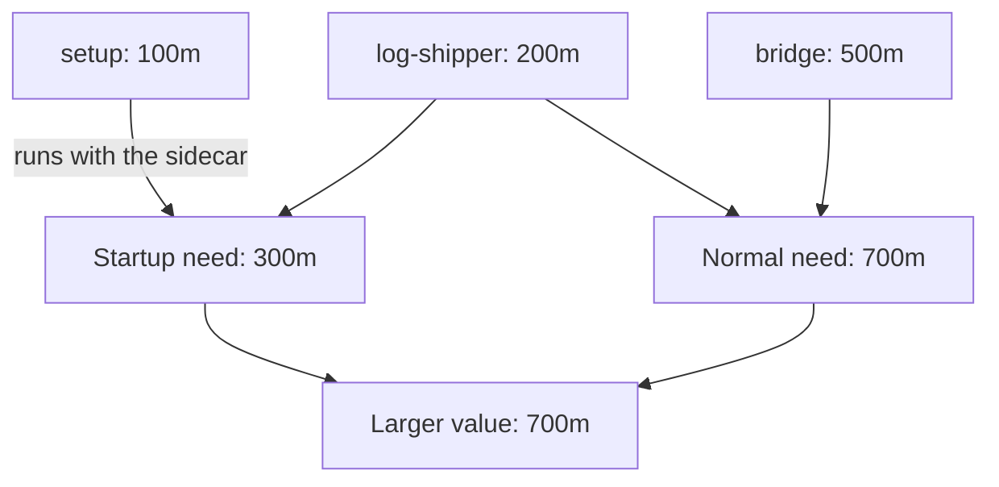

# Init And Sidecar Container Resources

A Pod often runs more than one container. An init container does setup work before the main containers start. A sidecar container is a helper that runs next to the main container for the whole life of the Pod, for example a log shipper. The scheduler needs one number per resource for the whole Pod, so Kubernetes has a rule that turns the settings of all these containers into one effective request.

## Three kinds of container in one Pod

An **application container** is listed under `spec.containers` and runs for the life of the Pod. A **regular init container** is listed under `spec.initContainers`. The kubelet runs the regular init containers one at a time, in order, and each must finish successfully before the next one starts. After the last one finishes, the application containers start.

A **sidecar container** (also called a restartable init container) is listed under `spec.initContainers` too, but it has `restartPolicy: Always`. The kubelet starts it in its place in the order, waits until it has started, and does not wait for it to finish. It keeps running beside the later init containers and the application containers, and the kubelet restarts it if it stops. This behaviour is stable in Kubernetes 1.35.

## The rule for the effective request

The scheduler calculates the effective request separately for CPU and for memory. Two situations can need the most capacity, so it takes the larger of the two numbers:

- During startup, one regular init container runs at a time. Its need is its own request plus the requests of all sidecars that were declared before it, because those sidecars are already running.
- During normal operation, all sidecars and all application containers run together. The need is the sum of their requests.

The effective request is the highest startup need of any regular init container, or the normal-operation sum, whichever is larger. The effective limit follows the same rule with limits. Pod overhead, a fixed extra amount that a runtime class can add for the container runtime, is added on top when it is configured.

A worked case. The sidecar `log-shipper` requests 200m CPU and 256Mi memory. The init container `setup` requests 100m and 128Mi. The application container `bridge` requests 500m and 512Mi. For CPU, the startup need is 100m plus 200m, which is 300m, and the normal sum is 200m plus 500m, which is 700m. The effective CPU request is 700m. For memory, the startup need is 128Mi plus 256Mi, which is 384Mi, and the normal sum is 256Mi plus 512Mi, which is 768Mi. The effective memory request is 768Mi.



The diagram shows the two possible peaks and that the Pod request is the larger one.

## Run the worked case

Save a Pod that uses exactly these numbers. All containers have requests equal to limits, so the class question comes up too.

<!-- astrona:playground:renew -->

Save this as `pod-bridge-effective.yaml`:

```yaml
apiVersion: v1
kind: Pod
metadata:
  name: bridge-effective
  namespace: starfleet
spec:
  initContainers:
  - name: log-shipper
    image: busybox:1.37.0
    restartPolicy: Always
    command: ["sh", "-c", "sleep 3600"]
    resources:
      requests:
        cpu: 200m
        memory: 256Mi
      limits:
        cpu: 200m
        memory: 256Mi
  - name: setup
    image: busybox:1.37.0
    command: ["sh", "-c", "echo ready"]
    resources:
      requests:
        cpu: 100m
        memory: 128Mi
      limits:
        cpu: 100m
        memory: 128Mi
  containers:
  - name: bridge
    image: busybox:1.37.0
    command: ["sh", "-c", "sleep 3600"]
    resources:
      requests:
        cpu: 500m
        memory: 512Mi
      limits:
        cpu: 500m
        memory: 512Mi
```

Apply it:

```sh
kubectl apply -f pod-bridge-effective.yaml
```

Then check the result:

```sh
kubectl -n starfleet wait --for=condition=Ready pod/bridge-effective --timeout=180s
kubectl -n starfleet get pod bridge-effective -o jsonpath='{.status.qosClass}{"\n"}'
```

The class is `Guaranteed`, because every container, including the init container and the sidecar, has requests equal to limits for both resources. Now read what the node reserves for this Pod:

```sh
kubectl describe node | grep bridge-effective
```

The line for `bridge-effective` in the `Non-terminated Pods` table shows 700m for the CPU request and 768Mi for the memory request, which are the effective values from the calculation above, not the 500m and 512Mi of the application container alone.

## A large init container sets the Pod request

A regular init container runs alone, so a heavy one can set the whole Pod request even when the application containers are small. Suppose an init container `migrate` requests 1 CPU and the application container `bridge` requests 200m, with no sidecar. The startup need is 1 CPU and the normal need is 200m, so the effective CPU request is 1 CPU for the whole life of the Pod. The scheduler uses this value to place the Pod and the node keeps it reserved even after `migrate` has finished. If the node has only 500m free, the Pod stays Pending although the running application would fit.

The same rule applies to limits and to the QoS class. One init container without a memory limit turns an otherwise Guaranteed Pod into a Burstable one. A sidecar without a limit does the same. Each container is also limited by itself: if the sidecar goes over its memory limit, the kernel kills only the sidecar, and the kubelet restarts it while the application container keeps running.

Check this on the running Pod. The init container statuses are separate from the application container statuses:

```sh
kubectl -n starfleet get pod bridge-effective -o jsonpath='{range .status.initContainerStatuses[*]}{.name}{" restarts="}{.restartCount}{"\n"}{end}'
```

Both entries are listed: `log-shipper` is still running, and `setup` has finished. Delete the Pod:

```sh
kubectl -n starfleet delete pod bridge-effective
```

You can now calculate the effective request of a Pod from its specification and predict its class, which is the same calculation the scheduler makes. Pod-level settings and namespace policies that change these values are a separate topic.

## Common pitfalls

> [!WARNING]
> Do not add the init container requests to the application requests. A regular init container runs alone, so only the larger of the startup need and the normal sum counts. Sidecars are the exception: they run beside everything after them, so they are part of both sums. A sidecar needs `restartPolicy: Always` under `initContainers`; without it the container is a regular init container and must finish before the Pod can start. Remember that init containers and sidecars also need equal requests and limits for the Pod to be Guaranteed.
