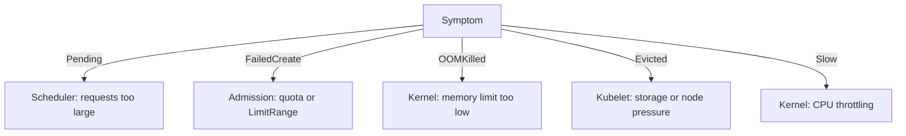

# Right-Sizing And Fixing Failing Workloads

Most resource problems arrive as a symptom, not as a message that says "wrong number". A Deployment has fewer Pods than expected, a Pod stays Pending, a container restarts every minute. The skill that the exam tests is to read the symptom, find the component that caused it, and change the right number. This part gives a short method for that and applies it to two broken Deployments.

## Read the symptom to find the component

Each component records its failure in a different place. The table gives the places to look for each symptom.

| Symptom | Component | Where to look |
| --- | --- | --- |
| Pod is `Pending` | Scheduler | `kubectl describe pod`, event `FailedScheduling` with `Insufficient cpu` or `Insufficient memory` |
| Deployment has fewer Pods than `replicas` and no Pod is Pending | API server admission | ReplicaSet events, reason `FailedCreate` (quota or LimitRange) |
| Pod restarts, status `CrashLoopBackOff` | Kubelet and kernel | `lastState.terminated.reason` is `OOMKilled`, exit code 137 |
| Pod is `Failed` with `Evicted` | Kubelet | `status.reason` and `status.message` of the Pod |
| Application is slow, no events | Kernel CPU limit | `cpu.stat` counters, `kubectl top` |

Matching the symptom to one row avoids the most common mistake, which is to change a value that the failing component never reads. Lowering a memory request does not stop an OOM kill, and raising a memory limit does not make a Pod schedule.



The diagram shows that each symptom leads to one component and one number.

## Choose numbers from evidence

The numbers come from measurement. Set the request near what the workload normally uses, because the scheduler reserves that amount. Set the memory limit above the highest use you have seen, because a container is killed the moment it crosses the limit. A CPU limit is optional: a low one throttles the container even when the node is idle, so set it only when you need to cap the workload. Where the workload must be the last one evicted, make the requests equal to the limits so that the Pod is Guaranteed.

The command `kubectl top pod --containers` shows live use when the metrics server runs. It reports the use at one moment, so take several samples while the application handles real work, and compare the highest value with the limit. The playground has no metrics server. There, use the facts that Kubernetes records instead: the last state of a container, the restart count and the events.

## Diagnose the Pod that is killed

The playground `starfleet` namespace has two broken Deployments. Start with the list of Pods:

<!-- astrona:playground:renew -->

```sh
kubectl -n starfleet get pods
```

The `scout` Pod runs. The `bridge` Pod has restarts and the status `CrashLoopBackOff` or `OOMKilled`, and the `shuttle` Pod is `Pending`. Look at `bridge` first and read why its container ended:

```sh
kubectl -n starfleet get pods -l app=bridge -o jsonpath='{.items[0].status.containerStatuses[0].lastState.terminated.reason}{" "}{.items[0].status.containerStatuses[0].lastState.terminated.exitCode}{"\n"}'
kubectl -n starfleet get deployment bridge -o jsonpath='{.spec.template.spec.containers[0].resources}{"\n"}'
```

The reason is `OOMKilled` with exit code 137, and the resources show a memory limit of `32Mi`. The process needs about 100 MiB at its peak. A fix needs a memory limit above that peak, and a request that stays below or equal to the limit.

Apply the fix with `kubectl set resources`. The option `-c` selects the container, and `--requests` and `--limits` take comma-separated pairs:

```sh
kubectl -n starfleet set resources deployment bridge -c bridge --requests=cpu=50m,memory=128Mi --limits=cpu=100m,memory=256Mi
kubectl -n starfleet rollout status deployment/bridge --timeout=120s
```

The command changes the Pod template, so the Deployment starts a rollout, and the old Pod is replaced when the new one is ready. The same command with `--dry-run=client -o yaml` prints the changed Deployment without applying it, which is a safe way to check a change on the exam.

## Diagnose the Pod that is Pending

Now look at `shuttle`. A Pending Pod has not started, so the event is the first place to look:

```sh
kubectl -n starfleet describe pod -l app=shuttle | sed -n '/^Events:/,$p'
kubectl -n starfleet get deployment shuttle -o jsonpath='{.spec.template.spec.containers[0].resources}{"\n"}'
```

The event is `FailedScheduling` with `Insufficient cpu`, and the Deployment requests `cpu: "50"`, which is fifty cores. The author meant 50 millicores. Fix the unit and keep the memory values:

```sh
kubectl -n starfleet set resources deployment shuttle -c shuttle --requests=cpu=50m,memory=32Mi --limits=cpu=100m,memory=64Mi
kubectl -n starfleet rollout status deployment/shuttle --timeout=120s
```

The new Pod fits on the node and the rollout completes. Confirm the end state of the whole namespace:

```sh
kubectl -n starfleet get pods -o custom-columns=NAME:.metadata.name,STATUS:.status.phase,QOS:.status.qosClass
```

All Pods are `Running`. The `scout` and `bridge` Pods are Burstable, and the `shuttle` Pod is also Burstable, because its requests are below its limits.

## What a good fix looks like

A good fix changes the one number that the failing component reads and keeps the rest of the specification. Three shortcuts look like fixes and are not. Deleting the `resources` field removes the symptom but makes the Pod BestEffort, the first to be evicted. Setting a very large memory limit stops the OOM kill but hides a leak and can overcommit the node. Setting a request of zero for a Pending Pod makes it schedule, but then the scheduler cannot protect the Pod from crowding. On the exam, the task text usually states a target, such as a class or a range, and a grader checks both the symptom and the intent.

You now have a method that starts with the symptom, picks the component, reads the evidence, and changes one number with a command you can repeat quickly. The graded lab for this module asks you to apply the same method to a namespace that has a LimitRange and a quota.

## Common pitfalls

> [!WARNING]
> Do not change a request when the container is killed for memory, and do not change a limit when the Pod is Pending. Read the event or the last state first. Writing `cpu: "50"` instead of `50m` is a unit error that the API server accepts. `kubectl set resources` starts a rollout, so wait for `kubectl rollout status` before you check the result.
