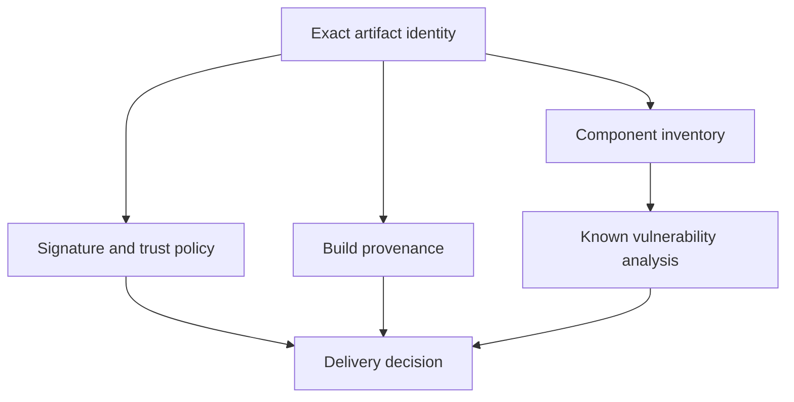

# Credentials And Image Supply Chains

An image has a trusted signature but includes a vulnerable dependency. The signature answers an origin question; it does not answer every content-safety question. Credential delivery and artifact verification also act at different boundaries.

## Learning objectives

- Distinguish artifact identity, origin, inventory and vulnerability evidence.
- Identify credential exposure paths in builds and runtime.
- Explain why verification must describe the exact deployed artifact.

## Before you start

Use a shell on your own machine with the module playground running. A Pod is Kubernetes's unit for running one or more containers together. The environment provides the `probe` Deployment, which maintains application Pods, and the `starfleet` namespace, which groups these objects.

Read-only commands below use kubectl, the Kubernetes command-line tool. Select the private kubeconfig: the file that identifies this environment's cluster and credentials. The commands do not change the application.

## Credentials and Image Supply Chains

A database password should reach only the process that needs it. Least privilege applies to credential readers, mounted files, ServiceAccounts and network access as well as API permissions. Do not put secrets in an image merely to avoid configuring them at deployment time; image access can expose all embedded layers.

A Kubernetes Secret requires access control and appropriate encryption at rest. Applications should avoid writing sensitive values into logs, error pages or diagnostic bundles. Rotation needs coordination between the credential issuer and consumers so old values stop working without causing an unnecessary outage.

Image supply chain security asks where an artifact came from, what it contains and whether it is the intended artifact. A digest identifies content. A signature or provenance record can support verification of origin and build history. A vulnerability scan looks for known problems in identified components. These answer different questions.

A signed image can still contain a vulnerability, and a clean scan cannot prove that the publisher is trusted or that every future vulnerability is known. A software bill of materials (SBOM) records components to support analysis. It does not independently prove safe application behavior.

Prefer trusted sources, reviewed dependencies and repeatable builds. Keep runtime privileges minimal, patch components and verify the intended artifact through the delivery process. Avoid mutable references when exact release identity matters.

Suppose an approved image has a valid signature but an exploitable dependency. The signature is useful evidence of origin, yet the dependency still needs remediation. Security reasoning should identify the property being checked rather than treating one passed check as a complete guarantee.

## Artifact Identity, Origin And Contents

An image digest answers which content is selected. A signature can answer whether a trusted identity attested to that content, assuming the verification policy and trust material are correct. Provenance can describe source and build steps. A component inventory can show included libraries. A vulnerability scan compares identified components with known problem data.

None of these questions is interchangeable. A digest by itself does not identify a trustworthy publisher. A signature does not prove that the signed code has no defect. An inventory without a trustworthy link to the built image can describe the wrong artifact. A scan may not detect an unknown flaw or a logic error in the application's own authorization checks.

A delivery policy can require several pieces of evidence for the exact artifact being promoted. Store the relationship between source revision, build identity, digest and verification result. Checking one image and deploying another weakens every apparently successful control.

## Credential Exposure Along The Runtime Path

A credential can leak through source files, build inputs, registry layers, mounted files, environment inspection, logs or diagnostic exports. Moving it into a Secret addresses some configuration concerns but not all these paths. Limit who can read it and which process receives it, then prevent accidental disclosure through normal and failure behavior.

Rotation must also remove old authority at the issuer. Updating a stored value while leaving the previous credential valid indefinitely does not revoke it. New consumers need to adopt the replacement according to their configuration delivery mechanism. Verification should use successful intended access and rejected old access where appropriate, without publishing the secret value.

Supply chain controls and least privilege support different phases of defense. The first narrows what software and credentials enter the system; the second limits what a compromised process can do. A coherent security answer connects both rather than treating a signed artifact as permission to run with unrestricted host access.

## Inspect the mechanism

A digest identifies content. A signature can attest to content under a trust policy, provenance can describe build history, and a software bill of materials (SBOM) lists components. A vulnerability scan compares identified components with known issue data. Passing one of these checks cannot substitute for the others.

The fixture uses a tagged upstream image and mounted application code. Its running image identity can be inspected, but that identity does not prove a signature was verified or a scan was performed. No signing or scanning service is provisioned here. Keep these conceptual controls explicit instead of writing a command that pretends the playground can demonstrate absent integrations.



A delivery decision combines evidence about distinct properties of the same intended artifact.

<!-- astrona:playground:renew -->

Select the private cluster connection and inspect the live state from your host shell:

```sh
export KUBECONFIG="$(astrona kubeconfig ats-029-playground-060-01)"
if test "$(kubectl config current-context)" = "kind-astro-ats-029-playground-060-01"; then
  kubectl -n starfleet get deployment probe -o jsonpath='{.spec.template.spec.containers[0].image}{"\n"}'
  kubectl -n starfleet get pods -l app=probe -o jsonpath='{range .items[*]}{.metadata.name}{" "}{.status.containerStatuses[0].imageID}{"\n"}{end}'
else
  printf "Select this module's private kubeconfig before continuing.\n" >&2
fi
```

Compare the requested reference with actual running identities. This proves only what these fields report. It does not generate provenance, inventory, scan results or trust-policy evidence. Keep the artifact identified by a future verification result linked to the artifact actually deployed; otherwise a successful check can describe different bytes.

You can now state what each supply-chain control establishes and what remains uncertain. Minimal runtime privilege and careful credential handling still matter after an artifact is approved.

## Common pitfalls

> [!WARNING]
> Signatures, digests, vulnerability scans and component inventories provide different evidence. Passing one check does not establish every aspect of workload safety.
