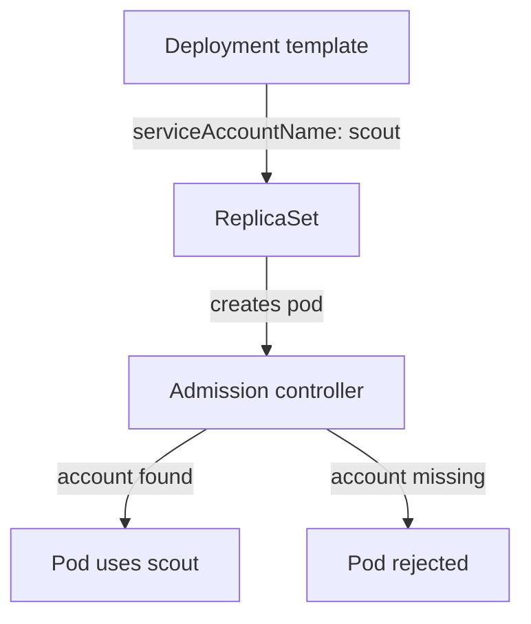

# Create And Assign A ServiceAccount

Every request to the Kubernetes API comes from an identity. People use certificates or tokens from a login system. Pods use a ServiceAccount: a namespaced Kubernetes object that represents the identity of a workload. This part shows which account a pod uses when you do nothing, how to create and assign a different one, and what the API server does when the choice is wrong. These steps are the first thing the exam asks for in a ServiceAccount task.

## The account a pod gets by default

A namespace is created together with a ServiceAccount called `default`. The ServiceAccount admission controller, a plug-in inside the API server that checks and changes every new pod, sets `spec.serviceAccountName` to `default` when the pod template does not name an account. The pod stores that value, so it is visible afterwards.

<!-- astrona:playground:renew -->

Read the account of the three workloads in `starfleet`:

```sh
kubectl -n starfleet get pods -o custom-columns=NAME:.metadata.name,ACCOUNT:.spec.serviceAccountName
kubectl -n starfleet get serviceaccounts
```

Every pod shows `default` in the `ACCOUNT` column, and the second command lists one ServiceAccount, `default`. The pods did not ask for it. The admission controller wrote it into the pod when the ReplicaSet created it.

The `default` account has no permissions of its own beyond the basic rights every authenticated identity has. That is safe, but it is also shared: every pod in the namespace that names no account uses the same identity. If one workload later needs a permission, giving it to `default` gives it to all of them. A separate account per workload avoids that.

## Create a ServiceAccount

The fastest way is the imperative command, which is what you use on the exam when speed matters:

```sh
kubectl -n starfleet create serviceaccount scout
kubectl -n starfleet get serviceaccount scout -o yaml
```

The first command prints `serviceaccount/scout created`. The second shows an object with a name, a namespace, a `uid` and a creation time, and nothing else. A new account has no token Secret, no permissions and no image pull secrets. It is only a name that other objects can point at.

The declarative form is the same object. Save this as `serviceaccount-probe.yaml`:

```yaml
apiVersion: v1
kind: ServiceAccount
metadata:
  name: probe
  namespace: starfleet
```

Apply it:

```sh
kubectl apply -f serviceaccount-probe.yaml
```

Use YAML when the account needs fields such as `automountServiceAccountToken` or `imagePullSecrets`. To print a starting file without creating anything, add `--dry-run=client -o yaml` to the create command.

## Assign it to a pod

A pod chooses its account with `spec.serviceAccountName`. In a Deployment the field belongs in the pod template, at `spec.template.spec.serviceAccountName`, because the Deployment does not run anything itself: its ReplicaSet creates pods from the template. The imperative command for this is `kubectl set serviceaccount`, which edits the template for you:

```sh
kubectl -n starfleet set serviceaccount deployment scout scout
kubectl -n starfleet rollout status deployment scout
kubectl -n starfleet get pods -l app=scout -o custom-columns=NAME:.metadata.name,ACCOUNT:.spec.serviceAccountName
```

The first `scout` after `deployment` is the Deployment, the second is the ServiceAccount. Changing the template starts a rolling update. When it finishes, the new `scout` pod shows `scout` as its account and the old pod is gone.



The ReplicaSet creates each pod, and the admission controller in the API server checks that the named account exists before the pod is stored.

## A pod cannot change its account

The account is fixed when the pod is created. If you try to patch `serviceAccountName` on a running pod, the API server rejects the update, because a pod only allows changes to a short list of fields such as the container image. To change the account of a running workload you change the template of its controller and let the controller replace the pods. That is why `kubectl set serviceaccount` on a Deployment is a rolling update and not an in-place change.

The account must also exist in the pod's own namespace. A pod in `starfleet` cannot use an account that exists only in `outpost`, because the name is looked up in the namespace of the pod. If you name an account that does not exist, the API server refuses to create the pod. Try it with the `shuttle` Deployment:

```sh
kubectl -n starfleet set serviceaccount deployment shuttle missing-account
kubectl -n starfleet get deployment shuttle
kubectl -n starfleet get replicasets -l app=shuttle
```

The Deployment accepts the change, because the Deployment object is valid. The new ReplicaSet wants one pod and has none, while the old pod keeps running. Look at the events of the new ReplicaSet:

```sh
kubectl -n starfleet get events --field-selector reason=FailedCreate
```

The events come from the `replicaset-controller` and say that the pod is forbidden because it could not look up the service account, with the text `serviceaccount "missing-account" not found`. This is the same pattern as any pod that an admission controller rejects: the controller that creates the pod records the error, and your `kubectl` command shows success.

Fix it by creating the account, or by pointing the Deployment at an account that exists. Point `shuttle` back to `default`:

```sh
kubectl -n starfleet set serviceaccount deployment shuttle default
kubectl -n starfleet rollout status deployment shuttle
```

The rollout finishes, and the failing ReplicaSet scales down. The Deployment is healthy again.

You can now read the account a pod uses, create accounts with `kubectl create serviceaccount` or YAML, assign them through the pod template, and read the `FailedCreate` event when the name is wrong. The open question is what credentials the pod receives from its account.

## Common pitfalls

> [!WARNING]
> - **Putting `serviceAccountName` on the Deployment instead of the pod template.** The field is not valid at the top of a Deployment. It belongs at `spec.template.spec`.
> - **Patching a running pod.** The API server rejects a change of `serviceAccountName` on an existing pod. Change the Deployment and let it roll.
> - **Looking for the error on the Deployment command.** A missing account shows up as `FailedCreate` events on the ReplicaSet while the old pods keep running.
> - **Creating the account in the wrong namespace.** The account must be in the same namespace as the pod. Check with `kubectl get serviceaccount -n <namespace>`.
