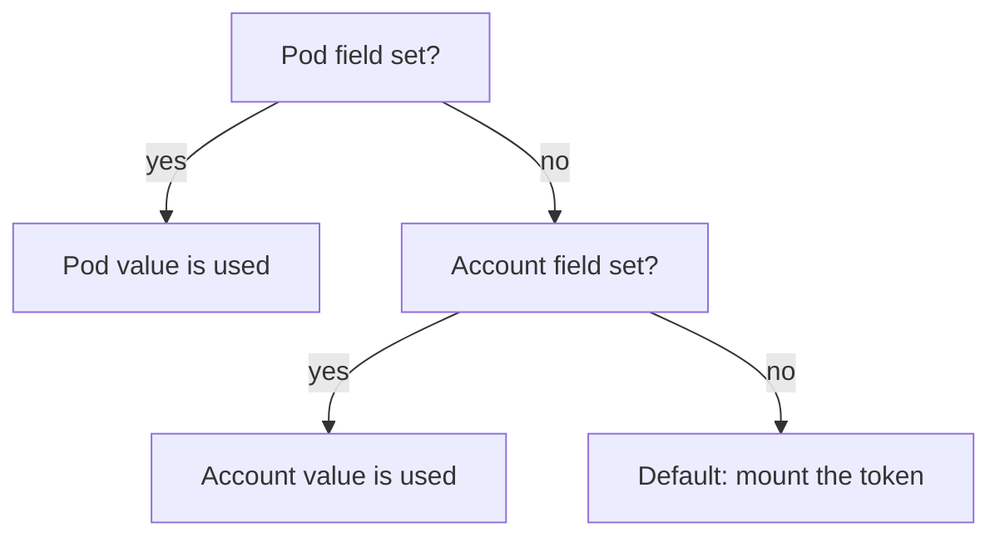

# Token Mounting And Image Pull Secrets

A ServiceAccount does two practical things for a pod. It supplies the token that the pod uses to call the Kubernetes API, and it can supply the credentials that the kubelet uses to pull the pod's image from a private registry. Most applications never call the API, so the token is unneeded credential material inside the container. This part shows how to switch the token mount off, which setting wins when the account and the pod disagree, and how to attach registry credentials to an account once so that every pod using it receives them.

## What a pod receives by default

When a pod is created, the admission controller adds a projected volume called `kube-api-access-<random suffix>` to the pod and mounts it in every container at `/var/run/secrets/kubernetes.io/serviceaccount`. A projected volume combines several sources into one directory. This one holds three files: `token`, a signed JSON Web Token (JWT) that identifies the account; `ca.crt`, the certificate authority certificate that signed the API server's certificate; and `namespace`, the name of the pod's namespace.

<!-- astrona:playground:renew -->

See the volume on the running `probe` pod. The account is `default` and nothing has switched the mount off:

```sh
kubectl -n starfleet get pods -l app=probe -o jsonpath='{range .items[*].spec.volumes[*]}{.name}{"\n"}{end}'
kubectl -n starfleet exec deploy/probe -- ls /var/run/secrets/kubernetes.io/serviceaccount
```

The first command prints one volume name that starts with `kube-api-access-`. The second lists the three files `ca.crt`, `namespace` and `token`. The `podinfo` application inside this pod never reads them, yet any process in the container can. If an attacker gets a shell in the container, the token is the first thing to try.

## Switch the mount off on the account

The field `automountServiceAccountToken` controls the mount. Set to `false` on a ServiceAccount, it tells the admission controller not to add the volume to pods that use the account. Save this as `serviceaccount-scout.yaml`:

```yaml
apiVersion: v1
kind: ServiceAccount
metadata:
  name: scout
  namespace: starfleet
automountServiceAccountToken: false
```

Apply it:

```sh
kubectl apply -f serviceaccount-scout.yaml
```

This command creates the `scout` account, or updates it if it already exists. Setting the field on the account changes nothing for pods that already run: the volume is added at pod creation, not later. Make the `scout` Deployment use the account and check the pod that replaces the old one:

```sh
kubectl -n starfleet set serviceaccount deployment scout scout
kubectl -n starfleet rollout status deployment scout
kubectl -n starfleet get pods -l app=scout -o jsonpath='{range .items[*].spec.volumes[*]}{.name}{"\n"}{end}'
```

The last command prints nothing, because the new `scout` pod has no volumes. The pod still runs and still serves requests. It only lost the way to authenticate to the API, which it never used.

## The pod setting wins

The same field exists in the pod spec, as `spec.automountServiceAccountToken`. When both are set, the pod value wins. The account value is only the default for pods that do not say anything. This allows one exception in each direction: an account that mounts a token by default can still produce a pod without one, and an account that switches the mount off can still produce a pod with one if that pod asks for it.



The pod field is checked first, then the account field, and a token is mounted when neither field says otherwise.

To see this, switch the mount off for one pod only. The `probe` pods use the `default` account, which still mounts the token. Patch the pod template of the Deployment:

```sh
kubectl -n starfleet patch deployment probe -p '{"spec":{"template":{"spec":{"automountServiceAccountToken":false}}}}'
kubectl -n starfleet rollout status deployment probe
kubectl -n starfleet get pods -l app=probe -o jsonpath='{range .items[*].spec.volumes[*]}{.name}{"\n"}{end}'
```

The new `probe` pod has no volume, and the `default` account itself is unchanged. Other pods in the namespace that use `default` still get a token. On the exam, read the task carefully: "the pod must not receive a token" can be done in the pod template, and "no pod using this account should receive a token" belongs on the account.

## Registry credentials on the account

A private registry needs credentials, which Kubernetes stores in a Secret of type `kubernetes.io/dockerconfigjson`. A pod lists such Secrets in `spec.imagePullSecrets`, and the kubelet uses them when it pulls the image. Writing that list into every pod template is repetitive. A ServiceAccount can carry the same list, and the admission controller copies it into each new pod that uses the account.

The playground already has the Secret `regcred` in `starfleet`. To create one yourself you use `kubectl create secret docker-registry regcred --docker-server=<registry> --docker-username=<user> --docker-password=<password>`. Add it to the `probe` account, which you create with the secret attached. Save this as `serviceaccount-probe.yaml`:

```yaml
apiVersion: v1
kind: ServiceAccount
metadata:
  name: probe
  namespace: starfleet
imagePullSecrets:
  - name: regcred
```

Apply it, give the `probe` Deployment the account, and read the list from the new pod:

```sh
kubectl apply -f serviceaccount-probe.yaml
kubectl -n starfleet set serviceaccount deployment probe probe
kubectl -n starfleet rollout status deployment probe
kubectl -n starfleet get pods -l app=probe -o jsonpath='{.items[0].spec.imagePullSecrets}'
```

The pod spec now contains `regcred` under `imagePullSecrets`, although the Deployment template does not mention it. The admission controller added it. The list on the account is copied when a pod is created, so adding a secret to an account later does not change pods that already run. The pod keeps the `automountServiceAccountToken: false` value from the earlier patch, because the pod template still carries it.

You now know how a ServiceAccount shapes the credentials of a pod: the token mount, controlled on the account or on the pod with the pod winning, and the image pull secrets that the account passes on. The open question is how that token is built, how long it lives and what the API does with it.

## Common pitfalls

> [!WARNING]
> - **Expecting a change on the account to reach running pods.** The token volume and the image pull secrets are added at pod creation. Restart or roll the workload after you change the account.
> - **Setting `automountServiceAccountToken: false` and expecting it to remove permissions.** It only removes the token from the pod. Role bindings on the account stay in place.
> - **Forgetting that the pod value wins.** A pod that sets `automountServiceAccountToken: true` gets a token even when its account says `false`.
> - **Creating the registry Secret in another namespace.** The Secret must be in the same namespace as the ServiceAccount and the pod.
