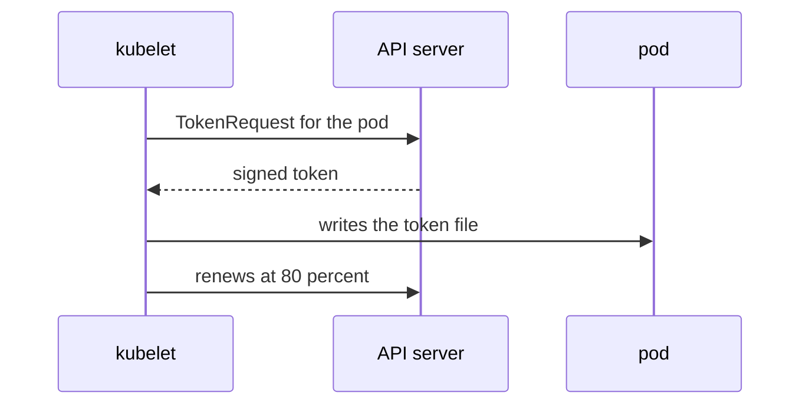

# ServiceAccount Tokens

A token is the proof that a request comes from a ServiceAccount. Without it, the API server treats the caller as anonymous. Older clusters stored a token in a Secret that never expired. Current clusters give each pod a short-lived token that the kubelet requests and renews. This part shows the three ways to get a token, what each one contains, and how long each one is valid. On the exam you usually need one of them: a token with a short lifetime for a one-off call, or the mounted token a pod already has.

## The projected token a pod receives

A projected volume is a volume that combines several sources into one directory. The admission controller adds one to each pod that mounts a token. The token source in it is a `serviceAccountToken` projection. The kubelet, the node agent that runs the pod, asks the API server for the token through the TokenRequest API, writes it to the file `token` in the volume, and asks again before the token expires.

The token is bound to the pod. The API server records the pod's name and unique ID inside the token. If the pod is deleted, the token stops being valid, even before its expiry time. The default lifetime is one hour plus a few seconds. The kubelet starts renewing the token when 80 percent of its lifetime has passed, and the file in the container changes in place, so an application that reads the file once and caches it ends up with an expired token.



The kubelet is the component that requests and renews the token, and the API server signs it.

## Request a token with kubectl

You can ask for a token yourself. The command `kubectl create token` sends a TokenRequest for one account and prints the result. Nothing is stored in the cluster, so there is no object to delete afterwards. The token is shown once, and it expires by itself.

<!-- astrona:playground:renew -->

A token is three parts joined by dots: a header, a payload with the claims, and a signature. The payload is only base64url text, so anyone who holds the token can read it. Paste this helper once in your terminal. It cuts out the payload, converts it to standard base64, adds the missing padding and prints it as JSON:

```sh
decode_token() {
  cut -d. -f2 | tr '_-' '/+' | awk '{s=$0; while (length(s)%4) s=s "="; print s}' | base64 -d | jq .
}
```

Request a token for the `default` account and read it:

```sh
kubectl -n starfleet create token default | decode_token
```

The output is a JSON object. The claim `sub` (subject) is `system:serviceaccount:starfleet:default`, which is the user name the API server uses for this account: `system:serviceaccount:` followed by the namespace, a colon and the account name. The claim `exp` is the expiry time and `iat` is the issue time, both in seconds since 1 January 1970. The claim `aud` (audience) lists who may accept the token. The claim `iss` (issuer) names the API server that signed it.

Now choose the lifetime and the audience yourself:

```sh
kubectl -n starfleet create token default --duration=20m --audience=probe | decode_token
```

The `aud` claim is now `probe` and `exp` is 1200 seconds after `iat`. The shortest duration the API server accepts is 10 minutes, and it may shorten a longer one to its own limit. The audience matters because a service that validates tokens must check that it is in the list. The Kubernetes API server expects its own audience, so it should reject a token made only for `probe`. Use `--audience` when a token goes to something other than the Kubernetes API, for example a service that checks tokens with the TokenReview API.

## Read the token a pod already has

A pod that mounts a token has the file at `/var/run/secrets/kubernetes.io/serviceaccount/token`. Print its claims from the `shuttle` pod. In a real cluster you never print a live token into a shared terminal, because anyone who sees it can use it until it expires:

```sh
kubectl -n starfleet exec deploy/shuttle -- cat /var/run/secrets/kubernetes.io/serviceaccount/token | decode_token
```

The claims differ from the `kubectl` token in one way: the object `kubernetes.io` inside the payload carries the namespace, the account name and unique ID, and the name and unique ID of the pod. That is the pod binding. The `exp` claim is about an hour after `iat`.

## The legacy token Secret

Before Kubernetes 1.24 the control plane created a token Secret for every account automatically, and the token never expired. Current clusters no longer do this. You can still ask for one by creating a Secret of type `kubernetes.io/service-account-token` that names the account in an annotation. A controller in the control plane then fills in the token. Save this as `secret-default-token.yaml`:

```yaml
apiVersion: v1
kind: Secret
metadata:
  name: default-legacy-token
  namespace: starfleet
  annotations:
    kubernetes.io/service-account.name: default
type: kubernetes.io/service-account-token
```

Apply it:

```sh
kubectl apply -f secret-default-token.yaml
```

Then read the token. The data is base64 encoded, and a few seconds may pass before the controller fills it in, so run the command again if it prints nothing:

```sh
kubectl -n starfleet get secret default-legacy-token -o jsonpath='{.data.token}' | base64 -d | decode_token
```

This token has no `exp` claim and no pod binding. It stays valid until you delete the Secret or the account. That is why it is the legacy choice: a leaked copy works for ever. Use it only for a client outside the cluster that cannot request tokens, and delete it when it is no longer needed. Remove it now:

```sh
kubectl -n starfleet delete secret default-legacy-token
```

You can now name the three token sources and say which one a task needs: the mounted token for a pod, `kubectl create token` for a short, scoped call, and the Secret for a token that must not expire. A token only says who the caller is. The open question is what that caller is allowed to do.

## Common pitfalls

> [!WARNING]
> - **Reading `kubectl create token` as a stored object.** The token is printed once and is not saved. Run the command again for a new one.
> - **Choosing a duration under 10 minutes.** The API server rejects it. Use `--duration=10m` as the shortest value.
> - **Caching the mounted token.** The kubelet replaces the file before it expires. A client must read the file again.
> - **Creating a legacy token Secret out of habit.** It never expires. Use `kubectl create token` unless the client truly cannot request one.
