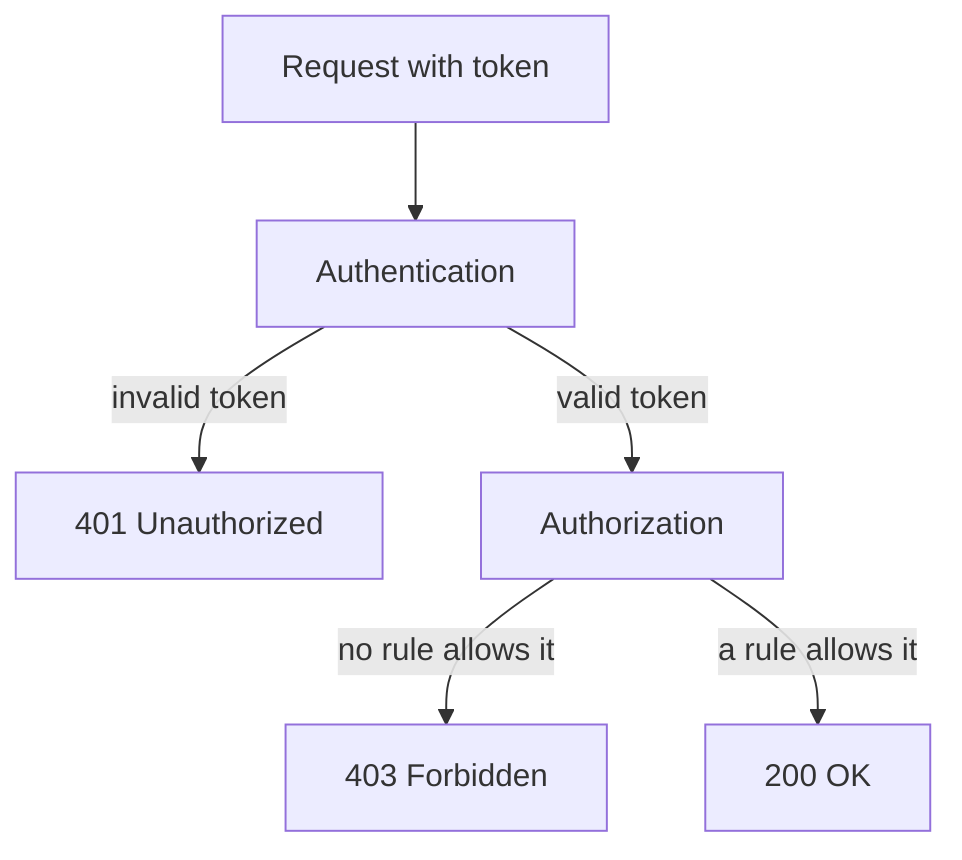

# Call The API As A ServiceAccount

A pod that needs to list pods, read a ConfigMap or watch a Service talks to the Kubernetes API server over HTTPS. Client libraries do this for you, but the exam, and any debugging session, needs the raw request: the address, the certificate authority file, the token and the response. This part sends a real request from the `shuttle` pod, reads the `403 Forbidden` answer of an account with no permissions, and fixes it with a Role and a RoleBinding. It ends with `kubectl auth can-i --as`, the fastest way to test a permission without opening a pod.

## The request from inside a pod

Every pod has the environment variables `KUBERNETES_SERVICE_HOST` and `KUBERNETES_SERVICE_PORT`, and a Service called `kubernetes` in the `default` namespace that points at the API server. Inside the cluster the name `kubernetes.default.svc.cluster.local` resolves to it. The server certificate is signed by the cluster certificate authority, and the mounted file `ca.crt` contains that authority's certificate. The request therefore needs two things: `--cacert` to trust the server, and an `Authorization: Bearer` header with the token.

<!-- astrona:playground:renew -->

Save a short helper in your terminal. It runs `curl` inside the `shuttle` pod, reads the mounted token there, sends a `GET` request to the path you give it, and prints the response body and the HTTP status code:

```sh
api_get() {
  kubectl -n starfleet exec deploy/shuttle -- sh -c "curl -s -w '\nHTTP %{http_code}\n' --cacert /var/run/secrets/kubernetes.io/serviceaccount/ca.crt -H \"Authorization: Bearer \$(cat /var/run/secrets/kubernetes.io/serviceaccount/token)\" https://kubernetes.default.svc.cluster.local$1"
}
```

The backslash before `$(cat` makes the pod's shell, not your own, read the token. List the pods in `starfleet`:

```sh
api_get /api/v1/namespaces/starfleet/pods
```

The response is a JSON object of kind `Status` with `"code": 403` and the last line says `HTTP 403`. The `message` field reads that pods is forbidden, that the user is `system:serviceaccount:starfleet:default`, that it cannot list the resource `pods` in the API group `""` in the namespace `starfleet`. That sentence names everything you need: the caller, the verb (`list`), the resource and the namespace.

## What 401 and 403 mean

The two status codes come from two different stages. Status `401 Unauthorized` means authentication failed: the token is missing, malformed, expired or signed by another cluster. Status `403 Forbidden` means authentication worked and authorization refused: the API server knows who the caller is, and no rule allows the request. Here the token is valid, so the answer is `403`. Replacing the token cannot fix a `403`. A new permission can.



Authentication produces the `401`, authorization produces the `403`, and only a request that passes both returns data.

## Grant one permission

Role-based access control (RBAC) is the authorizer that Kubernetes uses by default. A Role is a namespaced object that lists permissions as rules: each rule names API groups, resources and verbs. A RoleBinding is a namespaced object that gives a Role to subjects, which can be users, groups or ServiceAccounts. A Role alone does nothing, and a binding alone has nothing to give.

Create a ServiceAccount for `shuttle`, a Role that reads pods, and a binding. The `--serviceaccount` flag takes `<namespace>:<name>`:

```sh
kubectl -n starfleet create serviceaccount shuttle
kubectl -n starfleet create role pod-reader --verb=get,list,watch --resource=pods
kubectl -n starfleet create rolebinding shuttle-pod-reader --role=pod-reader --serviceaccount=starfleet:shuttle
```

The resulting RoleBinding has a `roleRef` that names the Role and a `subjects` list with one entry of kind `ServiceAccount`, with the name `shuttle` and the namespace `starfleet`. The namespace is part of the subject because a RoleBinding may name an account from a different namespace. Binding a Role never creates the account, and a typo in the account name creates a valid binding that matches nobody.

## Test the permission before you test the pod

The command `kubectl auth can-i` asks the authorizer whether an action is allowed. With `--as` you ask on behalf of another identity, which needs the right to impersonate, and the cluster administrator has it. The user name of a ServiceAccount is `system:serviceaccount:<namespace>:<name>`.

```sh
kubectl auth can-i list pods -n starfleet --as=system:serviceaccount:starfleet:shuttle
kubectl auth can-i delete pods -n starfleet --as=system:serviceaccount:starfleet:shuttle
kubectl auth can-i list pods -n outpost --as=system:serviceaccount:starfleet:shuttle
kubectl auth can-i list secrets -n starfleet --as=system:serviceaccount:starfleet:shuttle
```

The answers are `yes`, `no`, `no` and `no`. The Role allows only `get`, `list` and `watch` on pods, and a RoleBinding reaches only the namespace in which it lives. The command `kubectl auth can-i --list -n starfleet --as=system:serviceaccount:starfleet:shuttle` prints every rule that applies to the account in that namespace, including the small set that every authenticated identity has.

## Use the account from the pod

The permission exists, but the pod still runs as `default`. Point the Deployment at the new account, wait for the rollout, and repeat the two requests:

```sh
kubectl -n starfleet set serviceaccount deployment shuttle shuttle
kubectl -n starfleet rollout status deployment shuttle
api_get /api/v1/namespaces/starfleet/pods
api_get /api/v1/namespaces/starfleet/secrets
```

The first request returns the `PodList` as JSON and ends with `HTTP 200`. The second still returns `HTTP 403`, now naming the user `system:serviceaccount:starfleet:shuttle`, because the Role says nothing about Secrets. The identity changed in the message, and the permission grew by exactly the rule you wrote.

You can now send an API request by hand, tell a `401` from a `403`, grant a single permission with a Role and a RoleBinding, and prove it with `kubectl auth can-i --as` before and after. A workload needs only the rules its own code uses, so each account should get a narrow Role of its own.

## Common pitfalls

> [!WARNING]
> - **Treating `403` as a token problem.** A `403` means the token worked. Add the missing rule or fix the binding.
> - **Binding a Role in the wrong namespace.** A RoleBinding gives permissions only in its own namespace. Check with `kubectl auth can-i ... -n <namespace>`.
> - **Writing the subject namespace wrong.** `--serviceaccount=shuttle` without a namespace is rejected, and `outpost:shuttle` binds a different account.
> - **Using the wrong API group in a Role.** Pods and Secrets are in the core group `""`; Deployments are in `apps`. A rule with the wrong group matches nothing.
> - **Forgetting to roll the Deployment.** The new account reaches a pod only when the pod is created.
