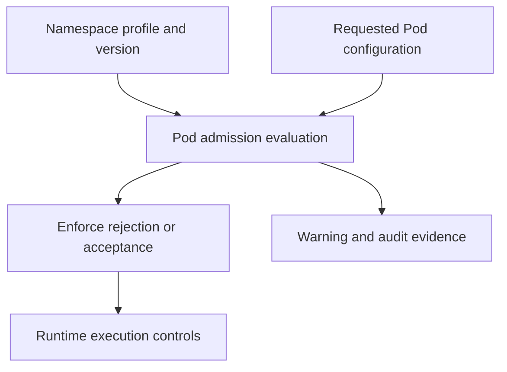

# Security Contexts And Pod Admission

A Pod was running before a namespace began enforcing a stronger security profile, but its replacement is rejected. Existing execution and new admission are different observations. Read the current enforcement mode and version before changing role permissions.

## Learning objectives

- Distinguish security admission from runtime enforcement.
- Interpret enforce, warn and audit profile modes.
- Explain why a running Pod does not prove future admission compatibility.

## Before you start

Use a shell on your own machine with the module playground running. A Pod is Kubernetes's unit for running one or more containers together. The environment provides the `probe` Deployment, which maintains application Pods, and the `starfleet` namespace, which groups these objects.

Read-only commands below use kubectl, the Kubernetes command-line tool. Select the private kubeconfig: the file that identifies this environment's cluster and credentials. The commands do not change the application.

## Security Contexts and Pod Admission

The `scout` process serves requests without needing host administration. A security context describes execution privileges and related settings for a Pod or container. Settings can require a non-root user, prevent privilege escalation, drop Linux capabilities and make the root filesystem read-only where the application supports it.

Linux capabilities divide selected privileged operations into smaller permissions. Dropping unnecessary capabilities reduces what a compromised process can do. A seccomp profile restricts permitted system calls. These controls complement ordinary file permissions and application checks; they do not repair a vulnerable application by themselves.

A read-only root filesystem can prevent writes to the image filesystem, but the application may still need writable temporary or data mounts. A non-root setting must match the image's user and file ownership requirements. Security configuration that prevents startup needs a suitable application design rather than simply being removed without analysis.

Pod Security Standards define Privileged, Baseline and Restricted profiles. Privileged allows broad behavior. Baseline prevents common privilege escalations while permitting many workloads. Restricted applies stronger hardening requirements. Pod Security Admission can enforce, warn about or audit these requirements through namespace configuration.

The profile is an admission rule, not a runtime process that automatically rewrites all applications into compliant ones. Enforcement can reject a new Pod. Warning reports a concern without the same rejection behavior. Version selection matters when comparing profile requirements across Kubernetes releases.

If an authorized developer cannot create a privileged workload in a Restricted namespace, the failure is expected admission behavior. The correct response is to design a compliant workload or obtain a justified exception through the platform's policy, not to assume RBAC authentication failed.

## Combining Execution Controls

A non-root process reduces reliance on privileged file access, but its numeric user and group must be compatible with the files it needs. An image that stores writable application data under a root-owned directory may fail after the identity is restricted. A suitable writable volume and ownership plan can preserve both application operation and the protection.

Preventing privilege escalation helps prevent a process from gaining additional privilege through execution mechanisms. Dropping capabilities removes selected privileged operations. Seccomp filters system calls. A read-only root filesystem limits writes to the image filesystem. Each constrains a different behavior, so one setting does not imply all the others are active.

These controls also have scope. A Pod-level context can supply defaults, while container-level settings can apply to individual processes where supported. A helper needing one specific capability should not automatically make every container privileged. Read the effective configuration of each container, including init containers and supporting helpers.

## Admission Profiles And Actual Runtime Protection

A namespace can enforce a Pod Security profile, warn on another selected level and audit violations for review. Enforcement affects acceptance of the relevant Pod configuration. Warning and audit can support migration toward stronger policy without behaving identically to enforcement. Merely enabling audit mode does not mean violating Pods are rejected.

The profile version should be deliberate because requirements can evolve with Kubernetes. A change to enforcement can affect newly admitted Pods and future replacements, so a workload that previously ran is not proof that its next Pod will pass the current policy.

Admission checks validate a declared configuration; runtime controls enforce that configuration during execution. Application authorization, secret handling and vulnerability management remain necessary even for a profile-compliant Pod. Explain a protection through what it restricts, where it acts and which threat remains outside its boundary.

## Inspect the mechanism

Pod Security Admission evaluates relevant Pod configurations against selected Pod Security Standards profiles. Namespace labels can select enforcement, warning and audit levels and versions. Enforcement can reject a new violating Pod; warning reports concerns without the same rejection action; audit records violations for review.

The policy checks declarations rather than rewriting the application into a compliant image. A user authorized to create Pods can still receive a profile rejection. Likewise, enabling audit mode is not equivalent to rejecting the workload. Read current namespace labels and the proposed container settings together, then adapt the application contract or use a justified platform exception.



Admission decides acceptance of declared settings, while runtime controls act after accepted startup.

<!-- astrona:playground:renew -->

Select the private cluster connection and inspect the live state from your host shell:

```sh
export KUBECONFIG="$(astrona kubeconfig ats-029-playground-080-01)"
if test "$(kubectl config current-context)" = "kind-astro-ats-029-playground-080-01"; then
  kubectl get namespace starfleet --show-labels
  kubectl -n starfleet get deployment probe -o yaml
  kubectl -n starfleet get pods -l app=probe
else
  printf "Select this module's private kubeconfig before continuing.\n" >&2
fi
```

The baseline namespace has no enforced profile unless practice or an earlier experiment added one. Do not infer Restricted enforcement merely because a security-context field is present. These commands inspect current declarations and running Pods without changing namespace policy. A later replacement request provides admission evidence that existing Pod status cannot supply.

You can now distinguish permission, policy acceptance and actual process protection. A compliant application still needs correct credentials, safe data handling and verified runtime behavior.

## Common pitfalls

> [!WARNING]
> A security context must fit the application. Pod Security enforcement rejects disallowed configurations; it does not automatically repair them or replace API permissions.
