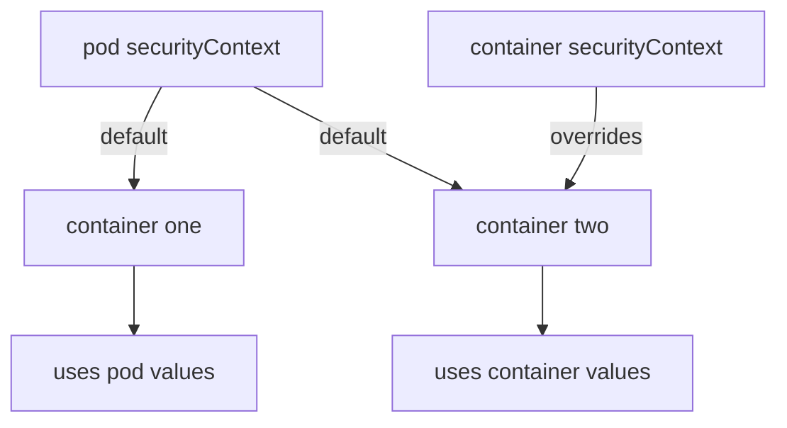

# User, Group And Volume Ownership

A container process runs as a Linux user and a Linux group, and the kernel checks both on every file it opens. If a pod does not say which user to run as, the container runs as the user the image defines, which is very often root. This part shows how to set the user and group from the pod, which setting wins when both the pod and the container set one, and how Kubernetes decides who owns the files of a volume.

## Numeric identity

Linux identifies a user by a number called the user ID (UID) and a group by a number called the group ID (GID). User ID 0 is root, the account that is allowed to do almost everything. A name such as `app` is only a label that the file `/etc/passwd` inside the image maps to a number. The kernel never sees the name.

A `securityContext` is a field of a pod or a container that sets security options for the container processes. These identity fields exist:

- `runAsUser` sets the UID of the container process.
- `runAsGroup` sets the primary GID of the process. Files the process creates get this group, unless the directory has the setgid bit.
- `runAsNonRoot: true` tells the kubelet (the node agent that starts containers) to refuse to start a container that would run as UID 0.
- `supplementalGroups` adds more group IDs to the process, besides the primary group. It is valid at pod level only.
- `fsGroup` names a group that owns the supported volumes of the pod. It is valid at pod level only.

`runAsUser`, `runAsGroup` and `runAsNonRoot` are valid at both levels. A pod-level value is the default for every container. A container-level value replaces the pod-level value for that container only.



The diagram shows that a container without its own value inherits the pod value, and a container with its own value ignores the pod value.

## Set the identity and read it back

Save this as `pod-identity.yaml`. The pod has two containers. The pod-level values are user 2000, group 3000 and the extra group 5000. The container `sidecar` overrides the user:

<!-- astrona:playground:renew -->

```yaml
apiVersion: v1
kind: Pod
metadata:
  name: identity
  namespace: starfleet
spec:
  securityContext:
    runAsUser: 2000
    runAsGroup: 3000
    supplementalGroups: [5000]
  containers:
    - name: main
      image: docker.io/library/busybox:1.37.0
      command: ["sh", "-c", "sleep 3600"]
    - name: sidecar
      image: docker.io/library/busybox:1.37.0
      command: ["sh", "-c", "sleep 3600"]
      securityContext:
        runAsUser: 2500
```

Apply it:

```sh
kubectl apply -f pod-identity.yaml
kubectl -n starfleet wait --for=condition=Ready pod/identity --timeout=60s
```

Then check the user in each container. The command `id -u` prints the numeric user ID and `id -g` prints the numeric group ID:

```sh
kubectl -n starfleet exec identity -c main -- id -u
kubectl -n starfleet exec identity -c sidecar -- id -u
kubectl -n starfleet exec identity -c sidecar -- id -g
```

The first command prints `2000`, because `main` has no `securityContext` of its own and inherits the pod value. The second prints `2500`, because the container value replaces the pod value. The third prints `3000`: the sidecar replaced only `runAsUser`, so `runAsGroup` still comes from the pod. Overriding is per field, not per block.

Run `kubectl -n starfleet exec identity -c main -- id` to see the whole identity. The primary group is 3000, and the list of groups also contains 5000 from `supplementalGroups`. A process uses its supplementary groups when it opens a file whose group matches one of them.

## Who owns a volume

Volumes add a second question: which user may write in them? Most volume types are created owned by root. A container running as UID 2000 may then be unable to write in a volume it mounts.

`fsGroup` solves this for the volume types that support ownership changes, such as `emptyDir`, `persistentVolumeClaim`, `configMap` and `secret`. The kubelet changes the group of the volume to the `fsGroup` value, adds read and write permission for the group, and sets the setgid bit on directories. The setgid bit makes every new file in the directory inherit the directory's group. The kubelet also adds the `fsGroup` to the supplementary groups of every container in the pod, so the process can use the group permission.

Save this as `pod-volume-owner.yaml`:

```yaml
apiVersion: v1
kind: Pod
metadata:
  name: volume-owner
  namespace: starfleet
spec:
  securityContext:
    runAsUser: 2000
    runAsGroup: 3000
    fsGroup: 4000
  volumes:
    - name: data
      emptyDir: {}
  containers:
    - name: main
      image: docker.io/library/busybox:1.37.0
      command: ["sh", "-c", "sleep 3600"]
      volumeMounts:
        - name: data
          mountPath: /data
```

Apply it:

```sh
kubectl apply -f pod-volume-owner.yaml
kubectl -n starfleet wait --for=condition=Ready pod/volume-owner --timeout=60s
```

Then check the owner of the mount path and of a new file. The format `%u:%g %a` prints the owner, the group and the permission bits in octal:

```sh
kubectl -n starfleet exec volume-owner -- stat -c '%u:%g %a' /data
kubectl -n starfleet exec volume-owner -- sh -c 'touch /data/log.txt && stat -c "%u:%g" /data/log.txt'
```

The first command prints `0:4000 2777`. The owner is root, the group is the `fsGroup`, and the leading `2` in the mode is the setgid bit. The second command prints `2000:4000`. The new file belongs to the process user 2000, and it got group 4000 from the directory and not the process group 3000. This is the setgid effect. The permission bits of the mount depend on the volume type, so the exact number can differ for other volume types.

`fsGroupChangePolicy` controls how much work the kubelet does. The default value `Always` changes the ownership of every file in the volume each time the pod starts. The value `OnRootMismatch` changes it only if the top directory has the wrong owner, which is much faster for a large volume.

## runAsNonRoot and the image user

`runAsNonRoot: true` does not choose a user. It only makes the kubelet check the user before the container starts. If the effective user is 0, the container does not start. If the effective user is a name that the kubelet cannot turn into a number without reading the image, the container does not start either.

Save this as `pod-nonroot-image.yaml`. It uses `runAsNonRoot` and gives no `runAsUser`, and the `busybox` image runs as root:

```yaml
apiVersion: v1
kind: Pod
metadata:
  name: nonroot-image
  namespace: starfleet
spec:
  containers:
    - name: main
      image: docker.io/library/busybox:1.37.0
      command: ["sh", "-c", "sleep 3600"]
      securityContext:
        runAsNonRoot: true
```

Apply it and look at the pod:

```sh
kubectl apply -f pod-nonroot-image.yaml
kubectl -n starfleet get pod nonroot-image
kubectl -n starfleet describe pod nonroot-image
```

The API server accepts the pod, because it does not read the image. The kubelet then refuses to start the container, and the pod status shows `CreateContainerConfigError`. The events in `describe` say that the container has `runAsNonRoot` and the image will run as root. Add `runAsUser: 2000` to the container and the same pod starts. A user that the image defines by name, such as the `app` user of the `podinfo` image, gives a similar error that says the image has a non-numeric user and the kubelet cannot verify that it is not root. A numeric `runAsUser` removes the doubt.

You now know how the identity fields work, which level wins, and why a volume has the group it has. The open question is what a process running as root can still do, and how to remove those abilities one by one.

## Common pitfalls

> [!WARNING]
> - **Putting `fsGroup` or `supplementalGroups` in a container.** Both fields are valid at pod level only. A container-level `securityContext` that sets them is rejected as an unknown field.
> - **Expecting `runAsNonRoot: true` to choose a user.** It only checks. Without a numeric `runAsUser`, an image that runs as root or has a named user fails with `CreateContainerConfigError`.
> - **Reading a rejected start as a scheduling problem.** The pod is scheduled and the kubelet refuses to start it. Read `kubectl describe pod`, not the scheduler events.
> - **Assuming a container override replaces the whole pod block.** Each field is resolved on its own, so a container that sets only `runAsUser` still gets `runAsGroup` from the pod.
> - **Using `fsGroup` on a volume type that does not support ownership changes.** Some volume types ignore it, and the files keep the owner that the storage gives them.
