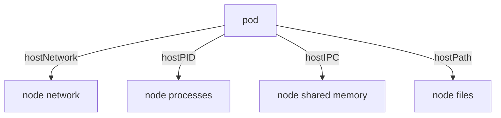

# Host Access And Sysctls

A container is isolated from its node by Linux namespaces: separate views of the network, the process list, the shared memory and the filesystem. A pod can ask to give up some of that isolation. This part shows what the host network, the host paths and the kernel parameters give a pod, why each one is a risk, and which of them a namespace policy rejects.

## What the pod spec can share with the node

A Linux **namespace** is a kernel feature that gives a process its own view of one kind of resource. Do not confuse it with a Kubernetes namespace, which groups API objects. These pod-level fields switch a Linux namespace off, so the pod uses the one of the node:

- `hostNetwork: true` puts the pod in the network namespace of the node. The pod uses the node's IP address and sees the node's network interfaces. A process can listen on any port of the node, and two such pods on one node cannot use the same port.
- `hostPID: true` lets the pod see and signal every process on the node.
- `hostIPC: true` lets the pod use the shared memory and the message queues of the node.

The volume type `hostPath` mounts a file or a directory of the node into the container. It is not a namespace setting, but it has the same effect: the container reads, and often writes, files that belong to the node. A `hostPath` of `/` gives the container the whole node filesystem. A writable `hostPath` of a directory such as `/etc` or `/var/lib/kubelet` lets a process change the node's configuration or read the credentials of other pods.

Each of these fields helps a node-level agent, such as a log collector or a network plugin, and each one is a way out of the container for an attacker. An ordinary application needs none of them.



The diagram shows the four ways a pod spec reaches resources of the node instead of resources of its own container.

## Use the node network

Save this as `pod-host-network.yaml`. The pod uses the network of the node:

<!-- astrona:playground:renew -->

```yaml
apiVersion: v1
kind: Pod
metadata:
  name: host-network
  namespace: starfleet
spec:
  hostNetwork: true
  containers:
    - name: main
      image: docker.io/library/busybox:1.37.0
      command: ["sh", "-c", "sleep 3600"]
```

Apply it:

```sh
kubectl apply -f pod-host-network.yaml
kubectl -n starfleet wait --for=condition=Ready pod/host-network --timeout=60s
```

Then compare the pod IP address with the node IP address:

```sh
kubectl -n starfleet get pod host-network -o jsonpath='{.status.podIP}{"\n"}{.status.hostIP}{"\n"}'
```

Both lines show the same address. A normal pod gets its own address from the pod network, and the two lines differ. Run `kubectl -n starfleet exec host-network -- hostname` and the output is the host name of the node, not the pod name. The pod sees the same network as the kubelet, so it can reach services that listen only on the node's local interface.

## Mount a node path

Save this as `pod-host-path.yaml`. It mounts the directory `/etc` of the node, read-only, and the pod uses it to read a file:

```yaml
apiVersion: v1
kind: Pod
metadata:
  name: host-path
  namespace: starfleet
spec:
  volumes:
    - name: node-etc
      hostPath:
        path: /etc
        type: Directory
  containers:
    - name: main
      image: docker.io/library/busybox:1.37.0
      command: ["sh", "-c", "sleep 3600"]
      volumeMounts:
        - name: node-etc
          mountPath: /host-etc
          readOnly: true
```

Apply it and read the node's host name file:

```sh
kubectl apply -f pod-host-path.yaml
kubectl -n starfleet wait --for=condition=Ready pod/host-path --timeout=60s
kubectl -n starfleet exec host-path -- cat /host-etc/hostname
```

The command prints the host name of the node, the same value that `kubectl get nodes` lists. A container that should only serve requests now reads a file of the node. The `type: Directory` field makes the kubelet check that the path exists as a directory before it starts the container. Without `readOnly: true` the container could change the file.

## Namespaces that reject host access

The namespace `outpost` enforces the Pod Security Standards level `baseline`. The `baseline` level rejects host namespaces, `hostPath` volumes and host ports. Try the first pod there with a server-side dry run, which sends the request to the API server and stores nothing. Change the namespace of the first pod to `outpost` on the fly and send it as a dry run:

```sh
sed 's/namespace: starfleet/namespace: outpost/' pod-host-network.yaml | kubectl apply --dry-run=server -f -
```

The API server answers with a `Forbidden` error. The message says the pod violates PodSecurity `baseline:latest` and names the check, `host namespaces (hostNetwork=true)`. The `hostPath` pod is rejected the same way with a message that names the `hostPath volumes`. Pod Security Admission, a controller inside the API server, makes the decision. It refuses the pod even though the request comes from the cluster administrator.

## Sysctls

A **sysctl** is a kernel parameter that you read and write through `/proc/sys`. Some sysctls are namespaced, which means each pod can have its own value without changing the node. The pod-level field `securityContext.sysctls` sets them at pod start.

Kubernetes splits namespaced sysctls into two groups. The **safe** sysctls cannot affect other pods or the stability of the node, and the kubelet allows them by default. Examples are `net.ipv4.ip_local_port_range`, `net.ipv4.tcp_syncookies`, `net.ipv4.ip_unprivileged_port_start` and `kernel.shm_rmid_forced`. All other sysctls are **unsafe**. The kubelet refuses them unless the node's administrator allows them with a kubelet option. The `baseline` and `restricted` levels allow only the safe list.

Save this as `pod-sysctl.yaml`. It sets one safe sysctl:

```yaml
apiVersion: v1
kind: Pod
metadata:
  name: sysctl-safe
  namespace: starfleet
spec:
  securityContext:
    sysctls:
      - name: net.ipv4.ip_local_port_range
        value: "32768 40000"
  containers:
    - name: main
      image: docker.io/library/busybox:1.37.0
      command: ["sh", "-c", "sleep 3600"]
```

Apply it and read the value in the container:

```sh
kubectl apply -f pod-sysctl.yaml
kubectl -n starfleet wait --for=condition=Ready pod/sysctl-safe --timeout=60s
kubectl -n starfleet exec sysctl-safe -- cat /proc/sys/net/ipv4/ip_local_port_range
```

The output is the two numbers 32768 and 40000. The node keeps its own range, because the parameter belongs to the network namespace of the pod. Now change the name to `kernel.msgmax`, which is namespaced but not on the safe list, and apply a pod with another name. The API server accepts it. The kubelet then refuses to run it, and `kubectl get pod` shows the status `SysctlForbidden`, because the node has not allowed the sysctl. The pod stays in the `Failed` phase.

You now know what a pod can take from the node and which of those requests a namespace rejects with a clear message. The open question is how to set the namespace policy and what to change in a workload when the policy rejects it.

## Common pitfalls

> [!WARNING]
> - **Using `hostNetwork` to fix a connection problem.** It exposes the node's network to the pod and can clash with ports of other pods. Fix the Service or the port instead.
> - **Mounting `hostPath` read-write.** A writable node path lets the container change the node. If a pod needs a node file, set `readOnly: true` on the mount and the narrowest path.
> - **Reading `SysctlForbidden` as a scheduling problem.** The pod is scheduled and the kubelet refuses it. Only the safe sysctls run without a change on the node.
> - **Putting `sysctls` in a container.** The field is valid at pod level only.
> - **Confusing a Linux namespace with a Kubernetes namespace.** `hostNetwork` removes the Linux network isolation. It has nothing to do with the namespace of the pod in the API.
