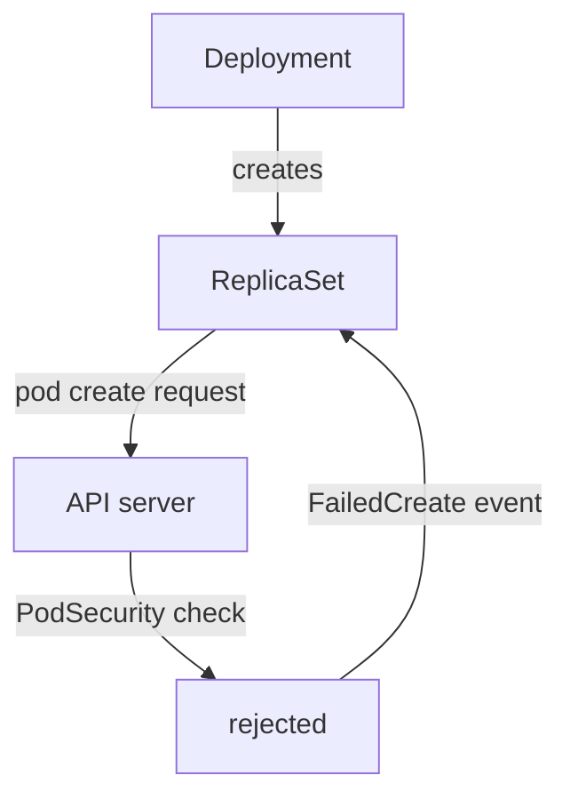

# Pod Security Admission And A Rejected Deployment

Every setting in this module can be allowed or refused for a whole namespace, and the refusal does not look like a normal error. A Deployment that breaks the policy is accepted by the API server, and then it creates no pods. This part explains the Pod Security Standards and the namespace labels that apply them, and then follows a rejected Deployment from the symptom to the fix.

## Pod Security Standards and Pod Security Admission

The **Pod Security Standards** are three levels that the Kubernetes project defines, each one a fixed list of checks on pod fields:

- `privileged` allows everything.
- `baseline` blocks known privilege escalations: privileged containers, host namespaces, `hostPath` volumes, host ports, capabilities outside a short list, unsafe sysctls and a few more.
- `restricted` adds hardening on top of `baseline`. Every container must set `allowPrivilegeEscalation: false`, must drop `ALL` capabilities (it may add back only `NET_BIND_SERVICE`), and the pod must run as non-root with `runAsNonRoot: true` and must not set user ID 0. The seccomp profile must be `RuntimeDefault` or `Localhost`. Volumes are limited to types such as `configMap`, `secret`, `emptyDir`, `projected`, `downwardAPI` and `persistentVolumeClaim`.

**Pod Security Admission** is the admission controller inside the API server that applies the levels. An admission controller is code that checks a request after authentication and authorization and before the object is stored. Pod Security Admission reads labels on the namespace in the form `pod-security.kubernetes.io/<mode>: <level>`. The three modes are:

- `enforce` rejects a pod that breaks the level.
- `warn` accepts the pod and sends a warning to the client, which `kubectl` prints. It also checks workload templates, such as a Deployment.
- `audit` accepts the pod and adds an annotation to the audit log of the API server.

Only `enforce` rejects anything. A namespace with no label checks nothing. The label `pod-security.kubernetes.io/enforce-version` pins the checks to a Kubernetes version, and the default `latest` means the version of the cluster.

## Test a level before you enforce it

The namespace `outpost` enforces `baseline` and warns at `restricted`. The pod `drifter` runs there with no `securityContext`. Look at the labels first:

<!-- astrona:playground:renew -->

```sh
kubectl get namespace outpost --show-labels
```

Before you raise the enforced level, ask the API server which running pods would break it. A server-side dry run of the label change does that and changes nothing:

```sh
kubectl label --dry-run=server --overwrite namespace outpost pod-security.kubernetes.io/enforce=restricted
```

The command prints a warning that existing pods in the namespace violate the new level. It names the pod `drifter` and lists the failed checks, such as `allowPrivilegeEscalation != false`, `unrestricted capabilities`, `runAsNonRoot != true` and `seccompProfile`. The last line says the namespace was labelled in a server dry run. Now apply the label for real:

```sh
kubectl label --overwrite namespace outpost pod-security.kubernetes.io/enforce=restricted
```

Enforcement applies to new pods only. The running `drifter` pod keeps running, but a pod that the ReplicaSet creates later, for example after a restart or a node failure, is checked against `restricted` and rejected.

## Create a Deployment that the namespace rejects

Save this as `deployment-bridge.yaml`. It has no `securityContext`, so its pod breaks every `restricted` check:

```yaml
apiVersion: apps/v1
kind: Deployment
metadata:
  name: bridge
  namespace: outpost
  labels:
    app: bridge
spec:
  replicas: 1
  selector:
    matchLabels:
      app: bridge
  template:
    metadata:
      labels:
        app: bridge
    spec:
      containers:
        - name: bridge
          image: docker.io/library/busybox:1.37.0
          command: ["sh", "-c", "echo up > /tmp/state; while true; do sleep 30; done"]
```

Apply it:

```sh
kubectl apply -f deployment-bridge.yaml
```

The command succeeds and prints `deployment.apps/bridge created`. It also prints a warning that the pod template would violate PodSecurity `restricted:latest`, because the namespace has the label `warn: restricted`. The Deployment is accepted, because `enforce` checks pods and not Deployments. Now look at what happened:

```sh
kubectl -n outpost get deployment bridge
kubectl -n outpost get replicaset -l app=bridge
```

The Deployment shows `0/1` ready, and the ReplicaSet shows a desired count of 1 and a current count of 0. No pod exists, so `kubectl get pods` shows nothing for `bridge`. The component that tried to create the pod is the ReplicaSet controller, and the API server refused its request. The reason is in the events of the ReplicaSet:

```sh
kubectl -n outpost describe replicaset -l app=bridge
kubectl -n outpost get events --field-selector reason=FailedCreate
```

Both commands show a `FailedCreate` event. The message starts with `Error creating: pods ... is forbidden: violates PodSecurity "restricted:latest"` and lists each failed check with the container name and the field to set. The Deployment status also carries the condition `ReplicaFailure` with the status `True`. This is the path to remember: Deployment, then ReplicaSet, then events.



The diagram shows that the rejection happens on the ReplicaSet's request, so the event appears on the ReplicaSet and not on the Deployment or on a pod.

## Fix the pod template

Fix the workload and leave the namespace label as it is. Weakening the label would remove the protection for every other workload in the namespace. The failed checks map to these fields:

- `allowPrivilegeEscalation != false` needs `allowPrivilegeEscalation: false` in the container.
- `unrestricted capabilities` needs `capabilities.drop: ["ALL"]` in the container.
- `runAsNonRoot != true` needs `runAsNonRoot: true`, and the `busybox` image runs as root, so it also needs a numeric `runAsUser`.
- `seccompProfile` needs `seccompProfile.type: RuntimeDefault`.

The command in the container writes to `/tmp`. Add `readOnlyRootFilesystem: true` for extra protection and give the container an `emptyDir` at `/tmp`. Save this as `deployment-bridge-fixed.yaml`:

```yaml
apiVersion: apps/v1
kind: Deployment
metadata:
  name: bridge
  namespace: outpost
  labels:
    app: bridge
spec:
  replicas: 1
  selector:
    matchLabels:
      app: bridge
  template:
    metadata:
      labels:
        app: bridge
    spec:
      securityContext:
        runAsNonRoot: true
        runAsUser: 1000
        seccompProfile:
          type: RuntimeDefault
      volumes:
        - name: scratch
          emptyDir: {}
      containers:
        - name: bridge
          image: docker.io/library/busybox:1.37.0
          command: ["sh", "-c", "echo up > /tmp/state; while true; do sleep 30; done"]
          securityContext:
            allowPrivilegeEscalation: false
            readOnlyRootFilesystem: true
            capabilities:
              drop: ["ALL"]
          volumeMounts:
            - name: scratch
              mountPath: /tmp
```

Apply it and wait for the rollout:

```sh
kubectl apply -f deployment-bridge-fixed.yaml
kubectl -n outpost rollout status deployment/bridge --timeout=90s
```

The Deployment controller creates a new ReplicaSet for the changed template, the pod passes admission, and the rollout completes. Check the file the container wrote:

```sh
kubectl -n outpost exec deployment/bridge -- cat /tmp/state
```

The command prints `up`. The pod now meets all four checks and still writes where it needs to write.

> [!TIP]
> Under exam time pressure, run `kubectl get events --sort-by=.lastTimestamp` in the namespace when a Deployment shows `0/1`. The rejection message names every field that you must set, so you can fix all of them in one edit.

You now know how a namespace label turns the Pod Security Standards into a rejection, how to test a level before you enforce it, how to find the rejected Deployment's reason in the ReplicaSet events, and how to fix the pod template instead of the label. The pod template is the thing you own as an application developer, and the namespace policy is the contract it must meet.

## Common pitfalls

> [!WARNING]
> - **Looking for the error on the Deployment or on a pod.** The Deployment is accepted and no pod exists. The rejection is in the events of the ReplicaSet.
> - **Lowering the namespace level to make the Deployment run.** Fix the pod template. A lower level removes the check for every workload in the namespace.
> - **Adding `runAsNonRoot: true` without a numeric `runAsUser`.** An image that runs as root still fails, now in the kubelet with `CreateContainerConfigError`.
> - **Forgetting the writable path after `readOnlyRootFilesystem: true`.** Add an `emptyDir` at the directory that the logs name.
> - **Expecting an enforced label to stop pods that already run.** It applies to new pods only. Run the dry run of the label first to list the pods that would break.
> - **Treating `warn` as protection.** Only `enforce` rejects a pod.
